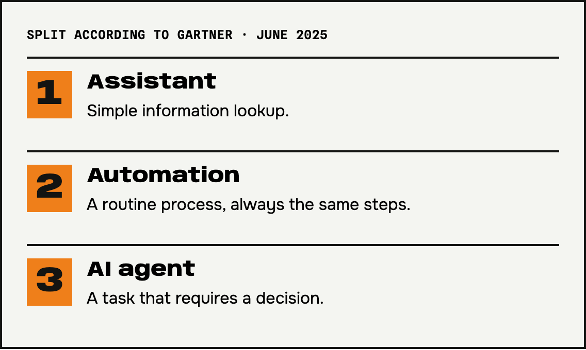
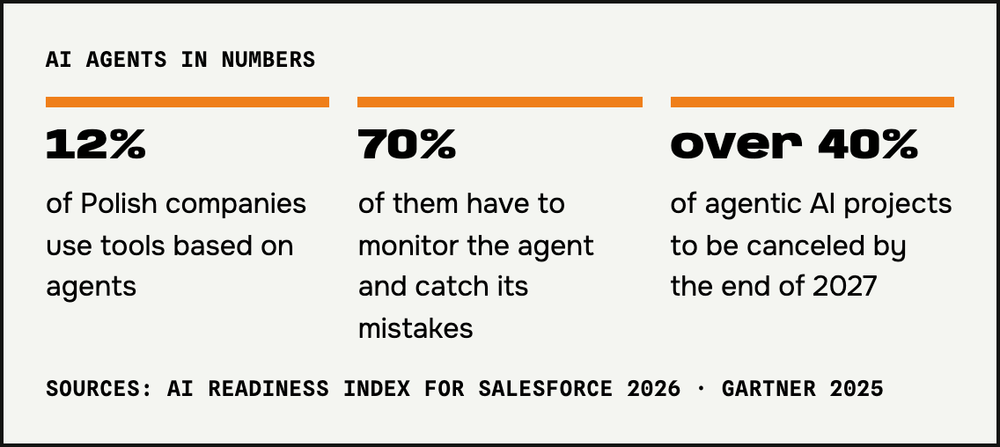
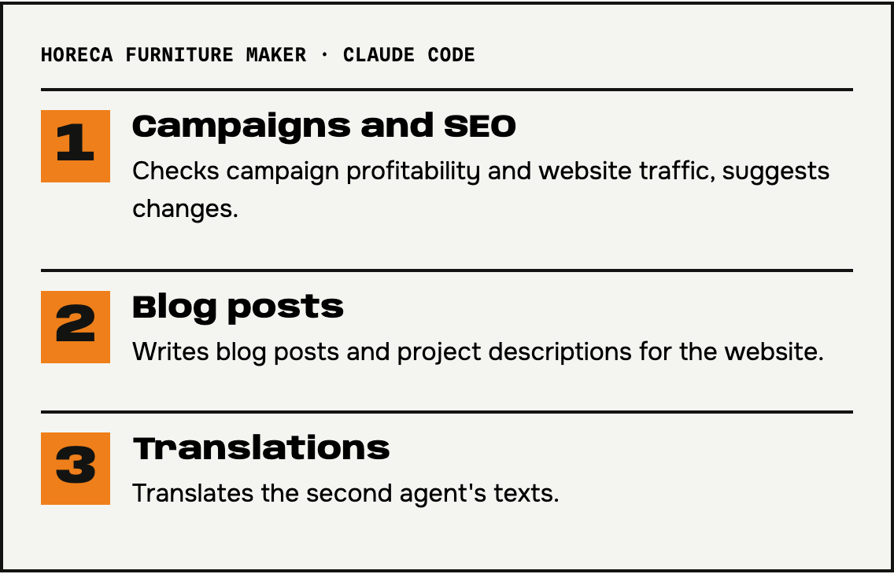

**AI agents for business** are the loudest topic in company conversations about artificial intelligence right now. I build them for clients, but I start by asking whether the task really needs an agent. If you run a company and wonder whether this is for you, see how an agent differs from a regular automation and what the research says.

## How AI agents differ from a chatbot and an automation

A chatbot answers questions, and an automation runs fixed steps, for example moving data from a form to a spreadsheet the same way every time. An agent gets a goal and access to tools, then picks the next step on its own: it reads a document, pulls data from it, saves it to a database, and hands the case to the right person.

Anushree Verma of the research firm Gartner suggests a simple split: use an agent where a decision is needed. Use automation for routine processes and an assistant for simple information lookup, and this split matches what I see at my clients.

*The split according to Anushree Verma of Gartner, June 2025.*

## How many companies in Poland use AI agents

SW Research and ITBC Communication ran the AI Readiness Index study for Salesforce. According to it, 12% of Polish companies use tools based on agents. The survey covered 200 small, medium, and large companies, and the respondents were owners, board members, and technology directors. A vendor of AI solutions commissioned the study, so treat these numbers as a rough guide.

Of the companies that use agents, 70% admit they have to monitor the agents' work and catch their mistakes. Only 19% of respondents have set metrics that would show whether AI pays off.

In June 2025, Gartner predicted that by the end of 2027 companies will cancel over 40% of agentic AI projects. It gave rising costs, unclear business value, and weak risk controls as the reasons. It also described “agent washing,” when a vendor calls a regular chatbot or assistant an agent. According to Gartner, of the thousands of companies selling agents, about 130 deliver what they promise.

*Sources: AI Readiness Index for Salesforce, 2026, and Gartner, June 2025.*

## When an AI agent for business makes sense

An AI agent makes sense when the process requires reading text, understanding a document, or choosing one of several paths. When the steps are always the same, a simple automation in n8n or Make.com is enough. It costs less, you can launch it faster, and it behaves predictably.

An example from a furniture maker for restaurants: the process sorts 230 clients by time since their last order and the total of their previous orders. I turn on the language model for only 29 of them, and plain rules that don't need a model handle the rest. The owner approves every message before it goes to the client.

Before you order an agent, answer three questions:

- Does the task require a decision, or does it just repeat the same steps?
- How will you know the agent pays off?
- Who will check the result when the agent isn't sure?

## How AI agents work at my clients

A furniture maker for the HoReCa industry wanted to run ads on its own, without an agency. I set up Claude Code with access to Google Ads, GA4, and Search Console. The first agent checks campaign profitability and website traffic, and when something changes in SEO, it suggests changes. The second writes blog posts and project descriptions, and the third translates them. After a month, the client was running campaigns on its own, and its sales grew.

*Diagram of the deployment at a furniture maker for the HoReCa industry.*

In my setups, an agent starts with read-only access, and a person approves changes. In the grant application workflow, the process reads documents with OCR and a language model. When a reading is uncertain, the system asks a designated person to confirm it. I describe the scope of work and more examples on the [AI automation services](/en/services/ai-automation/) page.

## Frequently asked questions about what AI agents do

### How is an agent different from a chatbot?
A chatbot answers questions, and an agent does tasks: it reads a document, pulls data, saves it to a database, and passes the case on.

### Can an agent make mistakes?
Yes. In the study for Salesforce, 70% of companies with agents have to monitor their work, so when a result is uncertain, my agent asks a person to confirm.

### How much does an agent cost?
I price it by scope, because the cost depends on the number of steps and systems. I give amounts from my projects in the post on [AI implementation cost](/en/posts/ai-implementation-cost/).

### Which models do you use?
I use Claude API, OpenAI API, and Gemini, and I pick the model for the task.

### Does an agent have access to all company data?
No. It gets only the data the task requires, through the API on a business account, and when personal data is involved, I sign a data processing agreement.

### Where should I start?
With one process that takes your team the most time, because that's where you'll see results fastest. I review it and tell you whether an automation is enough or you need an agent.

**Email me: office@robert-debicki.pl** and describe the process that takes you the most time. I'll tell you whether you need an AI agent.
