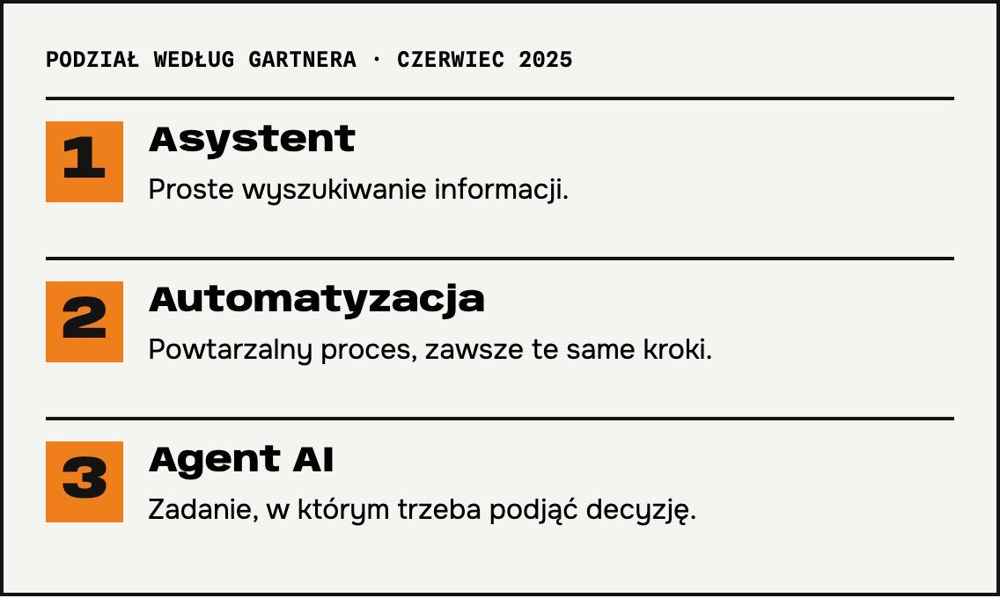
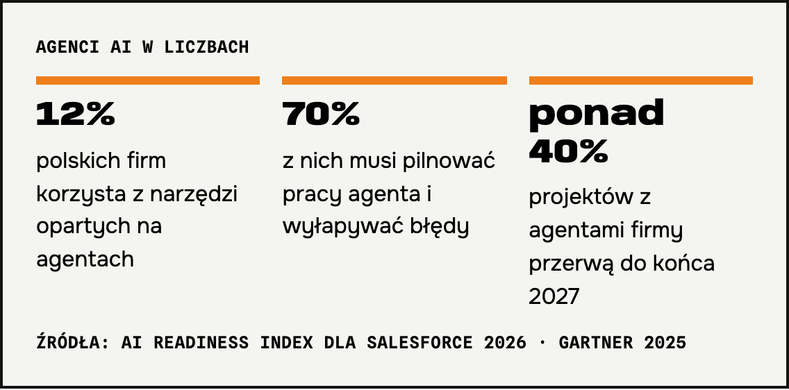
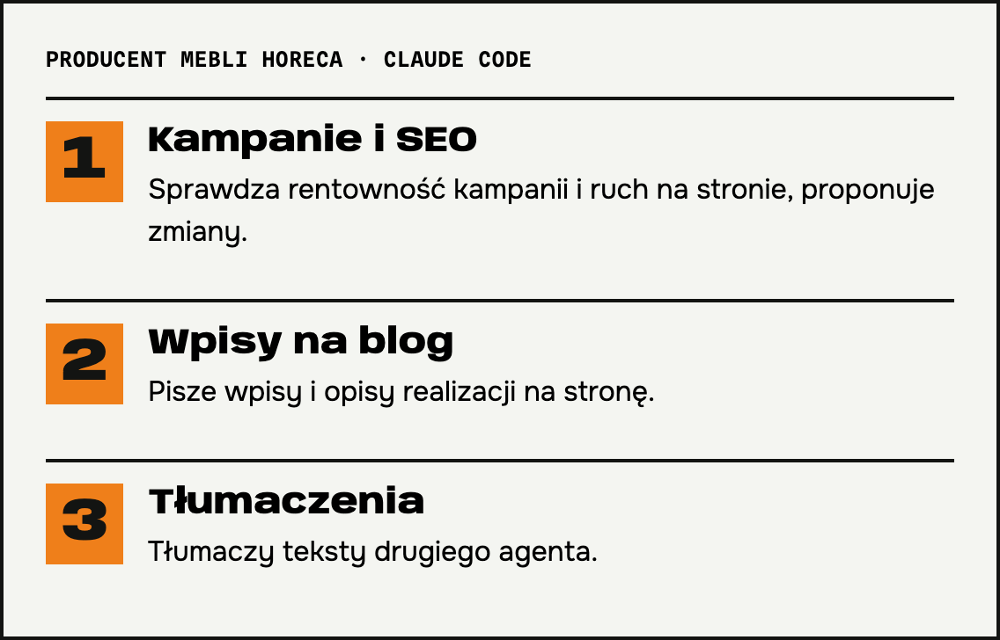

**Agenci AI** to dziś najgłośniejsze hasło w rozmowach o sztucznej inteligencji w firmach. Wdrażam ich u klientów, ale zaczynam od pytania, czy zadanie naprawdę wymaga agenta. Jeśli prowadzisz firmę i zastanawiasz się, czy to coś dla Ciebie, sprawdź, czym agent różni się od zwykłej automatyzacji i co mówią badania.

## Czym agenci AI różnią się od chatbota i automatyzacji

Chatbot odpowiada na pytania, a automatyzacja wykonuje stałe kroki, na przykład przenosi dane z formularza do arkusza zawsze w ten sam sposób. Agent dostaje cel i dostęp do narzędzi, a potem sam wybiera kolejny krok: czyta dokument, wyciąga z niego dane, zapisuje je w bazie i przekazuje sprawę właściwej osobie.

Anushree Verma z firmy badawczej Gartner proponuje prosty podział: agenta używaj tam, gdzie trzeba podjąć decyzję. Automatyzację stosuj w powtarzalnych procesach, a asystenta przy prostym wyszukiwaniu informacji, i ten podział pokrywa się z tym, co widzę u klientów.

*Podział według Anushree Verma z Gartnera, czerwiec 2025.*

## Ile firm w Polsce korzysta z agentów AI

Badanie AI Readiness Index przeprowadziły dla Salesforce pracownie SW Research i ITBC Communication. Według niego z narzędzi opartych na agentach korzysta 12% polskich firm. W ankiecie wzięło udział 200 małych, średnich i dużych firm, a odpowiadali właściciele, członkowie zarządu i dyrektorzy do spraw technologii. Badanie zamówił dostawca rozwiązań AI, więc traktuj te liczby jako orientacyjne.

Z firm, które używają agentów, 70% przyznaje, że musi pilnować ich pracy i wyłapywać błędy. Wskaźniki, po których firma pozna, czy AI się opłaca, ustaliło tylko 19% badanych.

Gartner w czerwcu 2025 roku przewidział, że do końca 2027 roku firmy przerwą ponad 40% projektów z agentami. Jako powody podał rosnące koszty, niejasny zysk dla firmy i słabą kontrolę ryzyka. Opisał też zjawisko „agent washing”, gdy dostawca nazywa agentem zwykłego chatbota albo asystenta. Według Gartnera z tysięcy firm, które sprzedają agentów, około 130 dostarcza to, co obiecuje.

*Źródła: AI Readiness Index dla Salesforce, 2026, oraz Gartner, czerwiec 2025.*

## Kiedy agent AI dla firm ma sens

Agent AI dla firm ma sens, gdy w procesie trzeba czytać tekst, rozumieć dokument albo wybrać jedną z kilku dróg. Gdy kroki są zawsze takie same, wystarczy prosta automatyzacja w n8n albo Make.com. Jest tańsza, szybciej ją uruchomić i działa przewidywalnie.

Przykład od producenta mebli dla gastronomii: proces dzieli 230 klientów według czasu od ostatniego zamówienia i sumy wcześniejszych zamówień. Model językowy włączam tylko przy 29 z nich, a resztę załatwiają zwykłe reguły, które nie potrzebują modelu. Właściciel akceptuje każdą wiadomość przed wysyłką do klienta.

Zanim zamówisz agenta, odpowiedz sobie na trzy pytania:

- Czy zadanie wymaga decyzji, czy tylko powtarza te same kroki?
- Po czym poznasz, że agent się opłaca?
- Kto sprawdzi wynik, gdy agent nie będzie pewny?

## Jak pracują agenci AI u moich klientów

Producent mebli dla branży HoReCa chciał prowadzić reklamy sam, bez agencji. Skonfigurowałem Claude Code z dostępem do Google Ads, GA4 i Search Console. Pierwszy agent sprawdza rentowność kampanii i ruch na stronie, a gdy w SEO coś się zmieni, proponuje zmiany. Drugi pisze wpisy na blog i opisy realizacji, a trzeci je tłumaczy. Po miesiącu klient prowadził kampanie samodzielnie i jego sprzedaż wzrosła.

*Schemat wdrożenia u producenta mebli dla branży HoReCa.*

Agent zaczyna u mnie od dostępu tylko do odczytu, a zmiany zatwierdza człowiek. W obiegu wniosków o dofinansowanie proces odczytuje dokumenty przez OCR z modelem językowym. Gdy odczyt jest niepewny, system prosi wskazaną osobę o potwierdzenie. Zakres pracy i kolejne przykłady opisuję na stronie [wdrożenie AI w firmie](/uslugi/ai-i-automatyzacja/).

## Najczęstsze pytania o to, co robią agenci AI

### Czym agent różni się od chatbota?
Chatbot odpowiada na pytania, a agent wykonuje zadania: czyta dokument, wyciąga dane, zapisuje je w bazie i przekazuje sprawę dalej.

### Czy agent może się pomylić?
Tak. W badaniu dla Salesforce 70% firm z agentami musi pilnować ich pracy, dlatego przy niepewnym wyniku mój agent prosi człowieka o potwierdzenie.

### Ile kosztuje agent?
Wyceniam go po zakresie, bo cena zależy od liczby kroków i systemów. Kwoty z moich wdrożeń podaję we wpisie [ile kosztuje wdrożenie AI](/wpisy/ile-kosztuje-wdrozenie-ai/).

### Z jakich modeli korzystasz?
Korzystam z Claude API, OpenAI API i Gemini, a model dobieram do zadania.

### Czy agent ma dostęp do wszystkich danych firmy?
Nie. Dostaje tylko te dane, których wymaga zadanie, przez API na koncie firmowym, a przy danych osobowych podpisuję umowę powierzenia przetwarzania.

### Od czego zacząć?
Od jednego procesu, który zabiera zespołowi najwięcej czasu, bo na nim najszybciej zobaczysz efekt. Sprawdzam go i mówię, czy wystarczy automatyzacja, czy potrzebny jest agent.

**Napisz do mnie: office@robert-debicki.pl** i opisz proces, który zabiera Ci najwięcej czasu. Odpowiem, czy potrzebujesz agenta AI.
