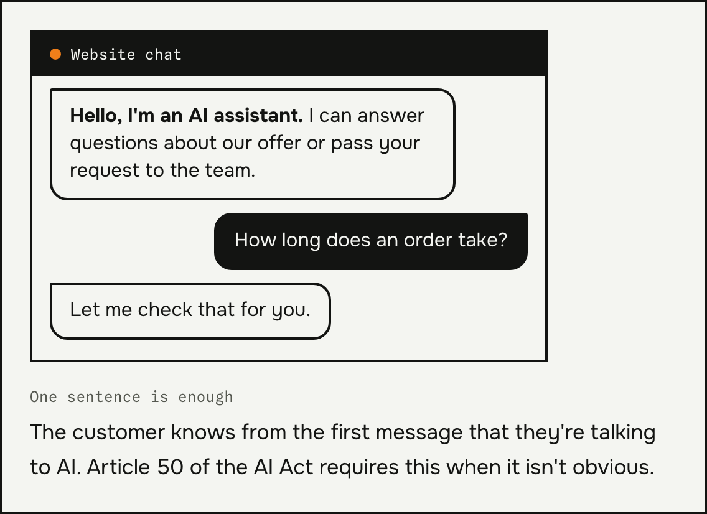
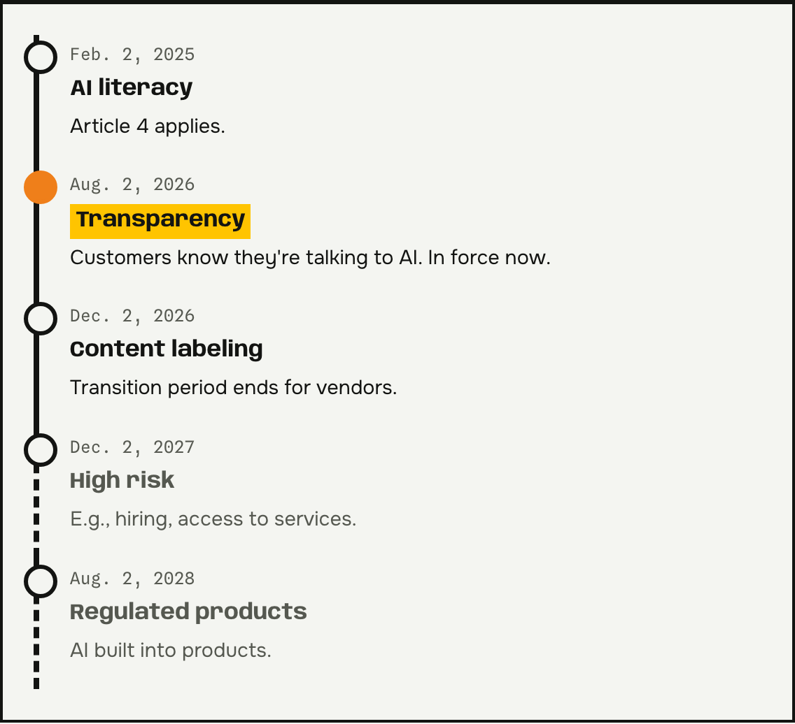
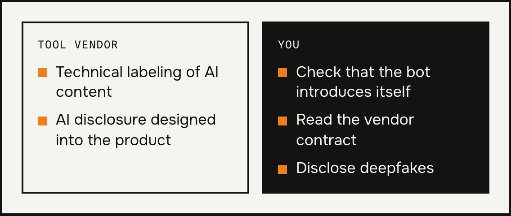
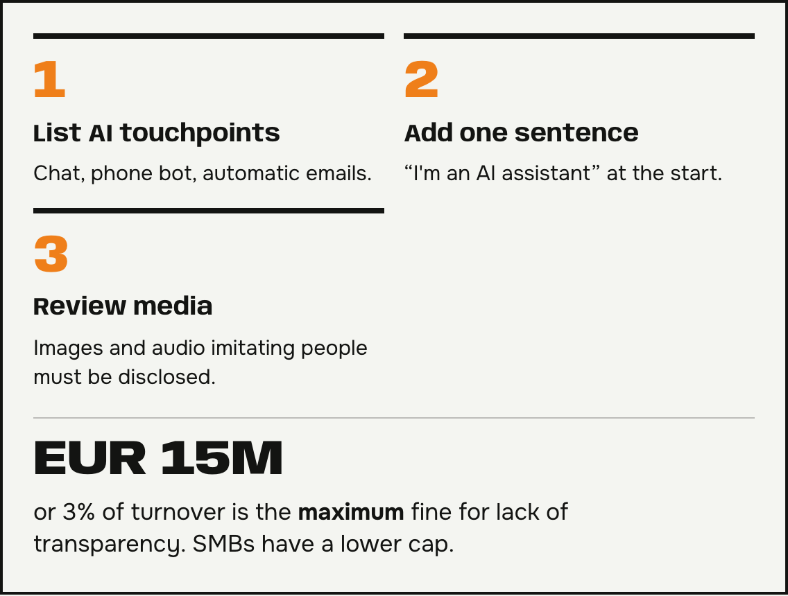

**The AI Act for small businesses** already applies to you if your website runs a chat or a bot answers your phone. The transparency rules have applied since August 2, 2026. I explain what they mean in practice and what you can check in one evening. Do you have a bot and aren't sure it meets the requirements? Send me an email.

## What applies since August 2, 2026

In its guidelines of July 20, 2026, the European Commission confirmed that the obligations in Article 50 apply from that date. The core rule is simple. Customers must know they're talking to artificial intelligence, unless it's obvious. They must be told at the first contact at the latest.

The article on Prawo.pl describes these [AI Act obligations from August 2026](https://www.prawo.pl/biznes/ai-act-jakie-obowiazki-maja-firmy-od-sierpnia-2026,1550271.html).

*Source: Prawo.pl, Aug. 11, 2026.*

## What's on the vendor and what's on you

Technical labeling of AI-generated content falls mainly on the tool vendor. For systems placed on the market before August 2, 2026, the transition period runs until December 2, 2026.

You're responsible for how the tool works with your customers. Check that the bot introduces itself, and read your contract with the vendor. Using AI to write a product description or an ad graphic doesn't automatically mean you have to disclose it.

## What the AI Act for small businesses pushes back

Obligations for high-risk systems, for example in hiring or in assessing access to services, will apply from December 2, 2027. For systems built into regulated products, the deadline is August 2, 2028. A typical chat in a small online store usually isn't such a system.

## The AI Act for small businesses in three steps

1. List the places where customers talk to AI: website chat, phone bot, automatic email replies.
2. Add one sentence at the start of the conversation, for example “I'm an AI assistant.”
3. Review your graphics, recordings, and videos. Images and audio that imitate real people must be disclosed.

Breaking the transparency rules can mean a fine of up to EUR 15 million or up to 3% of worldwide turnover, whichever is higher. Small and medium-sized businesses have a lower cap. These are maximum thresholds, not a fixed rate. This text isn't legal advice. If in doubt, ask a lawyer.

## Questions and answers

### Do I have to tell customers they're talking to a bot?
Yes, if it isn't obvious. It's best to do it in the first message.

### Does the AI Act also cover off-the-shelf tools I just buy?
Yes. The vendor must design the disclosure, but checking the setup and the contract is up to you.

### Does the AI Act for small businesses require a register of AI tools?
No. Prawo.pl notes that the rules don't require a register or an “AI officer” role. Still, a list of the places where you use AI is a good first step.

### Does a product description written by AI need a label?
Not automatically. The obligation covers specific content, for example deepfakes and texts on matters of public interest.

### How much does it cost to comply?
It depends on the tool and your contract with the vendor. Email me which bot you use, and I'll work it out for your case.
