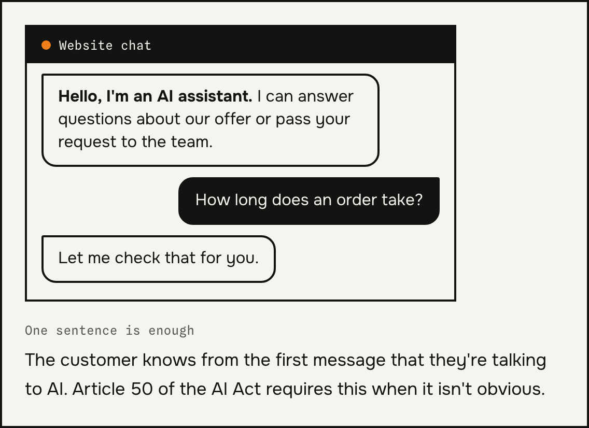
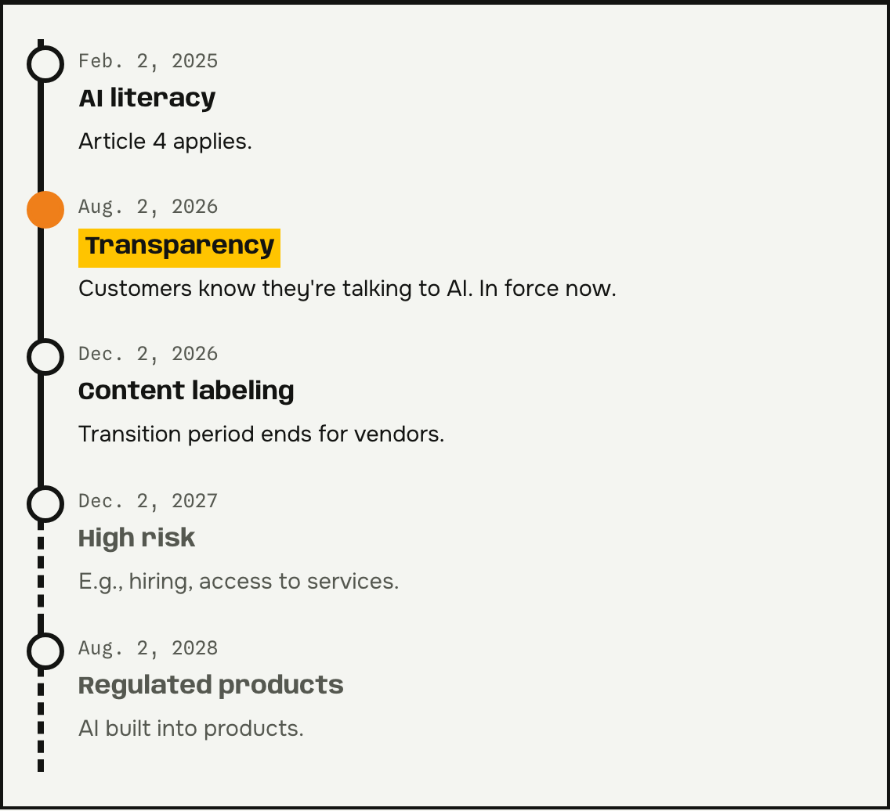
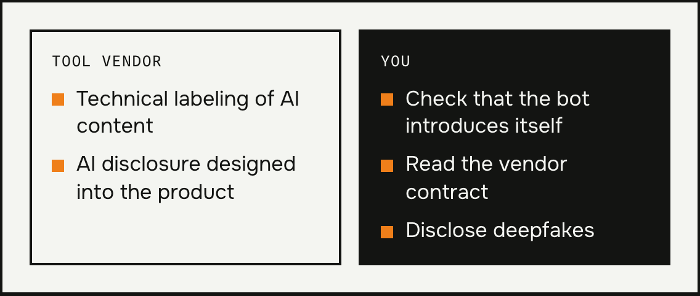
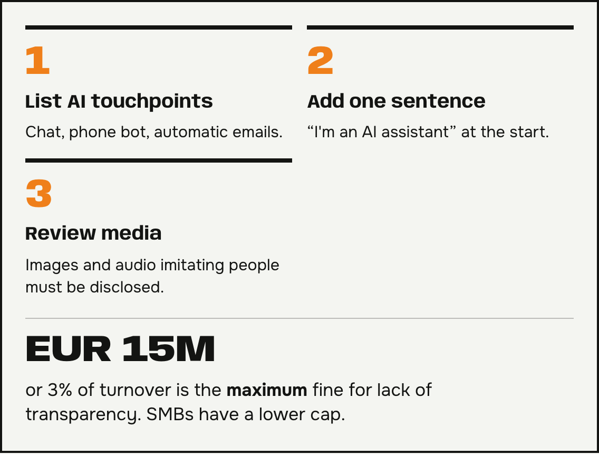

**The AI Act for small businesses** already applies to you if your website runs a chat or a bot answers your phone. The transparency rules have applied since Aug. 2, 2026. They say what customers must know when they talk to AI. I explain in plain language what they mean in practice and what you can check in your business in one evening. If you have a bot and aren't sure it meets the requirements, send me an email.

*The bot introduces itself in the first message.*

## AI Act 2026: what applies since Aug. 2

The AI Act is the EU law on artificial intelligence, and it takes effect in stages over several years. In this law, an AI system is a program that works with some independence and uses data to produce answers, content, or recommendations, as Article 3 of the AI Act describes it.

On July 20, 2026, the European Commission published guidelines on Article 50 and stated on its website that the transparency obligations apply from Aug. 2, 2026. The core rule is simple: customers must know they're talking to artificial intelligence, unless it's obvious to them. Under Article 50(5), this information must be clear and given at the first contact with the system at the latest.

One example from my own work is a voice bot for lead qualification, meaning the first call with a person interested in an offer. Two minutes after someone fills in the form, the bot calls them, and the assistant introduces herself as an AI assistant, meaning artificial intelligence, right away. If the customer asks for a person, the agent transfers the call to a person.

*Source: Prawo.pl, Aug. 11, 2026.*

The dates on the timeline come from an article by Dominik Ropela on Prawo.pl, published Aug. 11, 2026.

## Who is responsible for what: the vendor and your business

The AI Act splits businesses into roles, and the duties depend on the role. A provider, or vendor, is a company that builds an AI system and puts it on the market under its own name, for example the maker of the chat you use. A deployer is a company that uses an AI system in its work, not for private purposes.

A small business with a bot it bought is usually a deployer, even if it didn't build the bot itself.

Technical labeling of AI content, meaning a mark that a computer can read, falls on the tool vendor. For systems placed on the market before Aug. 2, 2026, vendors have until Dec. 2, 2026. According to Prawo.pl, this transition period doesn't delay the duties of a business that publishes deepfakes or texts on public matters. A deepfake is an AI image, recording, or video that imitates a real person, place, or event.

You're responsible for how the tool works with your customers, so check that the bot introduces itself, and read your contract with the vendor. Using AI to write a product description or an ad graphic doesn't automatically mean you have to disclose it.

*How AI Act duties split between the tool vendor and the business.*

Since Feb. 2, 2025, Article 4 of the AI Act has required companies that use AI to make sure their people understand those tools. The rule says plainly that no specific level of this knowledge has to be guaranteed. Prawo.pl adds that training should take into account people's experience and what they use the tools for.

## What the AI Act for small businesses pushes back

Obligations for high-risk systems, for example in hiring or in assessing access to services, will apply from Dec. 2, 2027. For systems that are part of products already covered by EU safety rules, the deadline is Aug. 2, 2028. A typical chat in a small store usually isn't such a system, but the transparency and AI literacy rules already apply.

## The AI Act for small businesses in three steps

Prawo.pl advises starting by working out which AI systems your business uses, in which processes, and in what role. To begin, three simple steps for one evening are enough:

1. List the places where customers talk to AI: website chat, [phone bot](/en/posts/voice-bot-for-business/), automatic email replies.
2. Add one sentence at the start of the conversation, for example “I'm an AI assistant.”
3. Review your graphics, recordings, and videos, because images and audio that imitate real people must be disclosed.

I also follow one more rule: decisions where a mistake costs money stay with a person.

If your bot collects customer data, also check GDPR, the EU rules on personal data protection. On Aug. 6, 2026, the Polish Personal Data Protection Office (UODO) published checklists for AI tools, including a separate version for small and medium-sized businesses. UODO advises asking these questions before you launch a tool, not after it's already running.

Breaking the transparency rules can mean a fine of up to EUR 15 million or up to 3% of annual worldwide turnover, whichever is higher. For small and medium-sized businesses, Article 99 of the AI Act sets a lower cap, because the lower of the two amounts applies. These are maximum thresholds, not a fixed rate for each breach. This text isn't legal advice, so if in doubt, ask a lawyer.

*The three compliance steps described above.*

## Frequently asked questions about the AI Act for small businesses

### Do I have to tell customers they're talking to a bot?
Yes, if it isn't obvious to them. It's best to do it in the first message or the first sentence of a phone call.

### What is my role under the AI Act if I buy a bot from a vendor?
Usually a deployer, meaning a company that uses an AI system in its work. The provider is the company that built the system and sells it under its own name.

### Do I have to train my staff on AI?
Yes, within reason. Article 4 requires you to support AI knowledge among the people who operate the tools, but it doesn't set a specific level of that knowledge.

### Does a small business have to keep a register of AI tools?
No. Prawo.pl notes that the rules don't require a register or an “AI officer” role, but a list of the places where you use AI is a good first step.

### Does a product description written by AI need a label?
Not automatically. The obligation covers specific content, for example deepfakes and texts published to inform the public on matters of public interest. According to Prawo.pl, the exception covers texts that a person responsible for the content reviewed before publication.

### How much does it cost to comply?
It depends on the tool and your contract with the vendor. Email me which bot you use, and I'll work it out for your case. I describe projects like this on the [AI and process automation](/en/services/ai-automation/) page.

**Email me: office@robert-debicki.pl** and tell me where your customers talk to AI in your business.
