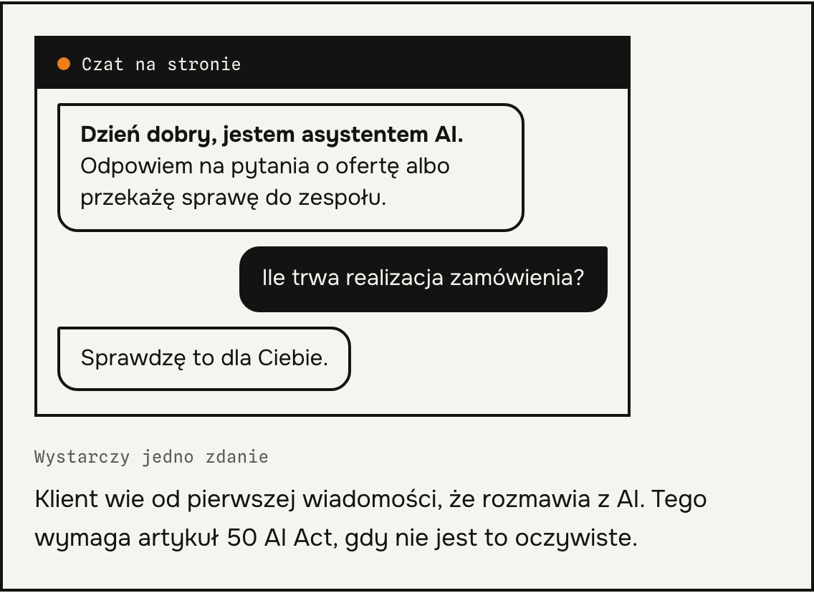
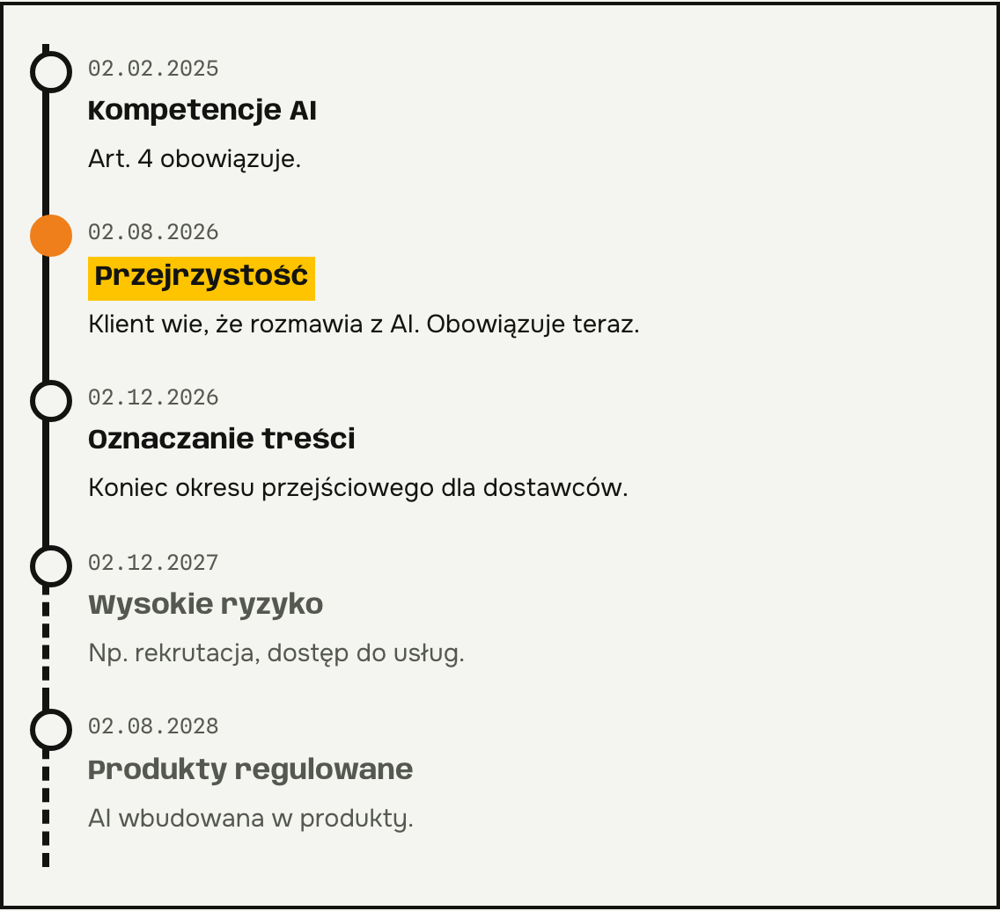
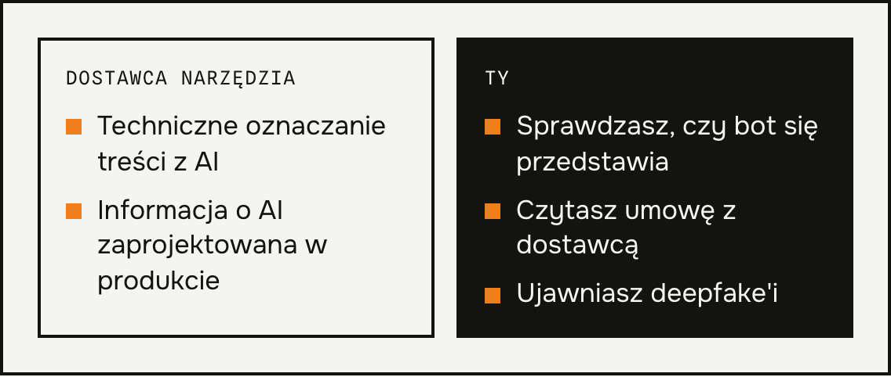

**AI Act dla małej firmy** dotyczy Cię już dziś, jeśli na stronie działa czat albo na telefon odpowiada bot. Od 2 sierpnia 2026 obowiązują przepisy o przejrzystości, czyli zasady, które mówią, co klient musi wiedzieć o rozmowie z AI. Opisuję prostym językiem, co one znaczą w praktyce i co sprawdzisz w firmie w jeden wieczór. Jeśli masz bota i nie wiesz, czy spełnia wymagania, napisz do mnie maila.

*Bot przedstawia się w pierwszej wiadomości.*

## AI Act 2026: co obowiązuje od 2 sierpnia

AI Act to unijne przepisy o sztucznej inteligencji, które są stosowane etapami w kolejnych latach. System AI to w nich program, który działa z pewną samodzielnością i na podstawie danych tworzy odpowiedzi, treści albo rekomendacje, jak opisuje to artykuł 3 AI Act.

Komisja Europejska opublikowała 20 lipca 2026 wytyczne do artykułu 50 i podała na swojej stronie, że obowiązki przejrzystości stosuje się od 2 sierpnia 2026. Najważniejsza zasada jest prosta: klient ma wiedzieć, że rozmawia ze sztuczną inteligencją, chyba że jest to dla niego oczywiste. Według artykułu 50 ust. 5 ta informacja ma być jasna i paść najpóźniej przy pierwszym kontakcie z systemem.

Przykład z mojego wdrożenia to voice bot do kwalifikacji leadów, czyli pierwszej rozmowy z osobą zainteresowaną ofertą. Dwie minuty po wypełnieniu formularza bot dzwoni do tej osoby, a asystentka od razu przedstawia się jako asystentka AI, czyli sztuczna inteligencja. Gdy klient poprosi o człowieka, agent przekierowuje połączenie do człowieka.

*Źródło: Prawo.pl, 11.08.2026.*

Terminy z osi czasu podaje artykuł Dominika Ropeli na Prawo.pl z 11 sierpnia 2026.

## Kto za co odpowiada: dostawca i Twoja firma

AI Act dzieli firmy na role, a od roli zależą obowiązki. Dostawca to firma, która tworzy system AI i wprowadza go na rynek pod własną nazwą, na przykład producent czatu, z którego korzystasz. Podmiot stosujący to firma, która używa systemu AI w swojej pracy, a nie prywatnie.

Mała firma z kupionym botem jest zwykle podmiotem stosującym, nawet jeśli sama go nie zbudowała.

Techniczne oznaczanie treści z AI, czyli znacznik czytelny dla komputera, spoczywa na dostawcy narzędzia. Dla systemów wprowadzonych przed 2 sierpnia 2026 dostawcy mają na to czas do 2 grudnia 2026. Według Prawo.pl ten okres przejściowy nie przesuwa obowiązków firmy, która publikuje deepfake'i albo teksty o sprawach publicznych. Deepfake to obraz, nagranie albo wideo z AI, które udaje prawdziwą osobę, miejsce albo zdarzenie.

Ty odpowiadasz za to, jak narzędzie działa u Twoich klientów, więc sprawdź, czy bot się przedstawia, i przeczytaj umowę z dostawcą. Samo użycie AI do opisu produktu albo grafiki reklamowej nie oznacza automatycznie obowiązku informowania o tym.

*Podział obowiązków AI Act między dostawcę narzędzia i firmę.*

Od 2 lutego 2025 artykuł 4 AI Act wymaga, żeby firmy, które używają AI, dbały o wiedzę o tych narzędziach u swoich ludzi. Przepis mówi wprost, że nie trzeba zapewnić żadnego konkretnego poziomu tej wiedzy. Prawo.pl dodaje, że szkolenie ma brać pod uwagę doświadczenie ludzi i to, do czego używają narzędzia.

## Co AI Act dla małej firmy przesuwa na później

Obowiązki dla systemów wysokiego ryzyka, na przykład w rekrutacji czy ocenie dostępu do usług, zaczną obowiązywać 2 grudnia 2027. Dla systemów, które są częścią produktów objętych już unijnymi przepisami o bezpieczeństwie, termin to 2 sierpnia 2028. Typowy czat w małym sklepie zwykle nie jest takim systemem, ale zasady przejrzystości i wiedzy o AI działają już teraz.

## AI Act dla małej firmy w trzech krokach

Prawo.pl radzi zacząć od ustalenia, jakich systemów AI firma używa, w jakich procesach i w jakiej roli. Na początek wystarczą trzy proste kroki na jeden wieczór:

1. Spisz miejsca, w których klient rozmawia z AI: czat na stronie, [bot telefoniczny](/wpisy/voice-bot-dla-firmy/), automatyczne odpowiedzi w mailach.
2. Dodaj na początku rozmowy jedno zdanie, na przykład „Jestem asystentem AI”.
3. Przejrzyj grafiki, nagrania i wideo, bo obrazy i dźwięk udające prawdziwe osoby wymagają ujawnienia.

Sam stosuję jeszcze jedną zasadę: decyzje, w których pomyłka kosztuje, zostają u człowieka.

Jeśli bot zbiera dane klientów, sprawdź też RODO, czyli przepisy o ochronie danych osobowych. Urząd Ochrony Danych Osobowych opublikował 6 sierpnia 2026 listy pytań kontrolnych do narzędzi AI, w tym osobną wersję dla małych i średnich firm. UODO radzi zadać te pytania przed uruchomieniem narzędzia, a nie dopiero wtedy, gdy już działa.

Za naruszenie przepisów o przejrzystości grozi kara do 15 mln euro albo do 3 procent rocznego światowego obrotu, zależnie od tego, która kwota jest wyższa. Dla małych i średnich firm artykuł 99 AI Act przewiduje niższy limit, bo liczy się mniejsza z tych dwóch kwot. To progi maksymalne, a nie stała stawka za każde naruszenie. Ten tekst nie jest poradą prawną, więc przy wątpliwościach zapytaj prawnika.

*Trzy kroki dostosowania opisane wyżej.*

## Najczęstsze pytania o AI Act dla małej firmy

### Czy muszę informować klientów, że rozmawiają z botem?
Tak, jeśli nie jest to dla nich oczywiste. Najlepiej zrobić to w pierwszej wiadomości albo w pierwszym zdaniu rozmowy telefonicznej.

### Kim jestem w AI Act, jeśli kupuję bota od dostawcy?
Zwykle podmiotem stosującym, czyli firmą, która używa systemu AI w swojej pracy. Dostawcą jest firma, która ten system stworzyła i sprzedaje go pod własną nazwą.

### Czy muszę szkolić pracowników z AI?
Tak, w rozsądnym zakresie. Artykuł 4 wymaga dbania o wiedzę o AI u ludzi, którzy obsługują narzędzia, ale nie określa konkretnego poziomu tej wiedzy.

### Czy mała firma musi prowadzić rejestr narzędzi AI?
Nie. Prawo.pl zaznacza, że przepisy nie wymagają rejestru ani stanowiska „AI officera”, ale lista miejsc, gdzie używasz AI, to dobry pierwszy krok.

### Czy opis produktu napisany przez AI trzeba oznaczać?
Nie automatycznie. Obowiązek dotyczy określonych treści, na przykład deepfake'ów i tekstów publikowanych, żeby informować o sprawach interesu publicznego. Według Prawo.pl wyjątek obejmuje teksty, które przed publikacją sprawdził człowiek odpowiedzialny za treść.

### Ile to kosztuje, żeby się dostosować?
Zależy od narzędzia i umowy z dostawcą. Napisz, jakiego bota używasz, a policzę to dla Twojego przypadku. Takie wdrożenia opisuję na stronie [AI i automatyzacja procesów](/uslugi/ai-i-automatyzacja/).

**Napisz do mnie: office@robert-debicki.pl** i podaj, gdzie w Twojej firmie klient rozmawia z AI.
