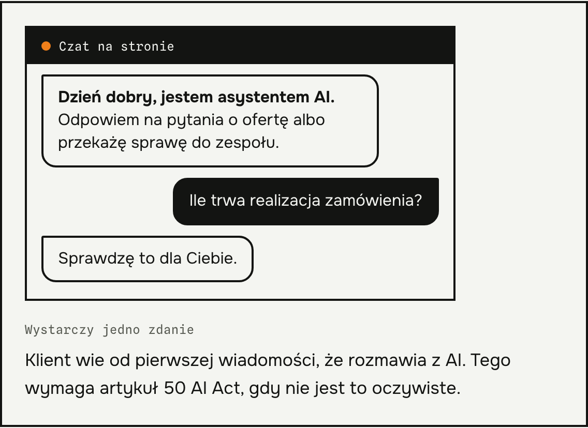
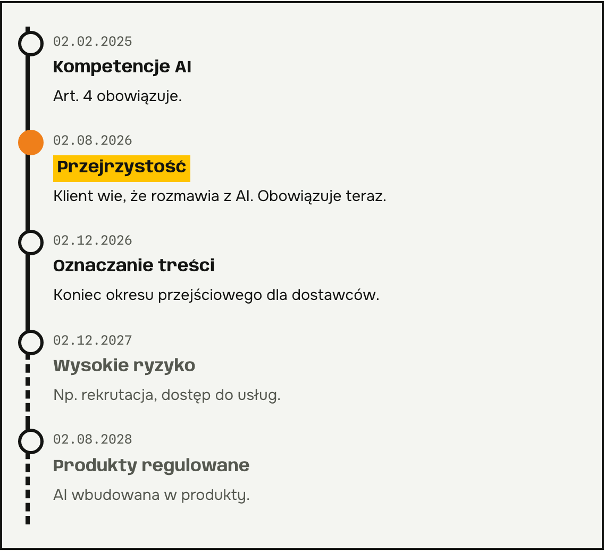
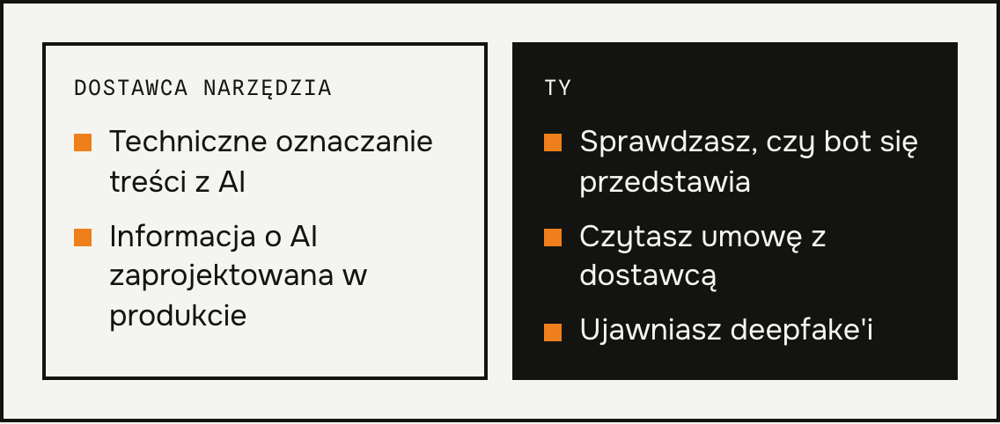
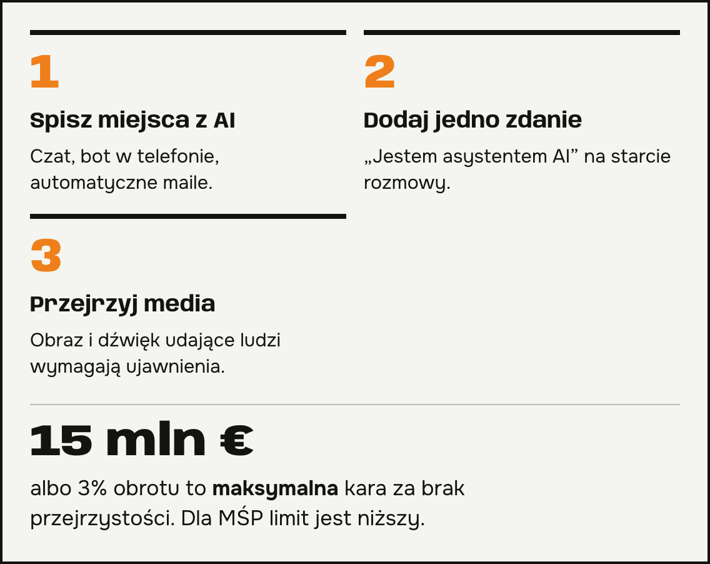

**AI Act dla małej firmy** dotyczy Cię już dziś, jeśli na stronie działa czat albo na telefon odpowiada bot. Od 2 sierpnia 2026 obowiązują przepisy o przejrzystości. Opisuję, co one znaczą w praktyce i co sprawdzisz w jeden wieczór. Masz bota i nie wiesz, czy spełnia wymagania? Napisz do mnie maila.

## Co obowiązuje od 2 sierpnia 2026

Komisja Europejska potwierdziła w wytycznych z 20 lipca 2026, że obowiązki z artykułu 50 stosuje się od tej daty. Najważniejsza zasada jest prosta. Klient ma wiedzieć, że rozmawia ze sztuczną inteligencją, chyba że jest to oczywiste. Informacja ma paść najpóźniej przy pierwszym kontakcie.

Opisują to [obowiązki z AI Act od sierpnia 2026](https://www.prawo.pl/biznes/ai-act-jakie-obowiazki-maja-firmy-od-sierpnia-2026,1550271.html) w artykule na Prawo.pl.

*Źródło: Prawo.pl, 11.08.2026.*

## Co jest po stronie dostawcy, a co po Twojej

Techniczne oznaczanie treści generowanych przez AI spoczywa głównie na dostawcy narzędzia. Dla systemów wprowadzonych przed 2 sierpnia 2026 okres przejściowy trwa do 2 grudnia 2026.

Ty odpowiadasz za to, jak narzędzie działa u Twoich klientów. Sprawdź, czy bot się przedstawia, i przeczytaj umowę z dostawcą. Samo użycie AI do opisu produktu albo grafiki reklamowej nie oznacza automatycznie obowiązku informowania o tym.

## Co AI Act dla małej firmy przesuwa na później

Obowiązki dla systemów wysokiego ryzyka, na przykład w rekrutacji czy ocenie dostępu do usług, zaczną obowiązywać 2 grudnia 2027. Dla systemów wbudowanych w regulowane produkty termin to 2 sierpnia 2028. Typowy czat w małym sklepie zwykle nie jest takim systemem.

## AI Act dla małej firmy w trzech krokach

1. Spisz miejsca, w których klient rozmawia z AI: czat na stronie, bot telefoniczny, automatyczne odpowiedzi w mailach.
2. Dodaj na początku rozmowy jedno zdanie, na przykład „Jestem asystentem AI”.
3. Przejrzyj grafiki, nagrania i wideo. Obrazy i dźwięk udające prawdziwe osoby wymagają ujawnienia.

Za naruszenie przepisów o przejrzystości grozi kara do 15 mln euro albo do 3 procent światowego obrotu, zależnie od tego, która kwota jest wyższa. Dla małych i średnich firm przewidziano niższy limit. To progi maksymalne, nie stała stawka. Ten tekst nie jest poradą prawną. Przy wątpliwościach zapytaj prawnika.

## Pytania i odpowiedzi

### Czy muszę informować klientów, że rozmawiają z botem?
Tak, jeśli nie jest to oczywiste. Najlepiej zrobić to w pierwszej wiadomości.

### Czy AI Act obejmuje też gotowe narzędzia, które tylko kupuję?
Tak. Obowiązek zaprojektowania informacji ma dostawca, ale sprawdzenie wdrożenia i umowy zostaje po Twojej stronie.

### Czy AI Act dla małej firmy wymaga rejestru narzędzi AI?
Nie. Prawo.pl zaznacza, że przepisy nie wymagają rejestru ani stanowiska „AI officera”. Lista miejsc, gdzie używasz AI, to jednak dobry pierwszy krok.

### Czy opis produktu napisany przez AI trzeba oznaczać?
Nie automatycznie. Obowiązek dotyczy określonych treści, na przykład deepfake'ów i tekstów o sprawach interesu publicznego.

### Ile to kosztuje, żeby się dostosować?
Zależy od narzędzia i umowy z dostawcą. Napisz, jakiego bota używasz, a policzę to dla Twojego przypadku.
