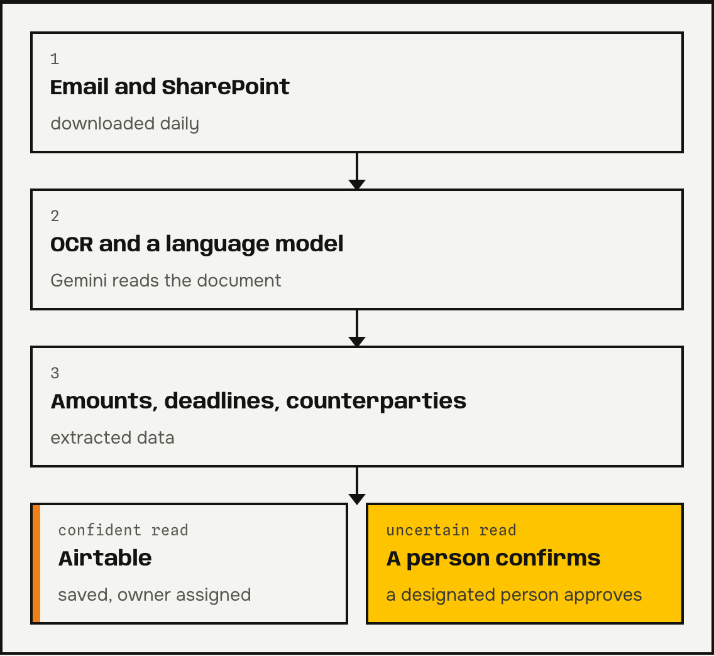
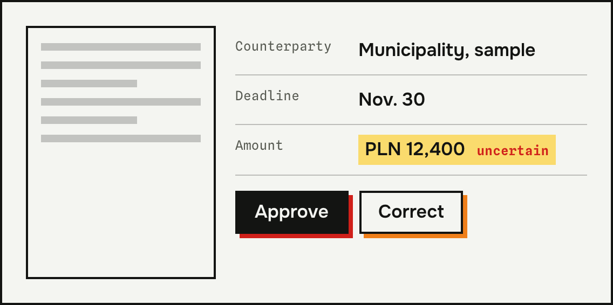

**Automated document reading** saves time wherever someone retypes amounts and deadlines from PDF files into a spreadsheet by hand. I describe a project where the system reads hundreds of grant applications every day and saves the data in one database. I also show what happens when a read is uncertain and how to protect personal data from documents. If someone at your company retypes documents by hand, email me and tell me what they cover.

## The problem: data in files and no shared database

The team I worked for pulled data from municipal grant applications by hand. Documents came in by email or sat as files in SharePoint, and the team had no shared database.

*Before the project, files sat in email and SharePoint. After the project, all the data goes into one database.*

## How automated document reading works

### What OCR is

OCR means reading text from a photo or a scan: it turns an image of letters into text that a program can work with. IBM describes OCR as a technology that quickly converts images of text into a machine-readable format. According to the same description, OCR works on scanned documents, camera images, and image-only PDFs. In the project described here, OCR works together with a language model, an AI program that understands the content and points out amounts and deadlines.

### The system's four steps

The system works in four steps that it repeats every day:

1. It downloads new documents from email and SharePoint every day.
2. It runs document OCR, and a language model reads the extracted text.
3. It pulls amounts, deadlines, and counterparty details from the text.
4. It saves the data in Airtable, an online database, and assigns an owner to the application.

The whole thing runs on n8n, a tool where you build an automation from connected steps. For reading the content, I use Google's Gemini model.

*Everything runs in n8n, from downloading a document to saving it in the database or asking a person.*

### What about invoices from KSeF

Reading invoices works differently when the invoice comes from KSeF, the Polish National e-Invoicing System. According to the Polish Ministry of Finance, companies with sales above PLN 200 million including VAT in 2024 have had to issue invoices in KSeF since Feb. 1, 2026. All other companies have issued invoices in KSeF since April 1, 2026. The ministry explains on its KSeF 2.0 page that an invoice in this system must be an XML file. It's a file that follows an official template, where every piece of data has a fixed place, so reading it doesn't require OCR. I describe downloading these invoices automatically in my post about [cost invoices from KSeF](/en/posts/ksef-faktury-kosztowe/).

## What about a read the system isn't sure of

A language model can make mistakes, and a wrong amount is costly, so when a read is uncertain, the system asks a designated person to confirm it. That way the automation doesn't pretend to be infallible, because confident reads go into the database on their own and uncertain ones go to a person. This rule fits the GDPR, the EU regulation on the protection of personal data. Its Article 5 requires data to be accurate and inaccurate data to be corrected or erased without delay.

*This is an illustration of the principle, not a screenshot of the client's system, so all the data on the screen is sample data.*

## What changes for the team

The system takes retyping off the team's plate, and instead of folders of files, the team has one database with an owner assigned to each application. I don't give a number of hours saved here, because I haven't measured that number. What I do know is that the process handles hundreds of applications and runs every day. I calculate the gain this way: I check how long one task takes a person and multiply it by the number of such tasks in a week or a month. Then I count the same way for the automation and compare the two results. The client doesn't have to maintain the automation, because I make the changes myself after consulting with the client.

## Personal data in documents

If the documents contain personal data, such as a first and last name, the project has to meet GDPR requirements.

### Data processing agreement

When a provider processes personal data on behalf of your company, Article 28 of the GDPR requires a data processing agreement. The agreement says what data is processed, for what purpose, and for how long. The provider acts only on the company's documented instructions, and people with access to the data commit to confidentiality. When the service ends, the provider deletes or returns the data, at the company's choice. The data minimization principle in Article 5 of the GDPR says data must be limited to what is necessary for the purpose of processing.

### How to protect the data

Article 32 of the GDPR requires the company and the provider to use technical and organizational measures that provide security appropriate to the risk. The rule gives examples such as encrypting data and pseudonymization, which means replacing data that identifies a person with a different label. It also lists the ability to restore access to data quickly after an incident and regular testing of whether the safeguards work. Before the project starts, we agree on which services the data from the documents may go to.

## Frequently asked questions about automated document reading

### Does automated document reading work with every document type?
No, it works best with a consistent layout, for example when reading invoices in PDF, applications, or contracts. Low-quality scans are more often sent to a person for confirmation.

### What if the system reads an amount wrong?
When a read is uncertain, the system asks a designated person to confirm it. When a read looks confident, spot-check the amounts from time to time anyway.

### Do I have to change the software I use?
Usually not, because in the project described here, the system downloads documents from email and SharePoint and saves the data in Airtable.

### Do invoices from KSeF also need OCR?
No, because an invoice in KSeF is an XML file that follows an official template. OCR helps with invoices delivered outside KSeF, for example as a PDF or on paper.

### How much does a project like this cost?
I work out the price from the numbers in the scope: the number of document types and where the data goes. Tell me which documents you retype, and I'll give you a quote for my [AI automation](/en/services/ai-automation/) service.

### How long does a deployment take?
I answer based on the scope of the deployment, which we set together before work starts.

### Is the data from the documents secure?
That depends on the services you choose and your contracts with their providers, so before the project starts, we agree on where the data may go. With personal data, GDPR requirements apply, including a data processing agreement and the safeguards in Article 32.

**Email me: office@robert-debicki.pl** and tell me which documents you retype by hand.
