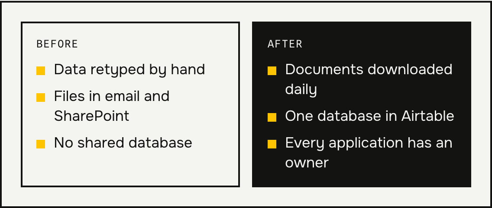
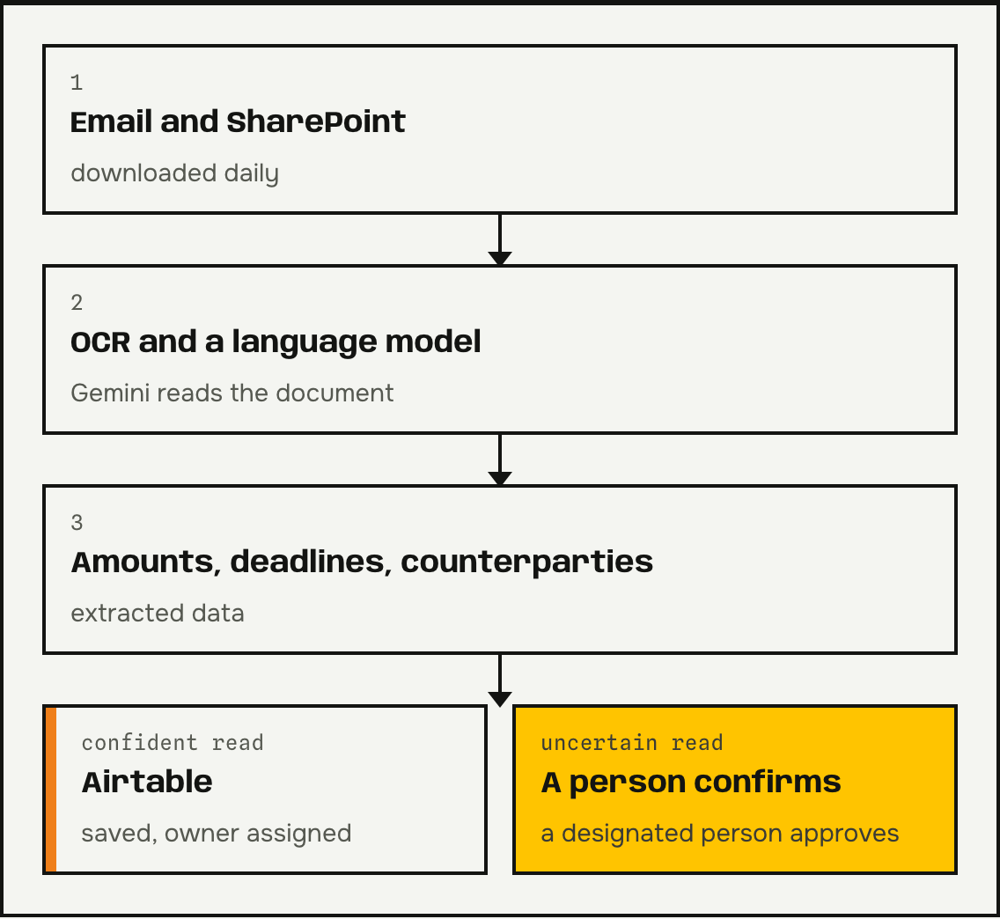
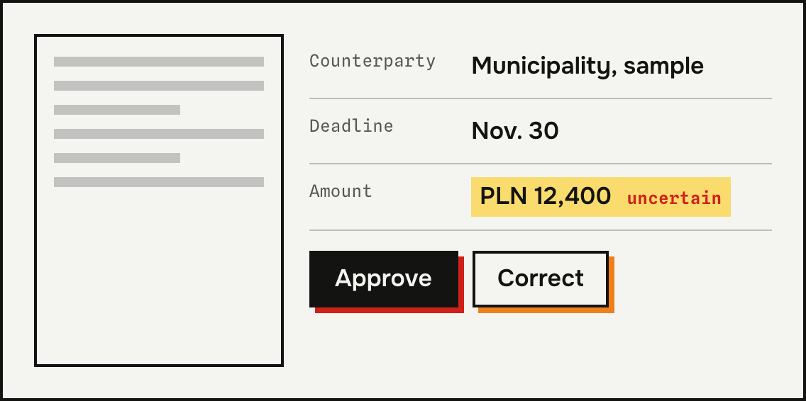

**Automated document reading** saves time wherever someone retypes amounts and deadlines from PDFs into a spreadsheet. I describe a project where the system reads hundreds of applications every day and saves the data in one database. I also show what happens when a read is uncertain. Do you retype documents by hand? Email me.

## The problem: data in files and no shared database

The team I worked for pulled data from municipal grant applications by hand. Documents came in by email and sat in SharePoint. The team had no shared database.

## How automated document reading works

The system works in four steps:

1. It downloads documents from email and SharePoint every day.
2. It reads them with OCR together with a language model.
3. It extracts amounts, deadlines, and counterparty details.
4. It saves the data in Airtable and assigns an owner to the application.

The whole thing runs on n8n. For reading, I use the Gemini model.

*Everything runs in n8n.*

## What about a read the system isn't sure of

A language model can make mistakes, and a wrong amount is costly. So when a read is uncertain, the system asks a designated person to confirm it.

That way the automation doesn't pretend to be infallible. Confident reads go through on their own, and uncertain ones go to a person.

*An illustration of the principle, not a screenshot of the client's system. Sample data.*

## What changes for the team

Automated document reading takes retyping off the team's plate. The team has one database instead of folders of files. The system assigns an owner to each application. I don't give a number of hours saved here, because I don't have a measured figure. What I do know is that the process handles hundreds of applications and runs every day.

## Questions and answers

### Does automated document reading work with every document type?
No. It works best with documents that have a consistent layout, such as applications, invoices, or contracts. Low-quality scans are more often sent to a person for confirmation.

### What if the system reads an amount wrong?
When a read is uncertain, the system asks a person. When a read looks confident, spot-check the amounts from time to time.

### Do I have to change the software I use?
Usually not. In the project described here, the system downloads documents from email and SharePoint and saves the data in Airtable.

### How much does a project like this cost?
The price depends on the number of document types and where the data goes. Tell me which documents you retype, and I'll give you a quote. I build processes like this as part of my [AI automation](/en/services/ai-automation/) service.

### Is the data from the documents secure?
That depends on the services you choose and your contracts with their providers. Before the project starts, we agree on where the data may go. With personal data, that matters because of the GDPR.
