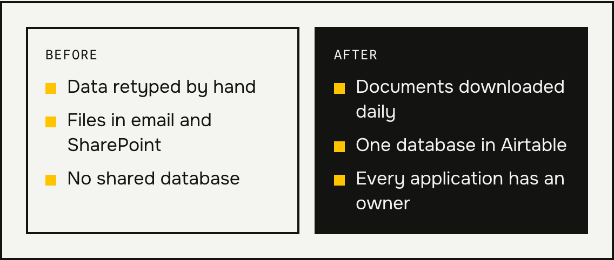

**Automated document reading** saves time wherever someone retypes amounts and deadlines from PDFs into a spreadsheet. I describe a project where the system reads hundreds of applications every day and saves the data in one database. I also show what happens when a read is uncertain. If you retype documents by hand, email me.

## The problem: data in files and no shared database

The team I worked for pulled data from municipal grant applications by hand. Documents came in by email and sat in SharePoint. The team had no shared database.

*Before the project, files in email and SharePoint. After, one database.*

## How automated document reading works

The system works in four steps:

1. It downloads documents from email and SharePoint every day.
2. It runs document OCR together with a language model.
3. It extracts amounts, deadlines, and counterparty details.
4. It saves the data in Airtable and assigns an owner to the application.

The whole thing runs on n8n. For reading, I use the Gemini model.

*Everything runs in n8n.*

## What about a read the system isn't sure of

A language model can make mistakes, and a wrong amount is costly. So when a read is uncertain, the system asks a designated person to confirm it.

That way the automation doesn't pretend to be infallible. Confident reads go through on their own, and uncertain ones go to a person.

*An illustration of the principle, not a screenshot of the client's system. Sample data.*

## What changes for the team

The system takes retyping off the team's plate. The team has one database instead of folders of files. The system assigns an owner to each application. I don't give a number of hours saved here, because I haven't measured that number. What I do know is that the process handles hundreds of applications and runs every day. I measure it this way: I check how long one task takes a person, multiply it by the number of such tasks in a week or a month, and then count the same way for the automation.

## Personal data in documents

If a provider processes personal data on behalf of your company, the GDPR requires a data processing agreement. The agreement says what data is processed and for what purpose. The provider acts only on the company's instructions and must protect the data. When the service ends, the data is deleted or returned, at the company's choice. The text of the rule is in [Article 28 of the GDPR](https://gdpr-info.eu/art-28-gdpr/).

## Frequently asked questions about automated document reading

### Does automated document reading work with every document type?
No. It works best with a consistent layout, for example when reading invoices, applications, or contracts. Low-quality scans are more often sent to a person for confirmation.

### What if the system reads an amount wrong?
When a read is uncertain, the system asks a person. When a read looks confident, spot-check the amounts from time to time.

### Do I have to change the software I use?
Usually not. In the project described here, the system downloads documents from email and SharePoint and saves the data in Airtable.

### How much does a project like this cost?
I work out the price from the numbers in the scope: the number of document types and where the data goes. Tell me which documents you retype, and I'll give you a quote. I build processes like this as part of my [AI automation](/en/services/ai-automation/) service.

### How long does a deployment take?
I answer based on the scope of the deployment, which we set before we start.

### Does the client have to change the automation?
No. The client never touches the automation, because everything happens automatically. I make changes after consulting with the client.

### Is the data from the documents secure?
That depends on the services you choose and your contracts with their providers. Before the project starts, we agree on where the data may go. With personal data, that matters because of the GDPR.

**Email me: office@robert-debicki.pl** and tell me which documents you retype by hand.
