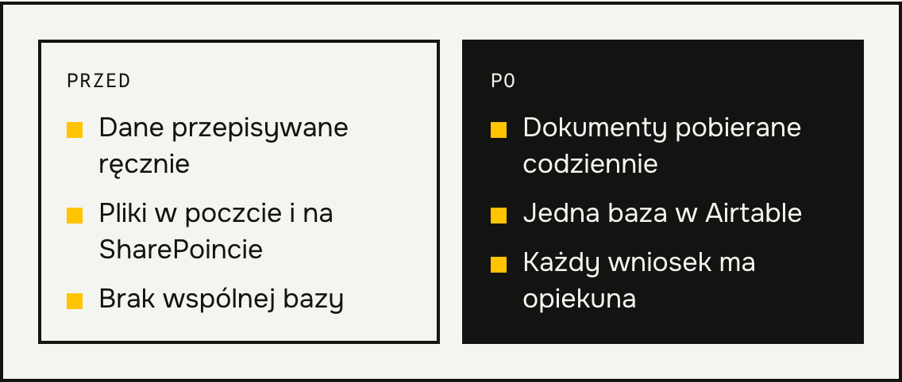
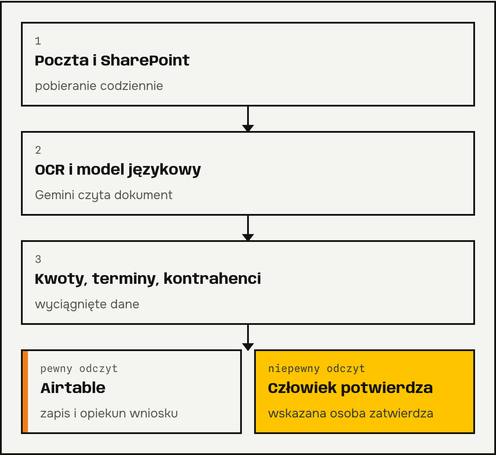

**Automatyczny odczyt dokumentów** oszczędza czas wszędzie tam, gdzie ktoś ręcznie przepisuje kwoty i terminy z plików PDF do tabeli. Opisuję wdrożenie, w którym system codziennie czyta setki wniosków o dofinansowanie i zapisuje dane w jednej bazie. Pokazuję też, co się dzieje, gdy odczyt jest niepewny, i jak chronić dane osobowe z dokumentów. Jeśli w Twojej firmie ktoś przepisuje dokumenty ręcznie, napisz do mnie i opisz, czego dotyczą.

## Problem: dane w plikach i brak wspólnej bazy

Zespół, dla którego pracowałem, ręcznie wyciągał dane z wniosków o dofinansowanie dla gmin. Dokumenty przychodziły mailem albo leżały w plikach na SharePoincie, a zespół nie miał wspólnej bazy danych.

*Przed wdrożeniem pliki leżały w poczcie i na SharePoincie, a po wdrożeniu wszystkie dane trafiają do jednej bazy.*

## Jak działa automatyczny odczyt dokumentów

### Czym jest OCR

OCR to odczyt tekstu ze zdjęcia albo skanu, czyli zamiana obrazu z literami na tekst, który program może dalej przetwarzać. IBM opisuje OCR jako technologię, która szybko zamienia obrazy tekstu na format czytelny dla maszyny. Według tego samego opisu OCR działa na zeskanowanych dokumentach, zdjęciach z aparatu i plikach PDF zawierających sam obraz. W opisanym wdrożeniu OCR działa razem z modelem językowym, czyli programem AI, który rozumie treść i wskazuje w niej kwoty i terminy.

### Cztery kroki systemu

System działa w czterech krokach, które powtarza każdego dnia:

1. Codziennie pobiera nowe dokumenty z poczty i z SharePointa.
2. Robi OCR dokumentów, a model językowy czyta odczytany tekst.
3. Wyciąga z tekstu kwoty, terminy i dane kontrahentów.
4. Zapisuje dane w Airtable, czyli w bazie danych online, i przypisuje opiekuna wniosku.

Całość stoi na n8n, czyli narzędziu, w którym automatyzację składa się z połączonych ze sobą kroków. Do odczytu treści używam modelu Gemini od Google.

*Całość działa w n8n, od pobrania dokumentu do zapisu w bazie albo pytania do człowieka.*

### A co z fakturami z KSeF

Przy odczycie faktur sytuacja wygląda inaczej, gdy faktura pochodzi z Krajowego Systemu e-Faktur, czyli KSeF. Według Ministerstwa Finansów obowiązek wystawiania faktur w KSeF działa od 1 lutego 2026 dla firm, które w 2024 miały sprzedaż powyżej 200 mln zł z VAT. Pozostałe firmy wystawiają faktury w KSeF od 1 kwietnia 2026. Ministerstwo wyjaśnia na stronie KSeF 2.0, że faktura w tym systemie musi mieć format pliku XML. To plik zgodny z urzędowym wzorem, w którym każda dana ma swoje stałe miejsce, więc do jego odczytu OCR nie jest potrzebny. Automatyczne pobieranie takich faktur opisuję we wpisie [faktury kosztowe z KSeF](/wpisy/ksef-faktury-kosztowe/).

## Co z odczytem, którego system nie jest pewny

Model językowy może się pomylić, a pomyłka w kwocie kosztuje, dlatego przy niepewnym odczycie system prosi wskazaną osobę o potwierdzenie. Dzięki temu automatyzacja nie udaje nieomylnej, bo pewne odczyty idą do bazy same, a niepewne trafiają do człowieka. Ta zasada pasuje do RODO, czyli unijnego rozporządzenia o ochronie danych osobowych. Jego artykuł 5 wymaga, żeby dane były prawidłowe, a błędne bez zwłoki poprawiane albo usuwane.

*To ilustracja zasady, a nie zrzut z systemu klienta, więc wszystkie dane na ekranie są przykładowe.*

## Co zmienia się dla zespołu

System zdejmuje z zespołu przepisywanie, a zamiast folderów z plikami zespół ma jedną bazę z opiekunem przypisanym do każdego wniosku. Nie podaję tu liczby zaoszczędzonych godzin, bo tej liczby nie mam zmierzonej. Wiem natomiast, że proces obsługuje setki wniosków i działa codziennie. Zysk liczę tak: sprawdzam, ile trwa człowiekowi jedna czynność, i mnożę to przez liczbę takich czynności w tygodniu albo w miesiącu. Potem liczę tak samo dla automatyzacji i porównuję oba wyniki. Klient nie musi obsługiwać automatyzacji, bo zmiany w niej wprowadzam ja, po konsultacji z klientem.

## Dane osobowe w dokumentach

Jeśli dokumenty zawierają dane osobowe, na przykład imię i nazwisko, przy wdrożeniu trzeba spełnić wymogi RODO.

### Umowa powierzenia

Gdy dostawca przetwarza dane osobowe w imieniu Twojej firmy, artykuł 28 RODO wymaga umowy powierzenia. Umowa mówi, jakie dane są przetwarzane, w jakim celu i przez jaki czas. Dostawca działa tylko na udokumentowane polecenie firmy, a osoby z dostępem do danych zobowiązują się do poufności. Po zakończeniu usługi dostawca usuwa dane albo je oddaje, według wyboru firmy. Zasada minimalizacji z artykułu 5 RODO mówi, że dane mają być ograniczone do tego, co konieczne do celu przetwarzania.

### Jak chronić dane

Artykuł 32 RODO wymaga od firmy i od dostawcy środków technicznych i organizacyjnych, które dają bezpieczeństwo odpowiednie do ryzyka. Przepis podaje przykłady, takie jak szyfrowanie danych i pseudonimizacja, czyli zastąpienie danych wskazujących osobę innym oznaczeniem. Wymienia też zdolność do szybkiego przywrócenia dostępu do danych po awarii oraz regularne testowanie, czy zabezpieczenia działają. Przed wdrożeniem ustalam z Tobą, do jakich usług mogą trafiać dane z dokumentów.

## Najczęstsze pytania o automatyczny odczyt dokumentów

### Czy automatyczny odczyt dokumentów obejmuje każdy typ?
Nie, najlepiej radzi sobie z powtarzalnym układem, na przykład przy odczycie faktur w PDF, wniosków czy umów. Skany słabej jakości częściej trafiają do potwierdzenia przez człowieka.

### Co jeśli system źle odczyta kwotę?
Przy niepewnym odczycie system prosi wskazaną osobę o potwierdzenie. Gdy odczyt wygląda na pewny, kwoty i tak okresowo sprawdzaj wyrywkowo.

### Czy muszę zmieniać program, którego używam?
Zwykle nie, bo w opisanym wdrożeniu system pobiera dokumenty z poczty i SharePointa, a dane zapisuje w Airtable.

### Czy faktury z KSeF też trzeba czytać przez OCR?
Nie, bo faktura w KSeF jest plikiem XML zgodnym z urzędowym wzorem. OCR przydaje się przy fakturach przekazanych poza KSeF, na przykład w PDF albo na papierze.

### Ile kosztuje takie wdrożenie?
Cenę wyliczam z liczb w zakresie, czyli z liczby typów dokumentów i miejsc zapisu. Napisz, jakie dokumenty przepisujesz, a podam wycenę w ramach usługi [wdrożenie AI i automatyzacja procesów](/uslugi/ai-i-automatyzacja/).

### Ile trwa wdrożenie?
Odpowiadam na podstawie zakresu wdrożenia, który ustalamy razem przed startem prac.

### Czy dane z dokumentów są bezpieczne?
To zależy od wybranych usług i umów z ich dostawcami, dlatego przed wdrożeniem ustalam z Tobą, gdzie dane mogą trafiać. Przy danych osobowych obowiązują wymogi RODO, w tym umowa powierzenia i zabezpieczenia z artykułu 32.

**Napisz do mnie: office@robert-debicki.pl** i podaj, jakie dokumenty przepisujesz ręcznie.
