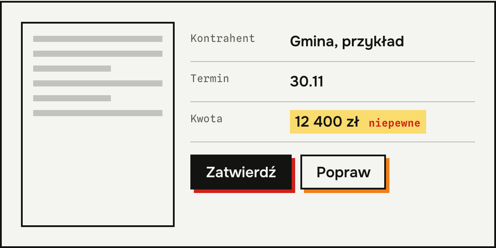

**Automatyczny odczyt dokumentów** oszczędza czas wszędzie tam, gdzie ktoś przepisuje kwoty i terminy z PDF do tabeli. Opisuję wdrożenie, w którym system codziennie czyta setki wniosków i zapisuje dane w jednej bazie. Pokazuję też, co się dzieje, gdy odczyt jest niepewny. Jeśli przepisujesz dokumenty ręcznie, napisz do mnie.

## Problem: dane w plikach i brak wspólnej bazy

Zespół, dla którego pracowałem, wyciągał dane z wniosków o dofinansowanie dla gmin ręcznie. Dokumenty przychodziły mailem i leżały na SharePoincie. Zespół nie miał wspólnej bazy danych.

*Przed wdrożeniem pliki w poczcie i na SharePoincie, po wdrożeniu jedna baza.*

## Jak działa automatyczny odczyt dokumentów

System działa w czterech krokach:

1. Pobiera dokumenty z poczty i SharePointa, codziennie.
2. Robi OCR dokumentów razem z modelem językowym.
3. Wyciąga kwoty, terminy i dane kontrahentów.
4. Zapisuje dane w Airtable i przypisuje opiekuna wniosku.

Całość stoi na n8n. Do odczytu używam modelu Gemini.

*Całość działa w n8n.*

## Co z odczytem, którego system nie jest pewny

Model językowy może się pomylić, a pomyłka w kwocie kosztuje. Dlatego gdy odczyt jest niepewny, system prosi wskazaną osobę o potwierdzenie.

Dzięki temu automatyzacja nie udaje nieomylnej. Pewne odczyty idą same, niepewne trafiają do człowieka.

*Ilustracja zasady, nie zrzut z systemu klienta. Dane przykładowe.*

## Co zmienia się dla zespołu

System zdejmuje z zespołu przepisywanie. Zespół ma jedną bazę zamiast folderów z plikami. System przypisuje opiekuna do każdego wniosku. Nie podaję tu liczby zaoszczędzonych godzin, bo tej liczby nie mam zmierzonej. Wiem natomiast, że proces obsługuje setki wniosków i działa codziennie. Mierzę to tak: sprawdzam, ile trwa człowiekowi jedna czynność, mnożę przez liczbę takich czynności w tygodniu albo w miesiącu, a potem liczę tak samo dla automatyzacji.

## Dane osobowe w dokumentach

Jeśli dostawca przetwarza dane osobowe w imieniu Twojej firmy, RODO wymaga umowy powierzenia. Umowa mówi, jakie dane są przetwarzane i w jakim celu. Dostawca działa tylko na polecenie firmy i ma chronić dane. Po zakończeniu usługi dane są usuwane albo oddawane, według wyboru firmy. Tekst przepisu opisuje [artykuł 28 RODO](https://gdpr-info.eu/art-28-gdpr/).

## Najczęstsze pytania o automatyczny odczyt dokumentów

### Czy automatyczny odczyt dokumentów obejmuje każdy typ?
Nie. Najlepiej radzi sobie z powtarzalnym układem, na przykład przy odczycie faktur, wniosków czy umów. Skany słabej jakości częściej trafiają do potwierdzenia przez człowieka.

### Co jeśli system źle odczyta kwotę?
Przy niepewnym odczycie system pyta człowieka. Gdy odczyt wygląda na pewny, kwoty okresowo sprawdzaj wyrywkowo.

### Czy muszę zmieniać program, którego używam?
Zwykle nie. W opisanym wdrożeniu system pobiera dokumenty z poczty i SharePointa, a dane zapisuje w Airtable.

### Ile kosztuje takie wdrożenie?
Cenę wyliczam na podstawie liczb z zakresu, czyli typów dokumentów i miejsc zapisu. Napisz, jakie dokumenty przepisujesz, a podam wycenę. Takie procesy buduję w ramach usługi [wdrożenie AI i automatyzacja procesów](/uslugi/ai-i-automatyzacja/).

### Ile trwa wdrożenie?
Odpowiadam na podstawie zakresu wdrożenia, który ustalamy przed startem.

### Czy klient musi zmieniać automatyzację?
Nie. Klient nie rusza automatyzacji, bo wszystko dzieje się automatycznie. Zmiany wprowadzam ja, po konsultacji z klientem.

### Czy dane z dokumentów są bezpieczne?
To zależy od wybranych usług i umów z ich dostawcami. Przed wdrożeniem ustalam z Tobą, gdzie dane mogą trafiać. Przy danych osobowych to ważne ze względu na RODO.

**Napisz do mnie: office@robert-debicki.pl** i podaj, jakie dokumenty przepisujesz ręcznie.
