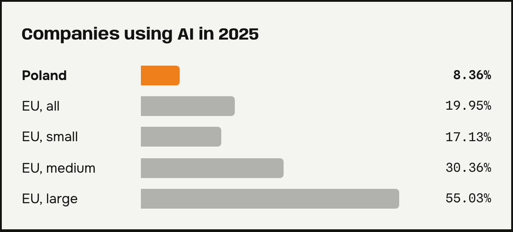
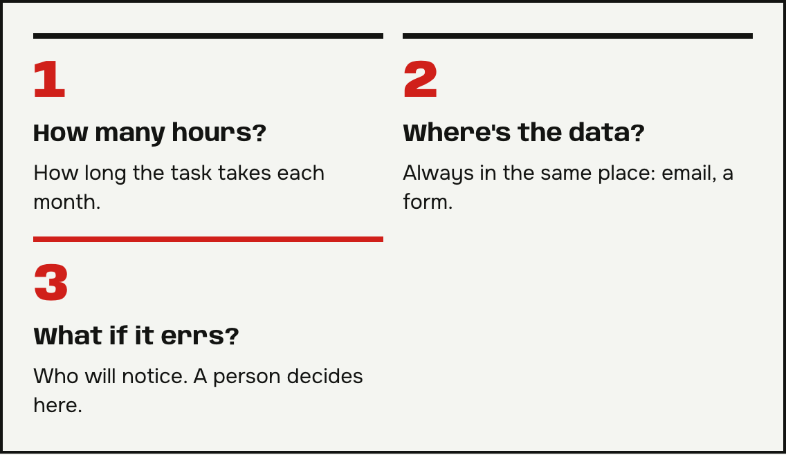
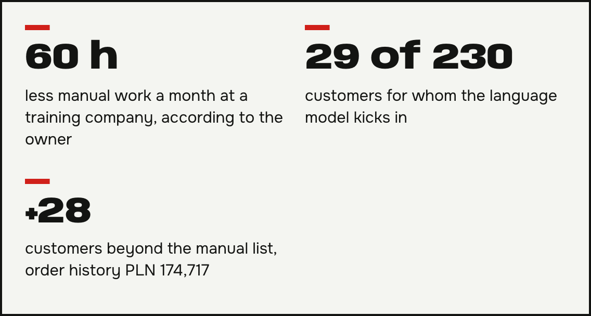

**Business process automation** is still an advantage in Poland, not the norm. According to Statistics Poland (GUS), 8.7% of Polish companies used artificial intelligence, or AI, in 2025. I explain how to pick your first process to automate and what results my clients saw, and if you want to check what to automate in your company, email me.

## How many companies use AI, and for what

GUS published its 2025 data on Dec. 8, 2025, and it covers companies with at least 10 employees. Of those, 8.7% use AI, most often to generate text or speech (5.3% of companies) and to analyze text (2.1%). The bigger the company, the more often it uses AI: according to the same GUS tables, 6.1% of small companies do. Among medium-sized companies the share is 15.6%, and among large ones, with 250 or more employees, it reaches 42%.

GUS also asks what companies use AI for. In the 2025 tables, 5% of all companies use it in marketing or sales, and 3.7% in office work, HR, and company management. AI helps 2.6% of companies in finance and accounting.

Eurostat, the statistical office of the European Union, reports 8.36% for Poland and 19.95% for the whole EU for 2025. Both figures cover companies with at least 10 employees. In this comparison, Poland has one of the three lowest results in the EU, along with Romania and Bulgaria.

*Companies with at least 10 employees. Source: Eurostat, 2025 data.*

## Why companies put off adopting AI

On Sept. 24, 2025, the Polish Economic Institute (PIE) reported that 77% of companies that don't use AI don't plan to adopt it until they have to. According to PIE, one in five of those companies named costs that are too high as the main obstacle.

Eurostat asks companies that considered AI but don't use it why. They most often point to a lack of expertise on the team (70.89%), unclear legal consequences (52.52%), and data protection concerns (48.83%). The least common answer is that AI wouldn't be useful for the company (20.68%).

## How to start business process automation

Start with one task that someone in your company repeats every week by the same rules. Ask yourself three questions about it:

1. How many hours a month does the task take the person who does it by hand today?
2. Is the input always in the same place, for example in email or a form?
3. What happens when the system makes a mistake, and who in the company will notice?

The third question matters most, because where a mistake is costly, I leave the decision to a person.

Once you know the answers, I build the automation in three steps. First I check how the task looks today, then I add a simple automation in n8n or Make.com. These are programs that connect the apps a company uses and pass data between them by set rules. I add AI only where documents have to be read or text understood, and a mistake that costs money stays with a person.

Both programs show an automation as a diagram on screen, not as code. Make.com says on its home page “No coding required.” The makers of n8n describe a visual builder on n8n.io in which anyone can follow how a process runs.

*Three questions to ask before your first automation.*

## How to calculate the gain from automation

I calculate the gain from automation with simple math based on working time. I check how long one task takes a person and multiply that time by the number of such tasks per week or per month. Then I calculate the same for the automation, and the difference shows how much time the team gets back. That's why the first of the three questions is about hours: without that number, there's nothing to compare.

## Results for my clients

For a training company, I built an app for sign-ups and schedules for 12 trainers. According to the owner, the company now does 60 hours less manual work a month.

For a company that collected data from municipal grant applications, a process downloads documents every day and saves the data in one database. I describe it in the post on [automated document reading with AI](/en/posts/automatyczny-odczyt-dokumentow/).

A maker of furniture for restaurants got a process that segments 230 customers by time since their last order. The language model, an AI that reads and writes text, kicks in for only 29 of them. The segmentation found 28 customers beyond the owner's manual list, with an order history worth PLN 174,717.

*Results of the projects described in this section.*

## Frequently asked questions about business process automation

### What size of company does automation make sense for?
Any company where someone does the same task by hand every week. Company size isn't a requirement.

### How long does the first project take?
It depends on the process. In one project, the client was running campaigns on their own after a month. I give a timeline for your process after we talk through the details.

### Does business process automation require a developer?
No. I run the project from process analysis to handing it over to your team, and the workflows include error handling and retries.

### Is AI right for every task?
No. I add AI where documents have to be read or text understood, while n8n or Make.com handle simple data transfers.

### How many companies in Poland use AI?
According to GUS, it was 8.7% of companies with at least 10 employees in 2025. Eurostat reports 8.36% for Poland compared with 19.95% for the whole EU.

### Will AI replace my employees?
In the projects described here, decisions stay with people. For example, the owner approves every message to a customer before it goes out.

### How do I start the conversation?
With one sentence: “What do we do by hand every week?” I describe what AI and automation can take over in a business on the [AI automation for business](/en/services/ai-automation/) page.

**Email me: office@robert-debicki.pl** and send that one sentence about the task you do by hand every week.
