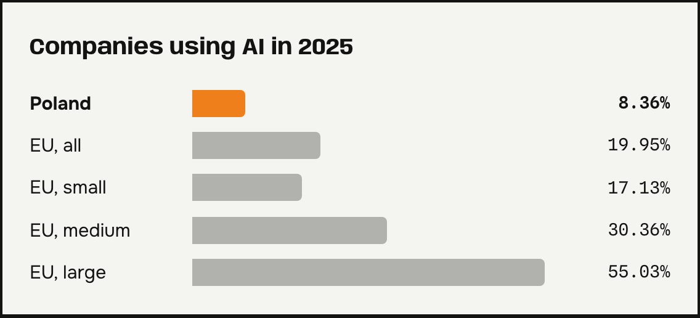
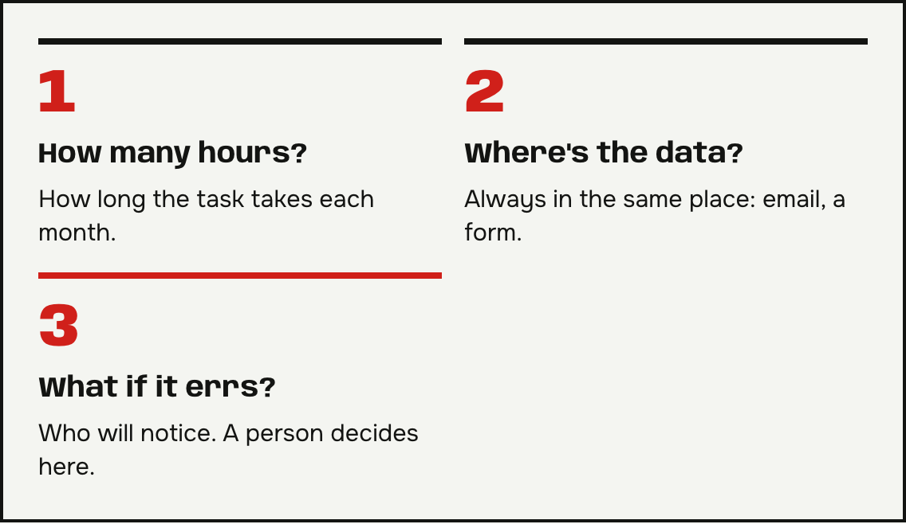
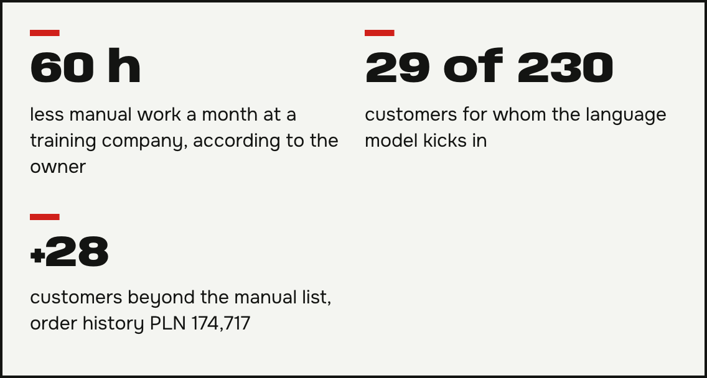

**Business process automation** is still an advantage, not the norm. According to Statistics Poland (GUS), 8.7% of Polish companies used artificial intelligence in 2025. I explain how to pick your first process to automate and what results my clients saw. Want to check what to automate in your company? Email me.

## How many companies use AI, and for what

GUS data for 2025 shows that 8.7% of companies in Poland use AI. Among the uses, GUS lists generating text or speech (5.3% of companies) and text analysis (2.1%). Eurostat reports 8.36% for Poland and 19.95% for the whole EU, for companies with more than 10 employees.

A PIE report adds that 77% of companies don't want to adopt AI until they have to. The site podatki.biz describes these [figures on AI in Polish companies](https://www.podatki.biz/artykuly/rosnie-wykorzystanie-ai-w-firmach-jednak-wolniej-niz-oczekiwano_16_61140.htm).

*Companies with more than 10 employees. Source: Eurostat via podatki.biz.*

## How to start business process automation

Start with one task that someone in your company repeats every week by the same rules. Ask three questions:

1. How many hours a month does the task take?
2. Is the input always in the same place, for example in email or a form?
3. What happens when the system makes a mistake, and who will notice?

The third question matters most. Where a mistake is costly, I leave the decision to a person.

## Results of business process automation

For a training company, I built an app for sign-ups and schedules for 12 trainers. According to the owner, the company now does 60 hours less manual work a month.

For a company that collected data from municipal grant applications, a process downloads documents every day and saves the data in one database. I describe it in the post on [automated document reading with AI](/en/posts/automatyczny-odczyt-dokumentow/).

A maker of furniture for restaurants got a process that segments 230 customers by time since their last order. The language model kicks in for only 29 of them. The segmentation found 28 customers beyond the owner's manual list, with an order history worth PLN 174,717.

## Questions and answers

### What size of company does automation make sense for?
Any company where someone does the same task by hand every week. Company size isn't a requirement.

### How long does the first project take?
It depends on the process. In one project, the client was running campaigns on their own after a month. I give a timeline for your process after we talk through the details.

### Does business process automation require a developer?
No. I run the project from process analysis to handing it over to your team. The workflows include error handling and retries.

### Will AI replace my employees?
In the projects described here, decisions stay with people. For example, the owner approves every message to a customer before it goes out.

### How do I start the conversation?
With one sentence: “What do we do by hand every week?” Email it to me. I describe what AI and automation can take over in a business on the [AI automation for business](/en/services/ai-automation/) page.
