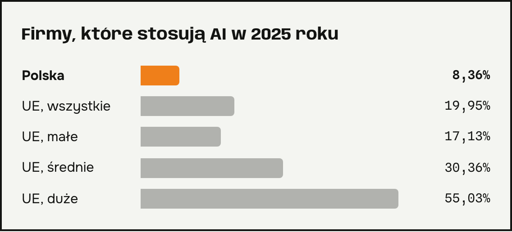
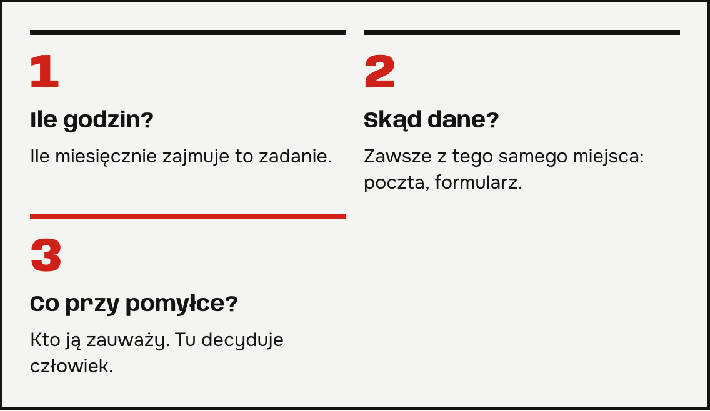
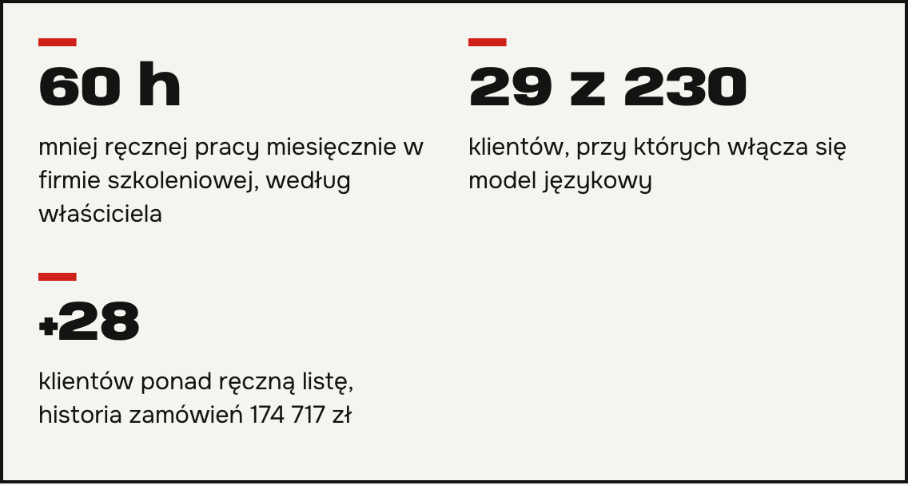

**Automatyzacja procesów w firmie** to nadal przewaga, nie standard. Według GUS w 2025 roku sztuczną inteligencję stosowało 8,7 procent polskich firm. Opisuję, jak wybrać pierwszy proces do zautomatyzowania i jakie efekty widzieli moi klienci. Chcesz sprawdzić, co zautomatyzować u siebie? Napisz do mnie.

## Ile firm używa AI i do czego

Z danych GUS za 2025 rok wynika, że 8,7 procent firm w Polsce stosuje AI. Wśród zastosowań GUS wymienia generowanie tekstu lub głosu (5,3 procent firm) oraz analizę tekstu (2,1 procent). Eurostat podaje dla Polski 8,36 procent, a dla całej Unii 19,95 procent firm zatrudniających ponad 10 osób.

Raport PIE dodaje, że 77 procent firm nie chce wdrażać AI, dopóki nie będzie to konieczne. Wyniki opisuje serwis [dane o AI w polskich firmach](https://www.podatki.biz/artykuly/rosnie-wykorzystanie-ai-w-firmach-jednak-wolniej-niz-oczekiwano_16_61140.htm).

*Firmy zatrudniające ponad 10 osób. Źródło: Eurostat za podatki.biz.*

## Jak zacząć automatyzację procesów w firmie

Zacznij od jednego zadania, które ktoś w Twojej firmie powtarza co tydzień według tych samych reguł. Zadaj trzy pytania:

1. Ile godzin miesięcznie zajmuje to zadanie?
2. Czy dane wejściowe są zawsze w tym samym miejscu, na przykład w poczcie albo formularzu?
3. Co się stanie, gdy system się pomyli, i kto to zauważy?

Trzecie pytanie jest najważniejsze. Tam, gdzie pomyłka kosztuje, zostawiam decyzję człowiekowi.

## Efekty automatyzacji procesów w firmie

W firmie szkoleniowej zbudowałem aplikację do zapisów i grafików dla 12 trenerek. Według właściciela firma ma o 60 godzin mniej ręcznej pracy miesięcznie.

W firmie, która zbierała dane z wniosków o dofinansowanie dla gmin, proces codziennie pobiera dokumenty i zapisuje dane w jednej bazie. Opisuję go we wpisie [automatyczny odczyt dokumentów przez AI](/wpisy/automatyczny-odczyt-dokumentow/).

Producent mebli dla gastronomii dostał proces, który dzieli 230 klientów według czasu od ostatniego zamówienia. Model językowy włącza się tylko przy 29 z nich. Segmentacja znalazła 28 klientów ponad ręczną listę właściciela, z historią zamówień wartą 174 717 zł.

## Pytania i odpowiedzi

### Od jakiej firmy ma sens automatyzacja?
Od takiej, w której ktoś co tydzień wykonuje to samo zadanie ręcznie. Wielkość firmy nie jest warunkiem.

### Ile trwa pierwsze wdrożenie?
Zależy od procesu. W jednym z projektów klient po miesiącu prowadził kampanie samodzielnie. Czas dla Twojego procesu podaję po rozmowie o szczegółach.

### Czy automatyzacja procesów w firmie wymaga programisty?
Nie. Prowadzę wdrożenie od analizy procesu do przekazania go zespołowi. Scenariusze mają obsługę błędów i ponawianie operacji.

### Czy AI zastąpi moich pracowników?
W opisanych wdrożeniach decyzje zostają u ludzi. Przykład: właściciel akceptuje każdą wiadomość do klienta przed wysyłką.

### Od czego zacząć rozmowę?
Od jednego zdania: „Co robimy ręcznie co tydzień?”. Napisz mi je w mailu.
