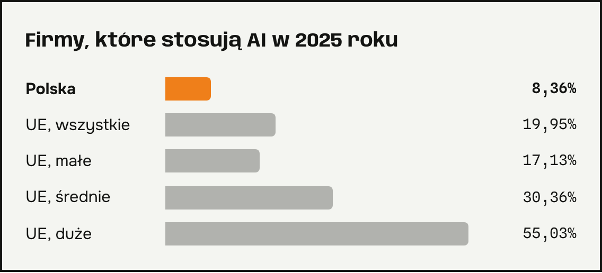
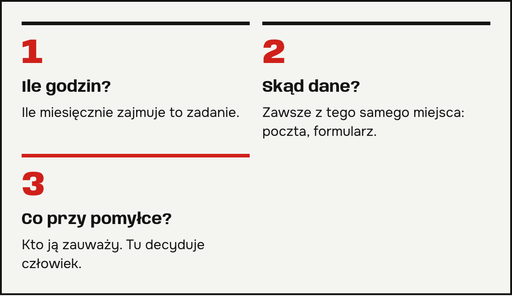
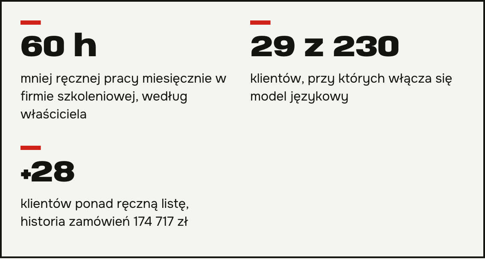

**Automatyzacja procesów w firmie** to w Polsce nadal przewaga, nie standard. Według Głównego Urzędu Statystycznego (GUS) w 2026 roku sztuczną inteligencję, czyli AI, stosuje 17,8 procent polskich firm, dwa razy więcej niż rok wcześniej. Opisuję, jak wybrać pierwszy proces do zautomatyzowania i jakie efekty widzieli moi klienci, a jeśli chcesz sprawdzić, co zautomatyzować u siebie, napisz do mnie.

## Ile firm używa AI i do czego

GUS opublikował dane za 2026 rok 21 października 2026 roku i liczy w nich firmy, które zatrudniają co najmniej 10 osób. AI stosuje 17,8 procent z nich, o 9,1 punktu procentowego więcej niż w 2025 roku, gdy było to 8,7 procent. Technologie, które tworzą obraz, dźwięk lub wideo, stosuje 9,9 procent firm, a te, które tworzą tekst lub głos, 9,7 procent. Im większa firma, tym częściej sięga po AI. W tablicach GUS za 2025 rok robiło to 6,1 procent małych firm, 15,6 procent średnich i aż 42 procent dużych, czyli od 250 pracowników.

GUS pyta też, do czego firmy używają AI. W 2026 roku najczęściej pracuje w marketingu i sprzedaży (11,1 procent firm), a 9,6 procent firm używa jej w pracy biurowej i przy decyzjach w zarządzaniu. Rok wcześniej było to 5 i 3,7 procent. W finansach i księgowości AI pomagała w 2025 roku 2,6 procent firm.

Eurostat, czyli urząd statystyczny Unii Europejskiej, podaje za 2025 rok 8,36 procent dla Polski i 19,95 procent dla całej Unii. Obie liczby dotyczą firm, które zatrudniają co najmniej 10 osób. W tym zestawieniu Polska ma jeden z trzech najniższych wyników w Unii, obok Rumunii i Bułgarii.

*Firmy zatrudniające co najmniej 10 osób. Źródło: Eurostat, dane za 2025 rok.*

## Dlaczego firmy odkładają wdrożenie AI

Polski Instytut Ekonomiczny (PIE) podał 24 września 2025 roku, że 77 procent firm, które nie stosują AI, nie planuje jej wdrożenia, dopóki nie będzie to konieczne. Według PIE co piąta z tych firm jako główną przeszkodę wskazała zbyt wysokie koszty.

Eurostat pyta o powody firmy, które rozważały AI, ale z niej nie korzystają. Najczęściej wskazują brak wiedzy w zespole (70,89 procent), niejasne skutki prawne (52,52 procent) i obawy o ochronę danych (48,83 procent). Najrzadziej pada odpowiedź, że AI nie przyda się w firmie (20,68 procent).

## Jak zacząć automatyzację procesów w firmie

Zacznij od jednego zadania, które ktoś w Twojej firmie powtarza co tydzień według tych samych reguł. Zadaj sobie przy nim trzy pytania:

1. Ile godzin miesięcznie zajmuje to zadanie osobie, która robi je dziś ręcznie?
2. Czy dane wejściowe są zawsze w tym samym miejscu, na przykład w poczcie albo w formularzu?
3. Co się stanie, gdy system się pomyli, i kto w firmie to zauważy?

Trzecie pytanie jest najważniejsze, bo tam, gdzie pomyłka kosztuje, zostawiam decyzję człowiekowi.

Gdy znasz odpowiedzi, buduję automatyzację w trzech krokach. Najpierw sprawdzam, jak zadanie wygląda dziś, a potem dokładam prosty automat w n8n albo Make.com. To programy, które łączą aplikacje używane w firmie i przekazują między nimi dane według ustalonych reguł. AI dodaję dopiero tam, gdzie trzeba czytać dokumenty albo rozumieć tekst, a pomyłka, która kosztuje, zostaje w rękach człowieka.

Oba programy pokazują automatyzację jako schemat na ekranie, a nie jako kod. Make.com pisze na swojej stronie głównej „No coding required”, czyli bez potrzeby programowania. Twórcy n8n opisują na stronie n8n.io edytor wizualny, w którym każdy może prześledzić przebieg procesu.

*Trzy pytania do zadania przed pierwszą automatyzacją.*

## Jak policzyć zysk z automatyzacji

Zysk z automatyzacji liczę prostym rachunkiem na czasie pracy. Sprawdzam, ile trwa człowiekowi jedna czynność, i mnożę ten czas przez liczbę takich czynności w tygodniu albo w miesiącu. Potem liczę to samo dla automatyzacji, a różnica pokazuje, ile czasu zespół odzyskuje. Dlatego pierwsze z trzech pytań dotyczy godzin, bo bez tej liczby nie ma czego porównać.

## Efekty wdrożeń u moich klientów

W firmie szkoleniowej zbudowałem aplikację do zapisów i grafików dla 12 trenerek. Według właściciela firma ma o 60 godzin mniej ręcznej pracy miesięcznie.

W firmie, która zbierała dane z wniosków o dofinansowanie dla gmin, proces codziennie pobiera dokumenty i zapisuje dane w jednej bazie. Opisuję go we wpisie [automatyczny odczyt dokumentów przez AI](/wpisy/automatyczny-odczyt-dokumentow/).

Producent mebli dla gastronomii dostał proces, który dzieli 230 klientów według czasu od ostatniego zamówienia. Model językowy, czyli AI, która czyta i pisze tekst, włącza się tylko przy 29 z nich. Segmentacja znalazła 28 klientów ponad ręczną listę właściciela, z historią zamówień wartą 174 717 zł.

*Efekty wdrożeń opisanych w tej sekcji.*

## Najczęstsze pytania o automatyzację procesów w firmie

### Od jakiej firmy ma sens automatyzacja?
Od takiej, w której ktoś co tydzień wykonuje to samo zadanie ręcznie. Wielkość firmy nie jest warunkiem.

### Ile trwa pierwsze wdrożenie?
Zależy od procesu. W jednym z projektów klient po miesiącu prowadził kampanie samodzielnie. Czas dla Twojego procesu podaję po rozmowie o szczegółach.

### Czy automatyzacja procesów w firmie wymaga programisty?
Nie. Prowadzę wdrożenie od analizy procesu do przekazania go zespołowi, a scenariusze mają obsługę błędów i ponawianie operacji.

### Czy AI nadaje się do każdego zadania?
Nie. AI dodaję tam, gdzie trzeba czytać dokumenty albo rozumieć tekst, a proste przekazywanie danych robią n8n albo Make.com.

### Ile firm w Polsce stosuje AI?
Według GUS w 2026 roku jest to 17,8 procent firm zatrudniających co najmniej 10 osób, dwa razy więcej niż rok wcześniej (8,7 procent). Eurostat podaje za 2025 rok 8,36 procent dla Polski wobec 19,95 procent w całej Unii.

### Czy AI zastąpi moich pracowników?
W opisanych wdrożeniach decyzje zostają u ludzi. Przykład: właściciel akceptuje każdą wiadomość do klienta przed wysyłką.

### Od czego zacząć rozmowę?
Od jednego zdania: „Co robimy ręcznie co tydzień?”. Co AI i automatyzacja mogą przejąć w firmie, opisuję na stronie [wdrożenie AI w firmie](/uslugi/ai-i-automatyzacja/).

**Napisz do mnie: office@robert-debicki.pl** i wyślij to jedno zdanie o zadaniu, które robicie ręcznie co tydzień.
