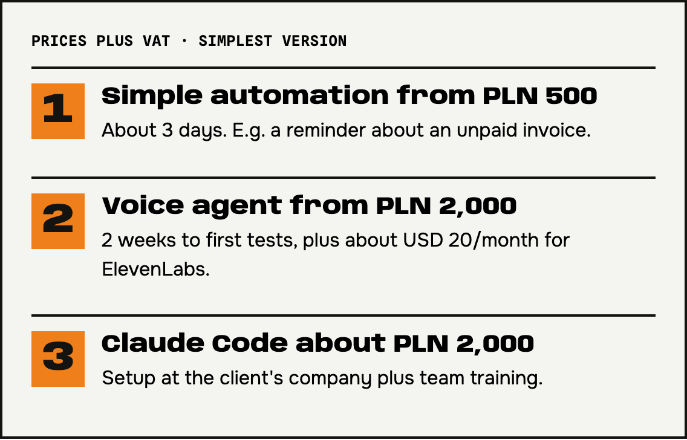
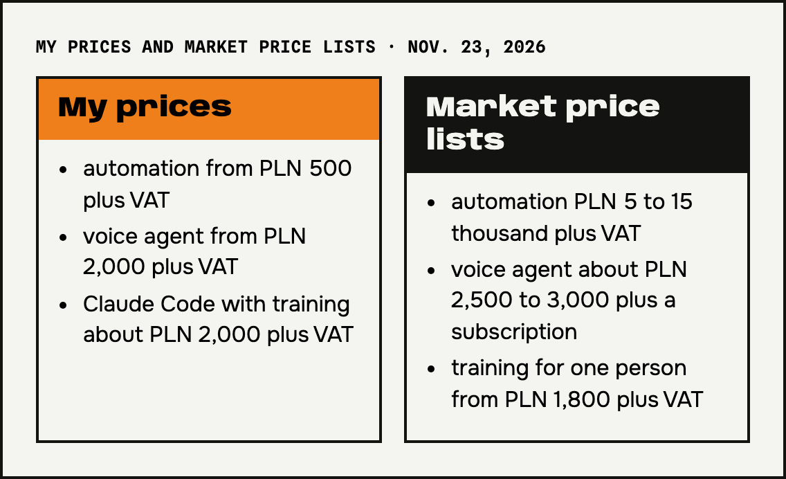

**How much AI implementation costs** is the question I hear from small business owners before we even talk about their process. I answer with numbers from my own projects: a simple automation starts at PLN 500 plus VAT, and a voice agent starts at PLN 2,000 plus VAT. See what the price depends on and which costs remain after launch, then email me about what you want to automate.

## AI implementation cost in my projects

I give amounts plus VAT for the simplest version of each service. I quote a larger scope separately, after we talk about how work happens in your company today and which software you use.

- **Simple automation: from PLN 500 plus VAT, about 3 days.** For example, a reminder to a client about an unpaid invoice or a morning list of today's tasks.
- **Voice agent: from PLN 2,000 plus VAT, 2 weeks to the first tests at the client's company.** The simplest bot calls the person who filled out the form, asks questions, and saves a note in the CRM.
- **Claude Code setup with team training: about PLN 2,000 plus VAT.** I set up the tool at the client's company and teach the team how to work with it day to day.

*Amounts plus VAT for the simplest version of each service, as of November 2026.*

## What raises the cost of AI implementation

The price goes up with the number of steps in the process and the number of systems that have to be connected. For a voice agent, that means more call scenarios and integrations, for example with a CRM or a calendar. For an automation, what matters is whether a simple rule is enough or you need an AI agent that reads documents and passes cases on by itself.

An example from a grant application workflow: the process pulls documents from email and SharePoint, reads them with OCR and a language model, and saves amounts and deadlines in Airtable. When a reading is uncertain, the system asks a designated person to confirm. I quote a project like this by scope, not from a price list.

Before I pick a tool, I check how the work looks today. Often it's enough to lay out the process properly and build a simple automation, and I add AI where it really saves work. I split a large, complex project into smaller stages and spread the amount across them. I describe how I work on these projects on the [AI and process automation](/en/services/ai-automation/) page.

## Costs that remain after launch

Some tools cost money every month, and those fees go to the client's accounts, not mine. For a voice agent, that's about USD 20 a month for ElevenLabs, depending on the number of calls. The client tops up the phone number account themselves when they get a low-balance notification. I write more about the bot itself on the [AI voice agents](/en/services/ai-voice-agents/) page.

I run complex automations that have to work all the time in n8n on a self-hosted server. It comes out cheaper than a Make subscription, where you pay for every operation in a scenario.

*Market price lists from implementation firms' websites, checked on Nov. 23, 2026.*

## My prices compared with the market

On Nov. 23, 2026, I checked the price lists that Google shows in AI answers to questions about cost. Implementation firms usually list a single automation at PLN 5 to 15 thousand plus VAT, and AI implementation with integrations from PLN 8,000 up. For a voice agent, starter packages cost about PLN 2,500 to 3,000 for setup, plus PLN 299 to 1,500 a month for maintenance. Claude Code training for one person starts at PLN 1,800 plus VAT in these price lists.

Compare the scope, not just the amount. I give the price of the simplest version, and I quote a larger project separately, after we talk about your process and the software you use.

## Frequently asked questions about AI implementation cost

### How much does an AI agent cost?
I quote it by scope, because the agent gets access to email, documents, and the company database through n8n or Make.com. I split a large project into stages and spread the amount across them.

### Are your prices net or gross?
Net. VAT is added to every amount in this post.

### How long does implementation take?
A simple automation runs after about 3 days. A voice agent goes through its first tests at the client's company after 2 weeks.

### Do I pay every month after implementation?
It depends on the tool. For a voice agent, you pay about USD 20 for ElevenLabs plus phone number top-ups, and n8n on a self-hosted server costs as much as that server.

### How much does Claude Code training cost?
About PLN 2,000 plus VAT, together with setup at the client's company. I set up the tool and train the team to work with it.

### Do I have to pay for a large project up front?
No. I split a large, complex project into smaller stages and spread the amount across them.

**Email me: office@robert-debicki.pl** and describe the process that takes your team the most time, and I'll reply with a quote.
