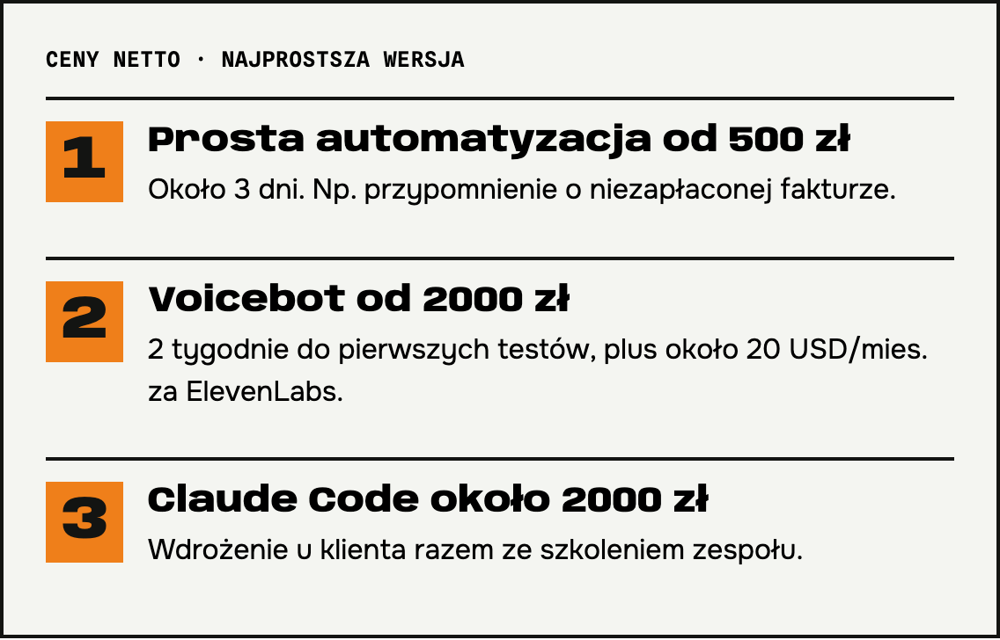
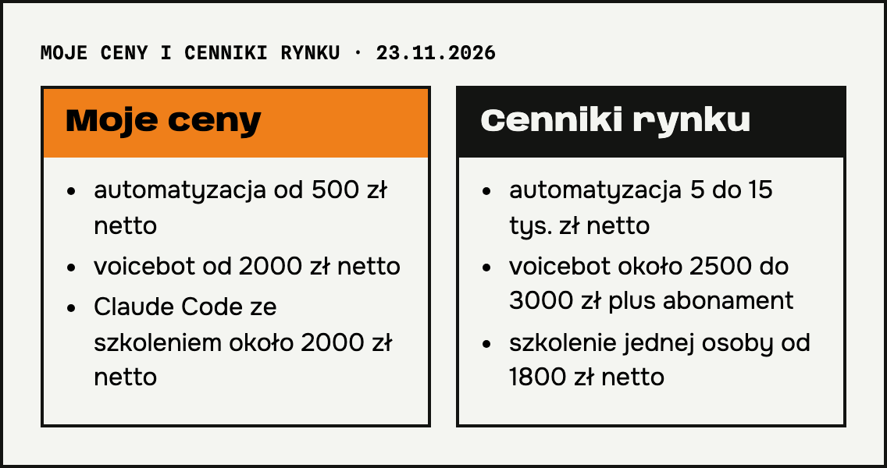

**Ile kosztuje wdrożenie AI** to pytanie, które słyszę od właścicieli małych firm jeszcze przed pierwszą rozmową o procesie. Odpowiadam kwotami z moich wdrożeń: prosta automatyzacja zaczyna się od 500 zł netto, a voicebot od 2000 zł netto. Sprawdź, od czego zależy cena i jakie koszty zostają po uruchomieniu, a potem napisz do mnie, co chcesz zautomatyzować.

## Ile kosztuje wdrożenie AI w moich projektach

Podaję kwoty netto, czyli bez VAT, za najprostszą wersję każdej usługi. Większy zakres wyceniam osobno, po rozmowie o tym, jak dziś wygląda praca w Twojej firmie i z jakich programów korzystasz.

- **Prosta automatyzacja: od 500 zł netto, około 3 dni.** Na przykład przypomnienie klientowi o niezapłaconej fakturze albo poranna lista zadań na dziś.
- **Voicebot: od 2000 zł netto, 2 tygodnie do pierwszych testów u klienta.** Najprostszy bot dzwoni do osoby z formularza, zadaje pytania i zapisuje notatkę w CRM.
- **Wdrożenie Claude Code ze szkoleniem zespołu: około 2000 zł netto.** Wdrażam narzędzie u klienta i uczę zespół, jak z nim pracować na co dzień.

*Kwoty netto za najprostszą wersję każdej usługi, stan na listopad 2026.*

## Co podnosi koszt wdrożenia AI

Cena rośnie z liczbą kroków w procesie i liczbą systemów, które trzeba ze sobą połączyć. Przy voicebocie są to kolejne scenariusze rozmów i integracje, na przykład z CRM albo kalendarzem. Przy automatyzacji liczy się to, czy wystarczy prosta reguła, czy potrzebny jest agent AI, który czyta dokumenty i sam przekazuje sprawy dalej.

Przykład z obiegu wniosków o dofinansowanie: proces pobiera dokumenty z poczty i SharePointa, odczytuje je przez OCR z modelem językowym i zapisuje kwoty oraz terminy w Airtable. Gdy odczyt jest niepewny, system prosi wskazaną osobę o potwierdzenie. Takie wdrożenie wyceniam po zakresie, a nie z cennika.

Zanim dobiorę narzędzie, sprawdzam, jak praca wygląda dziś. Często wystarczy dobrze ułożyć proces i zbudować prostą automatyzację, a AI dokładam tam, gdzie naprawdę oszczędza pracę. Duży i złożony projekt dzielę na mniejsze etapy, a kwotę rozkładam na części. Jak pracuję przy takich wdrożeniach, opisuję na stronie [AI i automatyzacja procesów](/uslugi/ai-i-automatyzacja/).

## Koszty, które zostają po uruchomieniu

Część narzędzi kosztuje co miesiąc, a te opłaty idą na konta klienta, nie na moje. Przy voicebocie to około 20 dolarów miesięcznie za ElevenLabs, zależnie od liczby rozmów. Konto z numerem telefonu klient doładowuje sam, gdy dostanie powiadomienie o końcu środków. Więcej o samym bocie piszę na stronie [voiceboty dla firm](/uslugi/voiceboty/).

Rozbudowane automatyzacje, które muszą działać cały czas, stawiam w n8n na własnym serwerze. Wychodzi to taniej niż subskrypcja Make, w której płacisz za każdą operację w scenariuszu.

*Cenniki rynku według stron firm wdrożeniowych, sprawdzone 23 listopada 2026.*

## Moje ceny na tle cenników rynku

Sprawdziłem 23 listopada 2026 cenniki, które Google pokazuje w odpowiedziach AI na pytania o koszt. Firmy wdrożeniowe podają za pojedynczą automatyzację zwykle od 5 do 15 tys. zł netto, a za wdrożenie AI z integracjami od 8000 zł wzwyż. Za voicebota pakiety startowe kosztują około 2500 do 3000 zł za wdrożenie, a do tego od 299 do 1500 zł miesięcznie za utrzymanie. Szkolenie z Claude Code dla jednej osoby zaczyna się w cennikach od 1800 zł netto.

Porównuj zakres, a nie samą kwotę. Ja podaję cenę najprostszej wersji, a większy projekt wyceniam osobno, po rozmowie o Twoim procesie i programach, z których korzystasz.

## Najczęstsze pytania o to, ile kosztuje wdrożenie AI

### Ile kosztuje agent AI?
Wyceniam go po zakresie, bo agent dostaje dostęp do poczty, dokumentów i bazy firmy przez n8n albo Make.com. Duży projekt dzielę na etapy, a kwotę rozkładam na części.

### Czy podajesz ceny netto czy brutto?
Netto. Do każdej kwoty z tego wpisu dochodzi VAT.

### Ile trwa wdrożenie?
Prosta automatyzacja działa po około 3 dniach. Voicebot przechodzi pierwsze testy u klienta po 2 tygodniach.

### Czy po wdrożeniu płacę co miesiąc?
Zależy od narzędzia. Przy voicebocie płacisz około 20 dolarów za ElevenLabs i doładowania numeru, a n8n na własnym serwerze kosztuje tyle, co ten serwer.

### Ile kosztuje szkolenie z Claude Code?
Około 2000 zł netto razem z wdrożeniem u klienta. Wdrażam narzędzie i szkolę zespół z pracy z nim.

### Czy duży projekt muszę opłacić od razu?
Nie. Duży i złożony projekt dzielę na mniejsze etapy, a kwotę rozkładam na części.

**Napisz do mnie: office@robert-debicki.pl** i opisz proces, który zabiera zespołowi najwięcej czasu, a odpowiem z wyceną.
