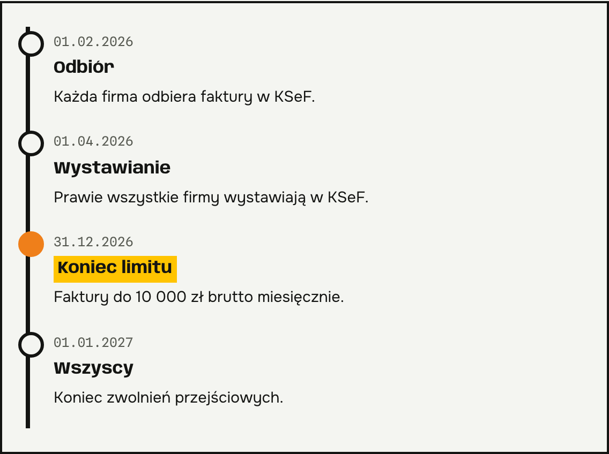
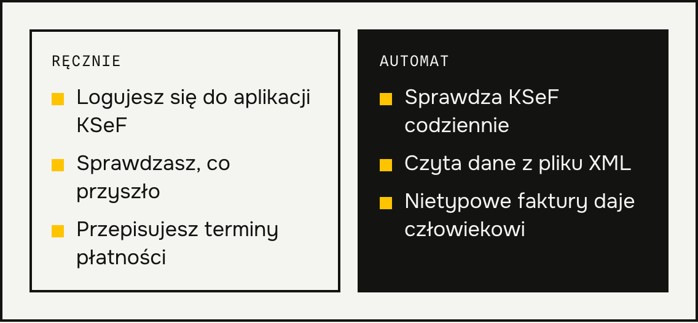
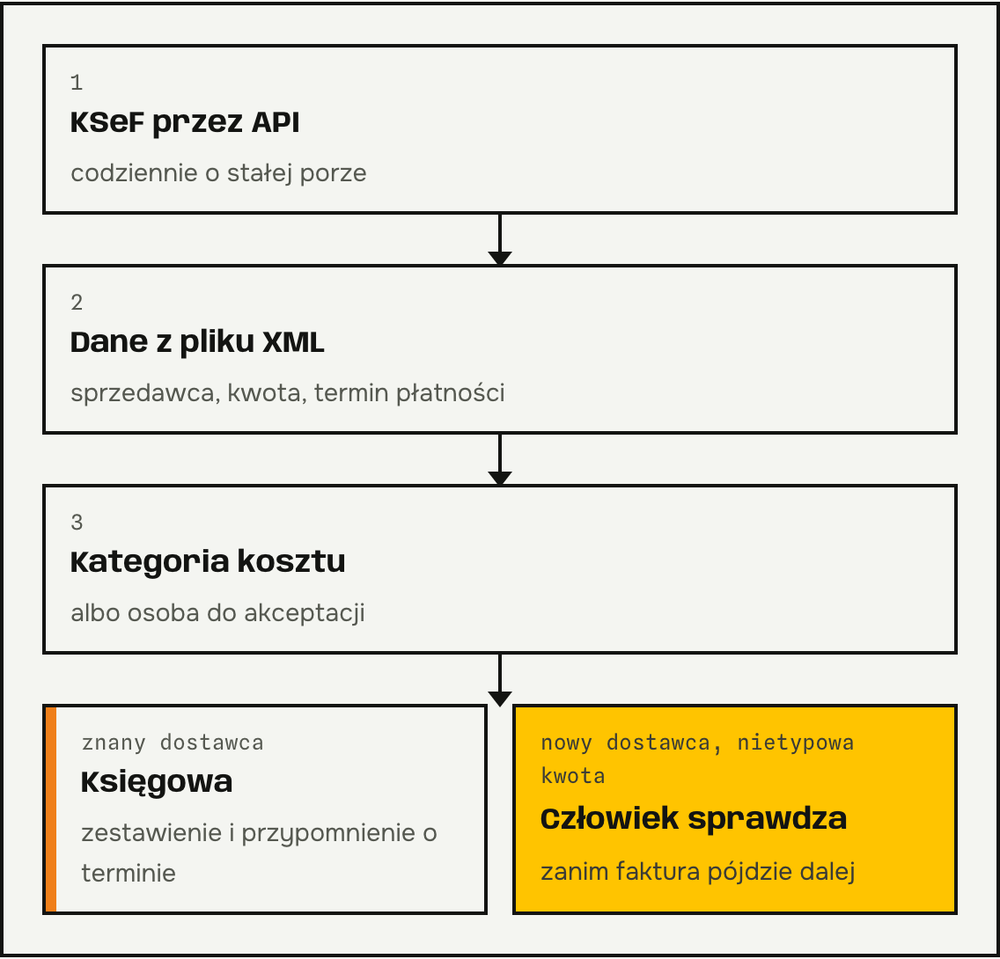

**Purchase invoices from KSeF** have been arriving since Feb. 1, 2026, and the system will not notify you when one comes in. I show my automation, which pulls purchase invoices on its own, and a design for companies that want to pull them straight from KSeF. Write to me if you want this set up in your company.

## What KSeF changes in 2026 and 2027

Since Feb. 1, 2026, every company receives invoices through KSeF, regardless of its size. On the same day, issuing invoices through KSeF became mandatory for companies whose sales in 2024 exceeded PLN 200 million. Since April 1, 2026, all other taxpayers issue invoices through KSeF.

Companies whose invoices covered by KSeF do not exceed PLN 10,000 gross per month can issue invoices outside KSeF only until Dec. 31, 2026. Invoices to consumers are not counted toward this limit.

A KSeF invoice is an XML file in a uniform format. Before that, an invoice was usually a sheet of paper or a PDF sent to the client by email.

*Source: KSeF 2.0, questions and answers, Ministry of Finance.*

## Why you have to pull purchase invoices from KSeF yourself

The Ministry of Finance states it plainly: “KSeF does not send notifications.” So your accounting software or app has to check regularly for new invoices. An invoice counts as received on the day its KSeF number is assigned, not on the day someone looks at the system.

You can review received invoices in the free KSeF 2.0 Taxpayer App or in the Ministry of Finance mobile app. The rules are explained on the [KSeF 2.0 questions and answers](https://ksef.podatki.gov.pl/pytania-i-odpowiedzi-ksef-20/) page.

An accounting firm can pull invoices for you if you grant it access to invoices in KSeF. The Ministry's KSeF 2.0 handbook also suggests deciding who in the company approves and checks purchase invoices.

*An example comparing manual work with an automation, not a screenshot from a client's system.*

## How automatic pulling of purchase invoices from KSeF works

I built an automation that pulls purchase invoices from Fakturownia, an invoicing program, at the end of each month. The same invoices are in KSeF, but this automation does not connect to KSeF directly.

I set up an automation that connects to KSeF through the API in about a week from the moment I receive the token. I am describing a project here, not a client deployment. This is how such an automation could work:

1. Every day at a set time, it pulls new purchase invoices from KSeF through the API.
2. It reads the seller, the amount, and the payment due date from the XML file.
3. It assigns the invoice to a cost category or to the person who approves it.
4. It sends the accountant a summary and reminds about payment deadlines.
5. An invoice from a new supplier or with an unusual amount goes to a person for review.

An invoice in KSeF has a fixed structure, FA(3), so the data does not have to be read from a scan. Scans and PDFs are a different case, which I describe in the post on how [automatic document reading](/en/posts/automated-document-reading/) works.

*A project design, not a screenshot from a client's system. The details depend on the accounting software.*

## What you need to connect to the KSeF API

The Ministry of Finance provides the KSeF 2.0 API, through which a program can pull invoices. According to the Ministry's KSeF 2.0 handbook, such a program can log in to the system with a token. A token is a string of characters generated in KSeF and tied to your permissions.

You generate the token in the KSeF Taxpayer App or in a program integrated with KSeF, after logging in with the National Node (Węzeł Krajowy), a qualified signature, or a qualified seal. The app shows the token only once, so save it right away. To pull invoices, the token needs the permission to access invoices, which covers both sales and purchase invoices.

KSeF does not set how long a token is valid, and the system does not invalidate it on its own. However, once you revoke all the permissions stored in the token, you can no longer log in to KSeF with it. Originally, tokens were supposed to work only until Dec. 31, 2026, but the Ministry decided that this login method will remain available for an indefinite period.

Do not share the token with other people, because according to the handbook it is safe only as long as no outsiders know it. The number of tokens is not limited, so an automation that uses the KSeF API can have its own token.

## Frequently asked questions about purchase invoices from KSeF

### Will KSeF email me about a new invoice?
No. According to the Ministry of Finance, KSeF does not send notifications. Your software or automation has to check for new invoices.

### Do I have to buy a program to receive invoices?
No. The Ministry of Finance provides the free KSeF 2.0 Taxpayer App and a mobile app. An automation is useful when you do not want to check them by hand every day.

### Does a small company with sales up to PLN 10,000 also receive invoices in KSeF?
Yes. The obligation to receive invoices applies from Feb. 1, 2026, regardless of company size. The PLN 10,000 limit applies only to issuing invoices until Dec. 31, 2026.

### How long does it take to set up an automation for purchase invoices from KSeF?
About a week from the moment I receive the token for the KSeF API.

### Will an automation replace the accountant?
No. The automation from the project pulls invoices, organizes the data, and reminds about deadlines. Bookkeeping stays with the accountant.

### How much does an automation for purchase invoices from KSeF cost?
The price depends on the number of invoices, programs, and people involved. Tell me how many purchase invoices you receive per month, and I will give you a quote. I build such processes as part of the [AI and process automation](/en/services/ai-automation/) service.

**Write to me: office@robert-debicki.pl** and describe where you get your purchase invoices today, and I will reply with how to download them automatically.
