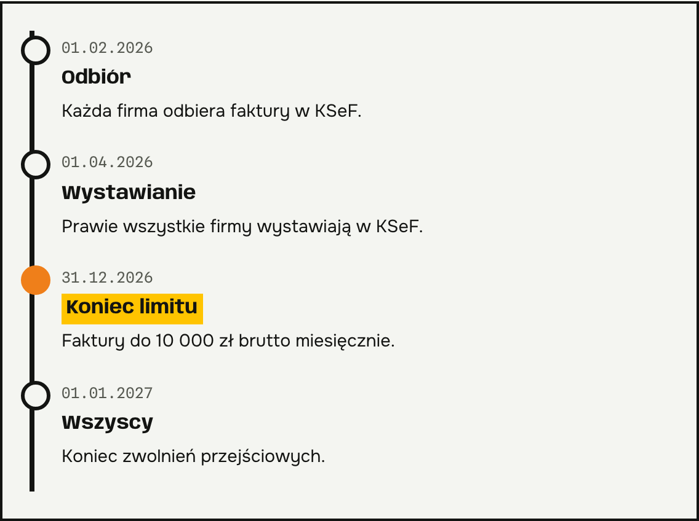
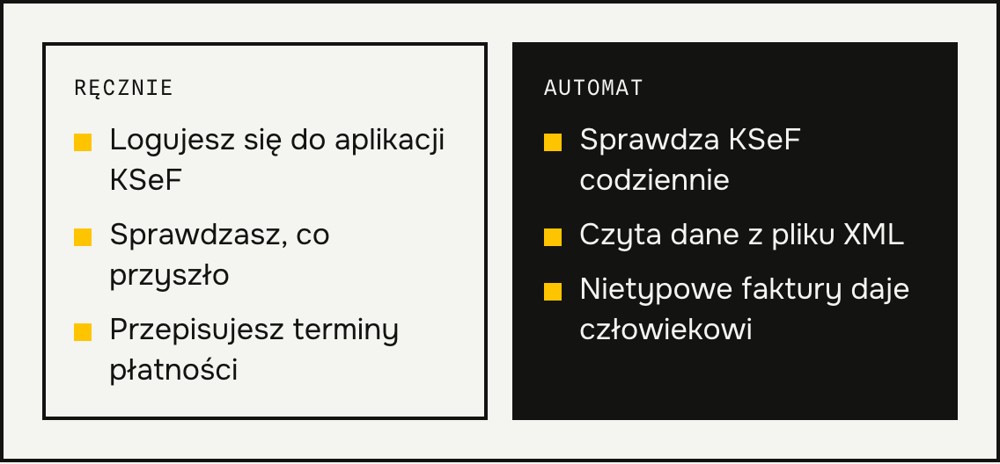
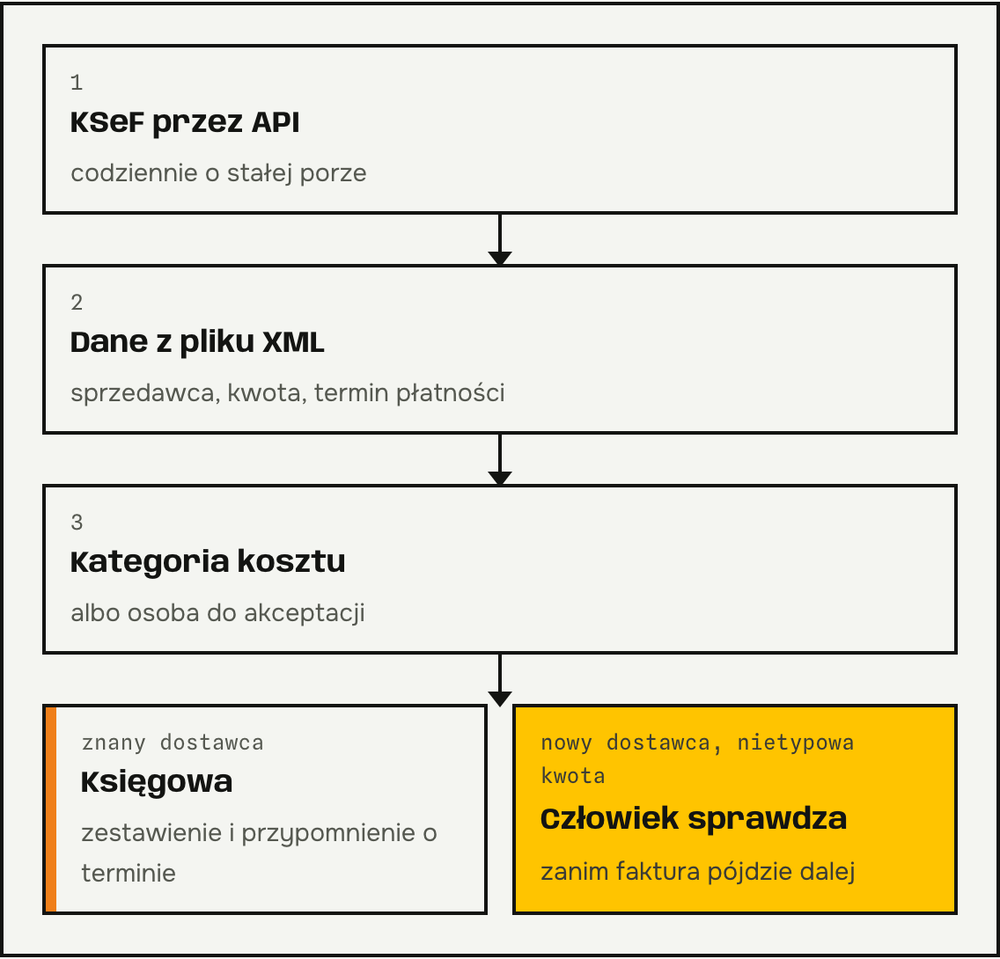

**Faktury kosztowe z KSeF** odbierasz od 1 lutego 2026, a system nie powiadomi Cię, że coś przyszło. Pokazuję mój automat, który sam pobiera faktury kosztowe, i projekt dla firm, które chcą pobierać je prosto z KSeF. Napisz do mnie, jeśli chcesz to ustawić w swojej firmie.

## Co zmienia KSeF w 2026 i 2027

Od 1 lutego 2026 każda firma odbiera faktury w KSeF, bez względu na wielkość. Tego samego dnia wystawianie faktur w KSeF objęło firmy, których sprzedaż w 2024 roku przekroczyła 200 mln zł. Od 1 kwietnia 2026 faktury w KSeF wystawiają pozostali podatnicy.

Firmy, których faktury objęte KSeF nie przekraczają łącznie 10 000 zł brutto w miesiącu, mogą wystawiać faktury poza KSeF tylko do 31 grudnia 2026. Faktur dla konsumentów nie wlicza się do tego limitu.

Faktura w KSeF to plik XML o jednolitym wzorze, a wcześniej była nią zwykle kartka papieru albo plik PDF wysłany kontrahentowi mailem.

*Źródło: KSeF 2.0, pytania i odpowiedzi, Ministerstwo Finansów.*

## Dlaczego faktury kosztowe z KSeF trzeba pobierać samemu

Ministerstwo Finansów pisze wprost: „KSeF nie wysyła powiadomień”, więc program księgowy albo aplikacja musi regularnie sprawdzać, czy pojawiły się nowe faktury. Fakturę uznaje się za otrzymaną w dniu nadania numeru KSeF, a nie w dniu, w którym ktoś zajrzał do systemu.

Otrzymane faktury możesz przeglądać w bezpłatnej Aplikacji Podatnika KSeF 2.0 albo w aplikacji mobilnej Ministerstwa Finansów, a zasady opisuje strona [pytania i odpowiedzi KSeF 2.0](https://ksef.podatki.gov.pl/pytania-i-odpowiedzi-ksef-20/).

Biuro rachunkowe może pobierać faktury za Ciebie, jeśli nadasz mu w KSeF uprawnienie do dostępu do faktur. Ministerstwo radzi też w podręczniku KSeF 2.0 ustalić, kto w firmie akceptuje i sprawdza poprawność faktur zakupowych.

*Przykład porównania pracy ręcznej i automatu, nie zrzut z systemu klienta.*

## Jak działa automatyczne pobieranie faktur z KSeF

Zbudowałem automat, który na koniec miesiąca pobiera faktury kosztowe z Fakturowni, czyli programu do faktur. Te same faktury są w KSeF, ale ten automat nie łączy się z samym KSeF.

Automat połączony z KSeF po API wdrażam w około tydzień od chwili, gdy dostanę token. Opisuję projekt, a nie wdrożenie u klienta, czyli jak taki automat mógłby działać:

1. Codziennie o stałej porze pobiera przez API nowe faktury zakupowe z KSeF.
2. Odczytuje z pliku XML sprzedawcę, kwotę i termin płatności.
3. Przypisuje fakturę do kategorii kosztu albo do osoby, która ją akceptuje.
4. Wysyła księgowej zestawienie i przypomina o terminach płatności.
5. Fakturę od nowego dostawcy albo z nietypową kwotą kieruje do człowieka.

Faktura w KSeF ma ustaloną strukturę FA(3), więc danych nie trzeba odczytywać ze skanu. Przy skanach i plikach PDF jest inaczej, co opisuję we wpisie o tym, jak działa [automatyczny odczyt dokumentów](/wpisy/automatyczny-odczyt-dokumentow/).

*Projekt automatu, nie zrzut z systemu klienta, a szczegóły zależą od programu księgowego.*

## Czego potrzebujesz do połączenia z KSeF API

Ministerstwo Finansów udostępnia API KSeF 2.0, przez które program może pobierać faktury. Według podręcznika KSeF 2.0 Ministerstwa Finansów taki program może logować się do systemu tokenem. Wystarczy token, czyli ciąg znaków wygenerowany w KSeF i przypisany do Twoich uprawnień.

Token generujesz w Aplikacji Podatnika KSeF albo w programie zintegrowanym z KSeF, po zalogowaniu się Węzłem krajowym, podpisem albo pieczęcią kwalifikowaną. Aplikacja pokazuje go tylko raz, więc od razu go zapisz. Do pobierania faktur token potrzebuje uprawnienia do dostępu do faktur, które obejmuje faktury sprzedażowe i zakupowe.

KSeF nie określa, jak długo token jest ważny, a system nie unieważnia go sam. Gdy jednak odbierzesz wszystkie uprawnienia zapisane w tokenie, nie zalogujesz się nim do KSeF. Pierwotnie tokeny miały działać tylko do 31 grudnia 2026, ale Ministerstwo zdecydowało, że ta metoda logowania zostaje na czas nieokreślony.

Tokenu nie przekazuj innym osobom, bo według podręcznika jest bezpieczny tylko wtedy, gdy nie znają go osoby postronne. Liczba tokenów nie jest ograniczona, więc automat do KSeF API może mieć własny token.

## Najczęstsze pytania o faktury kosztowe z KSeF

### Czy KSeF wyśle mi maila o nowej fakturze?
Nie, według Ministerstwa Finansów KSeF nie wysyła powiadomień. Nowe faktury musi sprawdzać Twój program albo automat.

### Czy muszę kupić program, żeby odbierać faktury?
Nie, Ministerstwo Finansów udostępnia bezpłatną Aplikację Podatnika KSeF 2.0 i aplikację mobilną. Automat przydaje się wtedy, gdy nie chcesz codziennie sprawdzać ich ręcznie.

### Czy mała firma ze sprzedażą do 10 000 zł też odbiera faktury w KSeF?
Tak, obowiązek odbioru obowiązuje od 1 lutego 2026 bez względu na wielkość firmy. Limit 10 000 zł dotyczy tylko wystawiania faktur do 31 grudnia 2026.

### Ile trwa wdrożenie automatu do faktur zakupowych z KSeF?
Około tygodnia od chwili, gdy dostanę token do KSeF API.

### Czy automat zastąpi księgową?
Nie, automat z projektu pobiera faktury, porządkuje dane i przypomina o terminach, a księgowanie zostaje u księgowej.

### Ile kosztuje automat do faktur kosztowych z KSeF?
Cena zależy od liczby faktur, programów i osób w obiegu. Napisz, ile faktur kosztowych dostajesz w miesiącu, a podam wycenę. Takie procesy buduję w ramach usługi [wdrożenie AI i automatyzacja procesów](/uslugi/ai-i-automatyzacja/).

**Napisz do mnie: office@robert-debicki.pl** i opisz, skąd dziś bierzesz faktury kosztowe, a odpiszę, jak można je pobierać automatycznie.
