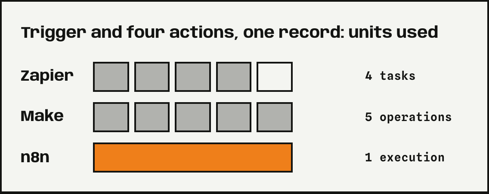
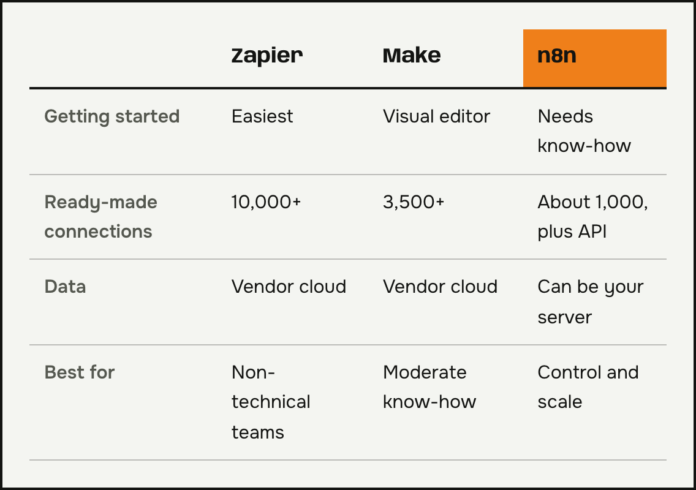
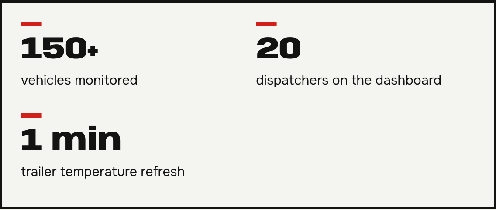

**n8n, Make, or Zapier** is a question I hear from business owners before their first automation. All three connect apps and do tasks for you. They differ in how they charge and how much technical knowledge they need. I explain what to look at before you choose. Not sure which tool fits your business? Email me.

## How n8n, Make, and Zapier differ

The biggest difference is how they bill. Zapier counts tasks, Make counts operations, and n8n counts workflow executions. Take a workflow with a trigger and four actions that handles one record. In Zapier, that's four tasks, because the trigger doesn't use tasks. In Make, that's five operations, because the trigger counts too. In n8n, that's one execution. With a few automations, the difference is small. With many, it grows.

Prices change often, so check the current pricing on the vendor's site before you decide. Digidop's [n8n, Make, and Zapier comparison](https://www.digidop.com/blog/n8n-vs-make-vs-zapier) covers the tools.

*Sources: Zapier and Make help centers, Digidop (n8n). Check current pricing.*

## n8n, Make, or Zapier: which fits which business

Comparisons describe Zapier as the easiest to use. It also has the most ready-made connections: its site lists more than 10,000 apps, and Make's lists more than 3,500. It fits when nobody in the company is technical and you need a quick start.

Make has a visual workflow editor where you can see what flows where. It's a middle ground for people with moderate technical knowledge.

n8n needs the most knowledge but gives you the most control. You can run it on your own server, so the data stays with you. That matters for client documents and the GDPR. Self-hosting does take setup and maintenance, though.

## Why I often choose n8n in my projects

For temperature monitoring in transportation, I moved the app logic to n8n on AWS so it wouldn't exceed workflow limits. The system watches more than 150 vehicles, and 20 dispatchers see readings that refresh every minute. I also use n8n for document reading and voice bots.

That's not a rule for everyone. For a simple automation for a small team, Zapier or Make is enough.

## Questions and answers

### Which tool is the cheapest?
It depends on the number of steps, records, and executions. Price one of your workflows using the current pricing of all three tools.

### Do I need to know how to code?
Not in Zapier or Make. In n8n, basic technical knowledge helps, especially on your own server.

### Can I switch tools later?
Yes, but you have to rebuild the workflows, because they don't transfer between tools. So choose deliberately.

### Where is my data stored?
In Zapier and Make, in the vendor's cloud. In n8n, you can choose your own server. Always check the data processing agreement.

### n8n, Make, or Zapier: which should I choose for my business?
Tell me what you want to automate and how many people will use it. I'll tell you which tool fits and why. I describe how I work on these projects on the [AI and process automation](/en/services/ai-automation/) page.
