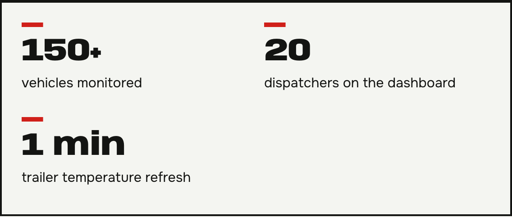

**n8n, Make, or Zapier** is a question I hear from business owners right before their first automation. All three tools connect apps and handle repetitive tasks for you, but they charge differently and need different levels of technical knowledge. I explain in plain language what to look at when you choose, and if you're still not sure what fits your business, email me.

## Workflow, integration, and API: three terms to start with

A workflow is a saved series of steps that the tool runs on its own, for example “when an order comes in, issue an invoice and send an email.” The first step is called the trigger, because it starts everything, and the steps after it are actions.

An integration is a built-in connection to a specific app, such as a spreadsheet, email, or an invoicing system. An API is the way apps exchange data with each other without a person in the loop, and integrations rely on it. When a tool has no integration with a given app, connecting through the API usually takes more technical knowledge.

## How n8n, Make, and Zapier differ

The biggest difference is how they bill: Zapier counts tasks, Make counts operations, and n8n counts workflow executions. Take a workflow with a trigger and four actions that handles one record, meaning one item of data, such as one order. In Zapier, that's four tasks, because the trigger doesn't use tasks, and in Make, that's five operations, because the trigger counts too. In n8n, the same workflow is one execution. With a few automations, the difference is small, but with many automations, it grows.

A subscription is a recurring fee for using a tool in the vendor's cloud, paid on a regular schedule. Prices change often, so check the current pricing on the vendor's site before you decide.

*Sources: Zapier and Make help centers, Digidop (n8n). Check current pricing.*

## n8n, Make, or Zapier: which fits which business

Comparisons describe Zapier as the easiest to use, and it also has the most integrations. Its site lists more than 10,000 apps, and Make's site lists more than 3,500. Zapier fits when nobody in the company is technical and you need a quick start.

Make has a visual workflow editor where you can see what flows where. On make.com, the vendor says you build automations visually, including by drag-and-drop, and that no coding is required (make.com). It's a middle ground for people with moderate technical knowledge.

n8n needs the most knowledge but gives you the most control over how and where an automation runs. The n8n documentation describes it as a tool where you can do a lot without code and add code when you need it (docs.n8n.io).

*Ease of use, required knowledge, and where the data lives in the three tools.*

## Self-hosting: pros and cons

Self-hosting means the software runs on a machine you rent or keep on-site, not in the vendor's cloud. The n8n documentation says you can run it on your own infrastructure, on-premises, or in a private cloud (docs.n8n.io). n8n then saves its execution history in its own database, meaning on your server and not with the vendor. This matters for client documents and the GDPR.

According to the same documentation, a self-hosted n8n instance sends diagnostic data and requests for updates and templates to the vendor by default. You can turn sending off with environment variables. The documentation is direct about the downsides: self-hosting takes knowledge of server setup, scaling, and security, and n8n recommends it for expert users. Mistakes can lead to data loss, security issues, and downtime. For people without server experience, n8n recommends its cloud version, and on your own server, maintenance is up to you.

## Why I often choose n8n in my projects

The choice of tool depends on what a given client needs and how complex the automation is. I build simple automations that don't run several times a day in Make. I set up complex automations that run all the time in n8n on my own server, because it's cheaper than a Make subscription.

For temperature monitoring in transportation, I moved the app logic to n8n on AWS so it wouldn't exceed workflow limits. The system watches more than 150 vehicles, and 20 dispatchers see readings that refresh every minute. I also use n8n for document reading and voice bots, but for a simple automation for a small team, Zapier or Make is enough.

*The transportation project described in this section.*

### An example: an advance invoice from an order

The order lands in Airtable, the client fills in the details needed for production, and then I click a button. n8n then issues the advance invoice in Fakturownia and creates a draft email to the client with that invoice.

After the invoice is paid, Fintable connects to my bank and compares the incoming transfers with the orders. It checks whether the transfer title matches the order number and whether the amount is right. When everything matches, it marks the order as paid.

Then the n8n automation changes the order status, and the order goes to production. The client gets a notification that their order has gone to production.

## Frequently asked questions about n8n, Make, or Zapier

### Which tool is the cheapest?
It depends on the number of steps, records, and executions in your workflows. Price one of your workflows using the current pricing of all three tools.

### Do I need to know how to code?
Not in Zapier or Make, and Make says outright on its site that no coding is required. According to its documentation, you can do a lot in n8n without code, but on your own server, technical knowledge helps.

### Can I switch tools later?
Yes, but you have to rebuild the workflows, because they don't transfer between tools. So choose deliberately.

### Where is my data stored?
In Zapier and Make, in the vendor's cloud, while in n8n you can choose your own server. Always check the data processing agreement too.

### n8n or Make: which needs less technical knowledge?
Make. It has a visual workflow editor, while n8n needs the most knowledge, especially on your own server.

### n8n, Make, or Zapier: which should I choose for my business?
It depends on what I'm automating, but for simple automations that don't run several times a day, I choose Make. When an automation is complex and has to run all the time, I set up n8n on my own server, because it's cheaper than a Make subscription. I describe how I work on these projects on the [AI and process automation](/en/services/ai-automation/) page.

**Email me: office@robert-debicki.pl** and describe what you want to automate. I'll tell you which tool fits and why.
