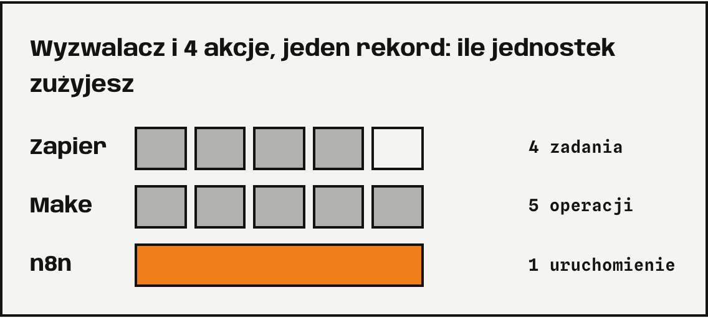
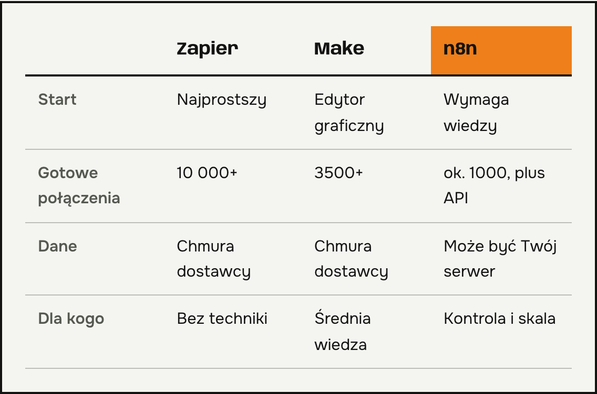
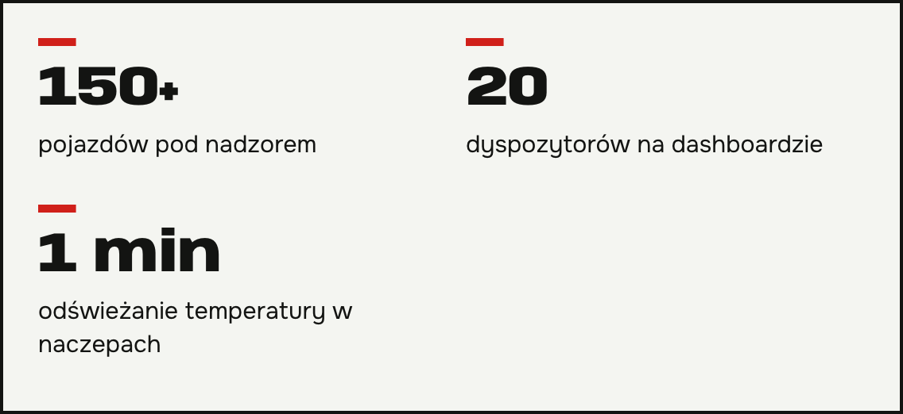

**n8n, Make czy Zapier** to pytanie, które słyszę od właścicieli firm tuż przed ich pierwszą automatyzacją. Wszystkie trzy narzędzia łączą programy ze sobą i wykonują powtarzalne zadania za Ciebie, ale inaczej liczą opłaty i wymagają innej wiedzy technicznej. Opisuję prostym językiem, na co patrzeć przy wyborze, a jeśli dalej nie wiesz, co pasuje do Twojej firmy, napisz do mnie.

## Scenariusz, integracja i API: trzy pojęcia na start

Scenariusz to zapisany ciąg kroków, który narzędzie wykonuje samo, na przykład „gdy przyjdzie zamówienie, wystaw fakturę i wyślij maila”. Pierwszy krok nazywa się wyzwalaczem, bo to on uruchamia całość, a kolejne kroki to akcje.

Integracja to wbudowane połączenie z konkretnym programem, na przykład z arkuszem, pocztą albo systemem do faktur. API to sposób, w jaki programy wymieniają dane między sobą bez udziału człowieka, i właśnie z niego korzystają integracje. Gdy narzędzie nie ma integracji z danym programem, połączenie przez API zwykle wymaga już więcej wiedzy technicznej.

## Czym różni się n8n, Make i Zapier

Najważniejsza różnica to sposób naliczania opłat: Zapier liczy zadania, Make liczy kredyty, a n8n liczy uruchomienia scenariusza. Od 27 sierpnia 2025 roku jedna operacja w Make to jeden kredyt, poza wbudowanymi funkcjami AI. Weź scenariusz z wyzwalaczem i czterema akcjami, który obsługuje jeden rekord, czyli jedną pozycję danych, na przykład jedno zamówienie. W Zapierze to 4 zadania, bo wyzwalacz nie zużywa zadań, a w Make to 5 operacji, czyli 5 kredytów, bo wyzwalacz też się liczy. W n8n ten sam scenariusz to jedno uruchomienie. Przy kilku automatyzacjach różnica jest mała, ale przy wielu automatyzacjach rośnie.

Subskrypcja to stała opłata za korzystanie z narzędzia w chmurze dostawcy, płacona co jakiś czas. Ceny zmieniają się często, więc przed decyzją sprawdź aktualny cennik na stronie producenta.

*Źródła: pomoc Zapier i Make, Digidop (n8n). Ceny sprawdź w aktualnym cenniku.*

## n8n, Make czy Zapier: które do jakiej firmy

Porównania opisują Zapiera jako najprostszy w obsłudze, a do tego ma on najwięcej integracji. Na swojej stronie podaje ponad 10 000 aplikacji, a Make na swojej ponad 3500. Zapier pasuje, gdy nikt w firmie nie zna się na technice i potrzebujesz szybkiego startu.

Make ma graficzny edytor scenariuszy, w którym widać, co dokąd płynie. Na stronie make.com producent pisze, że automatyzacje buduje się wizualnie, także metodą przeciągnij i upuść, a programowanie nie jest wymagane (make.com). To kompromis dla osób z umiarkowaną wiedzą techniczną.

n8n wymaga najwięcej wiedzy, ale daje największą kontrolę nad tym, jak i gdzie działa automatyzacja. Dokumentacja n8n opisuje go jako narzędzie, w którym dużo zrobisz bez kodu, a kod dodajesz wtedy, gdy jest potrzebny (docs.n8n.io).

*Prostota obsługi, wymagana wiedza i miejsce danych w trzech narzędziach.*

## Hosting na własnym serwerze: plusy i minusy

Hosting na własnym serwerze oznacza, że program działa na komputerze, który wynajmujesz albo masz u siebie, a nie w chmurze producenta. Dokumentacja n8n podaje, że możesz go uruchomić na własnej infrastrukturze, w swojej firmie albo w prywatnej chmurze (docs.n8n.io). Historię uruchomień n8n zapisuje wtedy w swojej bazie danych, czyli na Twoim serwerze, a nie u producenta. To ma znaczenie przy dokumentach klientów i RODO.

Według tej samej dokumentacji samodzielnie postawiony n8n domyślnie wysyła do producenta dane diagnostyczne oraz zapytania o aktualizacje i szablony. Wysyłanie można wyłączyć zmiennymi środowiskowymi. Minusy dokumentacja opisuje wprost: własny hosting wymaga wiedzy o konfiguracji serwerów, skalowaniu i zabezpieczeniach, a producent poleca go doświadczonym użytkownikom. Błędy mogą skończyć się utratą danych, problemami z bezpieczeństwem i przerwami w działaniu. Osobom bez doświadczenia z serwerami n8n poleca swoją wersję w chmurze, a przy własnym serwerze utrzymanie spada na Ciebie.

## Dlaczego w moich wdrożeniach często wybieram n8n

Wybór narzędzia zależy od tego, co u danego klienta trzeba zrobić i jak bardzo skomplikowana jest automatyzacja. Proste automatyzacje, które nie uruchamiają się kilka razy dziennie, buduję w Make. Rozbudowane automatyzacje, które działają cały czas, stawiam w n8n na własnym serwerze, bo wychodzi to taniej niż subskrypcja Make.

Przy monitoringu temperatur w transporcie przeniosłem logikę aplikacji do n8n na AWS, żeby nie przekraczać limitów workflow. System pilnuje ponad 150 pojazdów, a 20 dyspozytorów widzi odczyty odświeżane co minutę. Przy odczycie dokumentów i voice botach też używam n8n, ale przy prostej automatyzacji dla małego zespołu Zapier albo Make wystarczą.

*Wdrożenie w transporcie opisane w tej sekcji.*

### Przykład: faktura zaliczkowa z zamówienia

Zamówienie wpada do Airtable, klient uzupełnia dane potrzebne do produkcji, a potem klikam przycisk. Wtedy n8n wystawia fakturę zaliczkową w Fakturowni i tworzy szkic maila do klienta z tą fakturą.

Po opłaceniu faktury Fintable łączy się z moim bankiem i porównuje przychodzące przelewy z zamówieniami. Sprawdza, czy tytuł przelewu zgadza się z numerem zamówienia i czy kwota jest właściwa. Gdy wszystko się zgadza, oznacza zamówienie jako opłacone.

Wtedy automatyzacja w n8n zmienia status zamówienia, a zamówienie trafia na produkcję. Klient dostaje powiadomienie, że jego zamówienie trafiło do produkcji.

## Najczęstsze pytania o n8n, Make czy Zapier

### Które narzędzie jest najtańsze?
To zależy od liczby kroków, rekordów i uruchomień w Twoich scenariuszach. Policz jeden swój scenariusz w aktualnych cennikach wszystkich trzech narzędzi.

### Czy muszę umieć programować?
Nie w Zapierze i Make, a Make pisze na swojej stronie wprost, że kodowanie nie jest wymagane. Według dokumentacji w n8n dużo zrobisz bez kodu, ale przy własnym serwerze przydaje się wiedza techniczna.

### Czy mogę później zmienić narzędzie?
Tak, ale scenariusze trzeba odbudować, bo nie przenoszą się między narzędziami. Dlatego wybierz świadomie.

### Gdzie są przechowywane moje dane?
W Zapierze i Make w chmurze dostawcy, a w n8n możesz wybrać własny serwer. Zawsze sprawdź też umowę powierzenia danych.

### n8n czy Make: które wymaga mniej wiedzy technicznej?
Make. Ma graficzny edytor scenariuszy, a n8n wymaga najwięcej wiedzy, zwłaszcza przy własnym serwerze.

### n8n, Make czy Zapier: które wybrać dla mojej firmy?
Zależy od tego, co automatyzuję, ale do prostych automatyzacji, które nie uruchamiają się kilka razy dziennie, wybieram Make. Gdy automatyzacja jest rozbudowana i musi działać cały czas, stawiam n8n na własnym serwerze, bo wychodzi taniej niż subskrypcja Make. Jak pracuję przy takich wdrożeniach, opisuję na stronie [AI i automatyzacja procesów](/uslugi/ai-i-automatyzacja/).

**Napisz do mnie: office@robert-debicki.pl** i opisz, co chcesz zautomatyzować. Odpowiem, które narzędzie pasuje i dlaczego.
