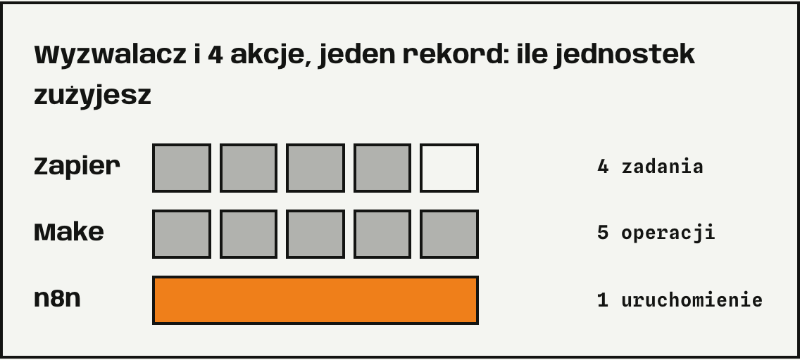
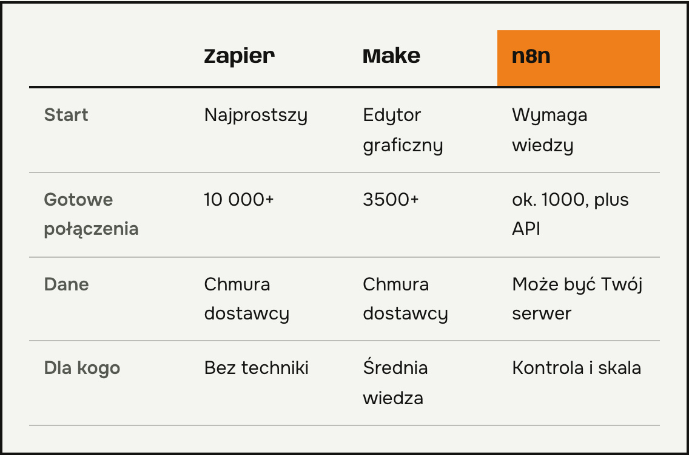
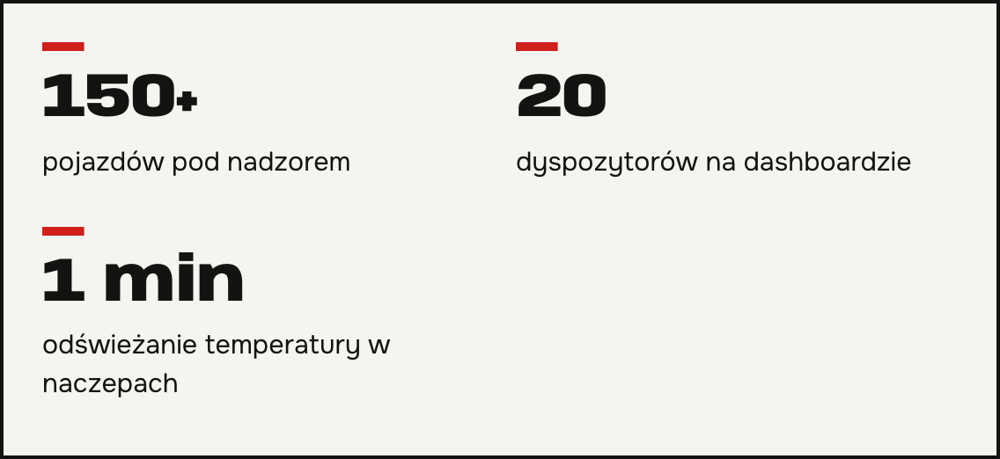

**n8n, Make czy Zapier** to pytanie, które słyszę od właścicieli firm przed pierwszą automatyzacją. Wszystkie trzy łączą programy ze sobą i wykonują zadania za Ciebie. Różnią się tym, jak liczą koszty i ile wiedzy technicznej wymagają. Opisuję, na co patrzeć, zanim wybierzesz. Nie wiesz, które narzędzie pasuje do Twojej firmy? Napisz do mnie.

## Czym różni się n8n, Make i Zapier

Najważniejsza różnica to sposób naliczania opłat. Zapier liczy zadania, Make liczy operacje, a n8n liczy uruchomienia scenariusza. Weź scenariusz z wyzwalaczem i czterema akcjami, który obsługuje jeden rekord. W Zapierze to 4 zadania, bo wyzwalacz nie zużywa zadań. W Make to 5 operacji, bo wyzwalacz też się liczy. W n8n to jedno uruchomienie. Przy kilku automatyzacjach różnica jest mała. Przy wielu rośnie.

Ceny zmieniają się często, więc przed decyzją sprawdź aktualny cennik na stronie producenta. Porównanie narzędzi opisuje [porównanie n8n, Make i Zapier](https://www.digidop.com/blog/n8n-vs-make-vs-zapier).

*Źródła: pomoc Zapier i Make, Digidop (n8n). Ceny sprawdź w aktualnym cenniku.*

## n8n, Make czy Zapier: które do jakiej firmy

Porównania opisują Zapiera jako najprostszy w obsłudze. Ma też najwięcej gotowych połączeń: na swojej stronie podaje ponad 10 000 aplikacji, a Make ponad 3500. Pasuje, gdy nikt w firmie nie zna się na technice i potrzebujesz szybkiego startu.

Make ma graficzny edytor scenariuszy, w którym widać, co dokąd płynie. To kompromis dla osób z umiarkowaną wiedzą techniczną.

n8n wymaga najwięcej wiedzy, ale daje największą kontrolę. Można go postawić na własnym serwerze, więc dane zostają u Ciebie. To ważne przy dokumentach klientów i RODO. Samodzielny hosting wymaga jednak konfiguracji i utrzymania.

## Dlaczego w moich wdrożeniach często wybieram n8n

Przy monitoringu temperatur w transporcie przeniosłem logikę aplikacji do n8n na AWS, żeby nie przekraczać limitów workflow. System pilnuje ponad 150 pojazdów, a 20 dyspozytorów widzi odczyty odświeżane co minutę. Przy odczycie dokumentów i voice botach też używam n8n.

To nie jest reguła dla każdego. Przy prostej automatyzacji dla małego zespołu Zapier albo Make wystarczą.

## Pytania i odpowiedzi

### Które narzędzie jest najtańsze?
To zależy od liczby kroków, rekordów i uruchomień. Policz jeden swój scenariusz w aktualnych cennikach wszystkich trzech narzędzi.

### Czy muszę umieć programować?
Nie w Zapierze i Make. W n8n przydaje się podstawowa wiedza techniczna, zwłaszcza przy własnym serwerze.

### Czy mogę później zmienić narzędzie?
Tak, ale scenariusze trzeba odbudować, bo nie przenoszą się między narzędziami. Dlatego wybierz świadomie.

### Gdzie są przechowywane moje dane?
W Zapierze i Make w chmurze dostawcy. W n8n możesz wybrać własny serwer. Zawsze sprawdź umowę powierzenia danych.

### n8n, Make czy Zapier: które wybrać dla mojej firmy?
Napisz, co chcesz zautomatyzować i ile osób będzie z tego korzystać. Odpowiem, które narzędzie pasuje i dlaczego.
