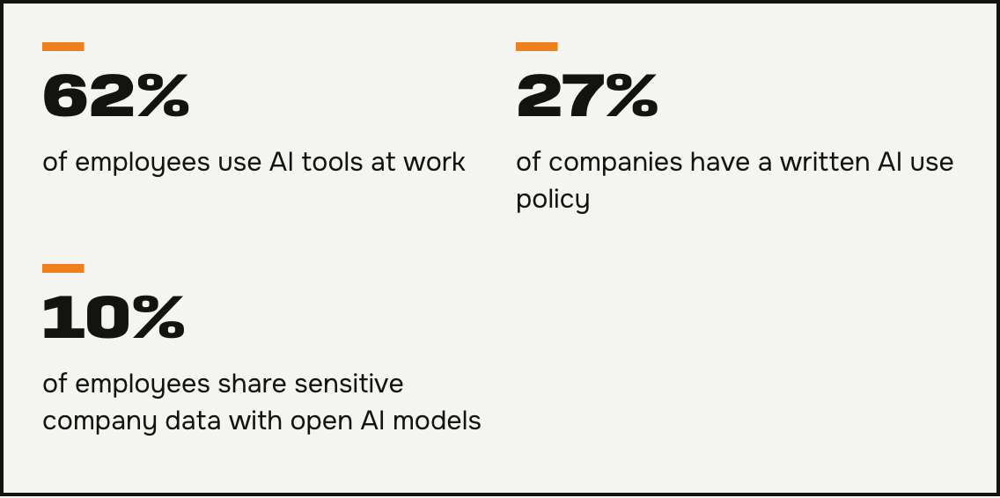
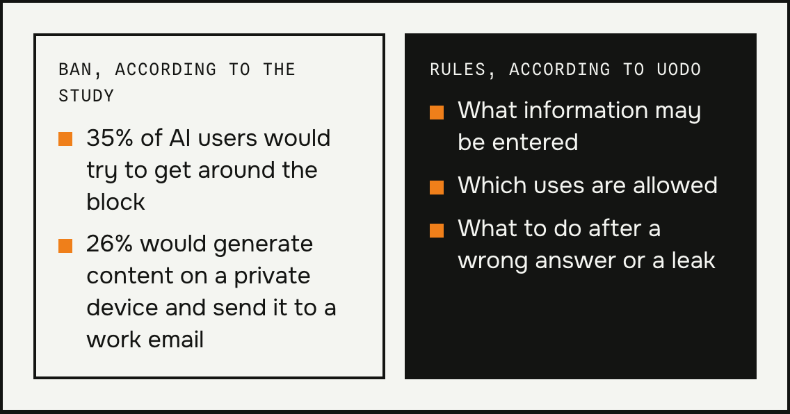
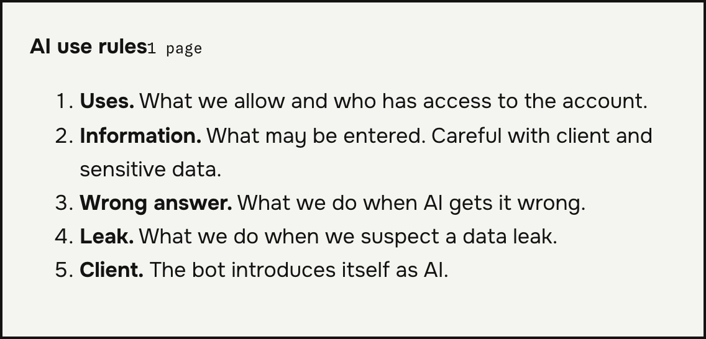

**An AI policy for your company** is a short set of rules that tells your team what data may go into AI tools and what to do after a leak. I show what UODO, Poland's data protection authority, says such rules should cover, and what the GDPR and OWASP say about protecting data if you run a small or medium business. If your company doesn't have rules like these yet, write to me, and I'll help you draft them and train your team.

## What a study says about AI at work

According to the ESET and DAGMA report “Cyberportret polskiego biznesu 2026” (the Polish business cyber portrait for 2026), 62% of employees use AI tools at work, and 27% of companies have written rules. The report is based on a survey from March 2026. It received answers from 1,026 people who work at a computer at least 3 days a week. 10% of employees admit they share sensitive company data with open AI models.

*Source: ESET and DAGMA, “Cyberportret polskiego biznesu 2026”, a survey of 1,026 people, March 2026.*

## Why a ban alone isn't enough

In the same study, 35% of AI users admit they would try to get around a company block. 26% would generate content on a private device and send it to a work email account. So a ban doesn't guarantee that AI will disappear from the company. In a guide from August 2026, UODO recommends setting rules for using AI tools.

*Sources: ESET and DAGMA, “Cyberportret polskiego biznesu 2026”, and the UODO guide as reported by Bankier.pl, Aug. 17, 2026.*

## An AI policy for your company: five rules on one page

According to UODO, the rules should set out what information may be entered into an AI tool, which uses the company allows, and what to do after a wrong answer or a suspected data leak. Based on that, I propose five points:

1. Allowed uses and the people who have access to the company account.
2. What information may be entered, with special care for client data and sensitive data.
3. What we do when AI gives a wrong answer.
4. What we do when we suspect a data leak.
5. The client knows they're talking to AI when a bot answers them.

The fifth rule follows from the transparency rules that I describe in the post [AI Act for a small business](/en/posts/ai-act-for-small-business/). From Feb. 2, 2025, the AI Act also requires companies to take steps that support the AI skills of the people who use AI on their behalf. UODO adds that training users reduces the risk of improper use of the tool.

*An example, not a client's document: points 1 to 4 follow the UODO guide, point 5 follows the AI Act.*

## How to protect data when you bring AI into the company

UODO's checklist for small and medium businesses starts with a question: what problem should AI solve, and can it be solved without AI? Then it asks you to check the following with the tool provider:

1. A data processing agreement, which is required when the provider processes data on the company's behalf.
2. The country where the provider stores data, and whether the data leaves the European Union.
3. Whether the provider uses the data you enter to train its models, and whether you can turn that off.
4. How long the provider keeps the chat history and files, and whether you can delete them.

The UODO checklist also reminds you that Article 32 of the GDPR requires limiting access to the people who need it. In practice, UODO mentions named accounts and two-factor authentication. The OWASP Top 10 for LLM Applications 2025 advises giving access only to the data a given person or process needs. The same organization recommends teaching users not to enter sensitive information into models.

For sensitive data, children's data, or transfers outside the European Economic Area, UODO's short checklist isn't enough. In those cases, UODO points to an extended version of the checklist or to a specialist.

## What to do when data leaks

Under Article 33 of the GDPR, a company reports a personal data breach to UODO without undue delay. Where possible, it does so within 72 hours of finding the breach. No report is needed when the breach is unlikely to create a risk to people's rights or freedoms.

When the risk is high, Article 34 of the GDPR requires informing the people whose data is affected without undue delay. The company documents every breach with its circumstances, even when it doesn't report it. A provider that processes data on the company's behalf notifies the company of a breach without undue delay. UODO recommends deciding in advance who in the company is responsible for reporting to UODO.

You can also report the incident to CERT Polska. According to gov.pl, CERT Polska accepts reports through the form at incydent.cert.pl, by SMS to the number 8080, and through the mObywatel app.

To keep a leak from happening again, Article 32 of the GDPR requires technical and organizational measures matched to the risk, for example pseudonymization and encryption of data. UODO also advises periodically checking whether the tool works properly and whether the team hasn't changed the way it uses it.

## Frequently asked questions about an AI policy for your company

### Does a small company need an AI policy?
UODO recommends one in its guide for small and medium businesses. According to the ESET and DAGMA report, 62% of employees use AI at work, and 27% of companies have written rules.

### Can I just block ChatGPT?
You can, but in the ESET and DAGMA study, 35% of AI users admit they would try to get around a block. UODO recommends rules that say which information and uses are allowed.

### How do I protect data so it doesn't leak online?
Enter only the data your rules allow into AI, and give account access only to people who need it. UODO mentions named accounts and two-factor authentication, and OWASP advises not to enter sensitive information into models.

### What do I do when data leaks?
If personal data leaks, the company, as the controller, reports the breach to UODO without undue delay, within 72 hours where possible. A report isn't needed when the risk to people is unlikely. When the risk is high, the GDPR also requires informing the people whose data is affected.

### How do I secure the company so a leak doesn't happen again?
The GDPR requires technical and organizational measures matched to the risk, for example encryption of data. UODO also advises periodically checking the tool and how it's used, and training employees.

### What should an AI policy for a company include?
According to UODO: what information may be entered, which uses are allowed, and what to do after a wrong answer or a suspected leak. Add the AI Act rule about telling clients they're talking to AI.

### Do employees need training?
Yes. According to UODO, training users reduces the risk of improper use.

**Write to me: office@robert-debicki.pl** and tell me which AI tools your team uses, and I'll help you write the rules and train your people.
