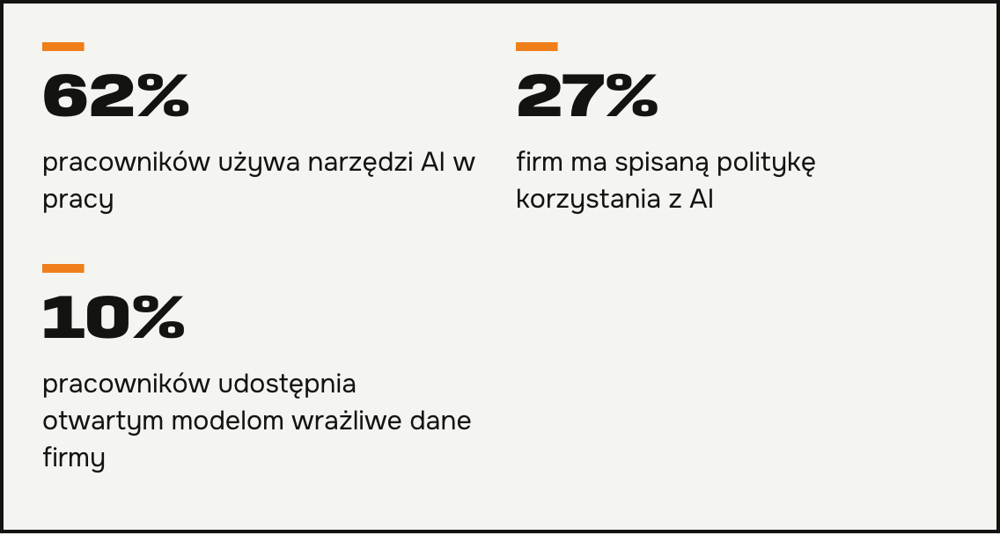
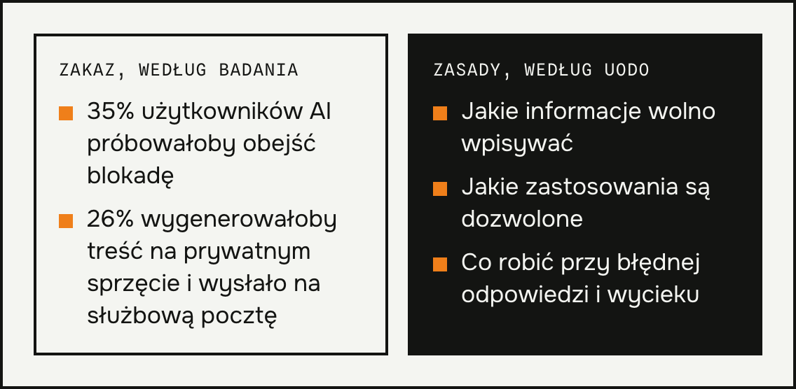
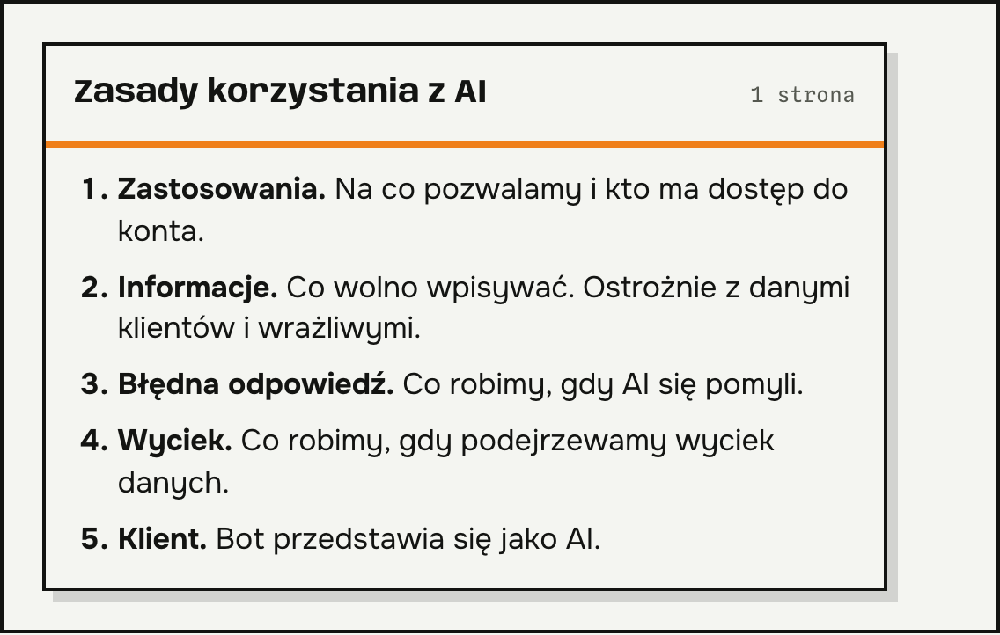

**Polityka AI w firmie** to krótki zbiór zasad, który mówi zespołowi, jakie dane wolno wpisywać do narzędzi AI i co robić przy wycieku. Pokazuję, co według UODO powinno się w nich znaleźć i co o ochronie danych mówią RODO i OWASP, jeśli prowadzisz małą albo średnią firmę. Jeśli Twoja firma nie ma jeszcze takich zasad, napisz do mnie, a pomogę je spisać i przeszkolić zespół.

## Co pokazuje badanie o AI w pracy

Według raportu ESET i DAGMA „Cyberportret polskiego biznesu 2026” 62% pracowników używa narzędzi AI w pracy, a spisane zasady ma 27% firm. Raport powstał na podstawie ankiety z marca 2026. Odpowiedziało 1026 osób, które pracują przy komputerze co najmniej 3 dni w tygodniu. 10% pracowników przyznaje, że udostępnia otwartym modelom AI wrażliwe dane firmy.

*Źródło: ESET i DAGMA, „Cyberportret polskiego biznesu 2026”, ankieta 1026 osób, marzec 2026.*

## Dlaczego sam zakaz nie wystarcza

W tym samym badaniu 35% użytkowników AI przyznaje, że próbowałoby obejść firmową blokadę. 26% wygenerowałoby treść na prywatnym sprzęcie i przesłało ją na służbową pocztę. Sam zakaz nie daje więc pewności, że AI zniknie z firmy. UODO w poradniku z sierpnia 2026 zaleca ustalenie zasad korzystania z narzędzi AI.

*Źródła: ESET i DAGMA, „Cyberportret polskiego biznesu 2026”, oraz poradnik UODO za Bankier.pl, 17.08.2026.*

## Polityka AI w firmie: pięć zasad na jedną stronę

Według UODO zasady powinny określać, jakie informacje wolno wpisywać do narzędzia AI, jakie zastosowania firma dopuszcza i co robić przy błędnej odpowiedzi albo podejrzeniu wycieku danych. Na tej podstawie proponuję pięć punktów:

1. Dozwolone zastosowania i osoby, które mają dostęp do konta firmowego.
2. Jakie informacje wolno wpisywać, ze szczególną ostrożnością przy danych klientów i danych wrażliwych.
3. Co robimy, gdy AI poda błędną odpowiedź.
4. Co robimy, gdy podejrzewamy wyciek danych.
5. Klient wie, że rozmawia z AI, gdy odpowiada mu bot.

Piąta zasada wynika z przepisów o przejrzystości, które opisuję we wpisie [AI Act dla małej firmy](/wpisy/ai-act-dla-malej-firmy/). Od 2 lutego 2025 AI Act wymaga też, żeby firma podejmowała działania wspierające kompetencje AI osób, które korzystają z AI w jej imieniu. UODO dodaje, że szkolenie użytkowników ogranicza ryzyko niewłaściwego użycia narzędzia.

*Przykład, nie dokument klienta: punkty 1 do 4 według poradnika UODO, punkt 5 według AI Act.*

## Jak chronić dane przy wdrożeniu AI w firmie

Lista kontrolna UODO dla małych i średnich firm zaczyna od pytania, jaki problem ma rozwiązać AI i czy da się go rozwiązać bez AI. Potem każe sprawdzić u dostawcy narzędzia między innymi te sprawy:

1. Umowę powierzenia przetwarzania danych, obowiązkową, gdy dostawca przetwarza dane w imieniu firmy.
2. Kraj, w którym dostawca przechowuje dane, i to, czy dane trafiają poza Unię Europejską.
3. Czy dostawca używa wpisanych danych do trenowania swoich modeli i czy można to wyłączyć.
4. Jak długo dostawca przechowuje historię rozmów i pliki oraz czy możesz je usunąć.

Lista UODO przypomina też, że artykuł 32 RODO wymaga ograniczenia dostępu do osób, które go potrzebują. W praktyce UODO wymienia konta imienne i uwierzytelnianie dwuskładnikowe. OWASP w zestawieniu zagrożeń Top 10 for LLM Applications 2025 radzi dawać dostęp tylko do danych potrzebnych danej osobie albo procesowi. Ta sama organizacja zaleca uczyć użytkowników, żeby nie wpisywali do modeli informacji wrażliwych.

Przy danych wrażliwych, danych dzieci albo przekazywaniu danych poza EOG krótka lista UODO nie wystarcza. Wtedy UODO kieruje do rozszerzonej wersji listy albo do specjalisty.

## Co zrobić, gdy dane wyciekną

Według artykułu 33 RODO firma zgłasza naruszenie ochrony danych osobowych do UODO bez zbędnej zwłoki. W miarę możliwości robi to nie później niż w 72 godziny od stwierdzenia naruszenia. Zgłoszenie nie jest potrzebne, gdy mało prawdopodobne jest, że naruszenie spowoduje ryzyko dla praw lub wolności osób.

Gdy ryzyko jest wysokie, artykuł 34 RODO wymaga bez zbędnej zwłoki zawiadomić osoby, których dane dotyczą. Każde naruszenie firma dokumentuje razem z jego okolicznościami, nawet gdy go nie zgłasza. Dostawca, który przetwarza dane w imieniu firmy, zgłasza jej naruszenie bez zbędnej zwłoki. Lista UODO zaleca ustalić z góry, kto w firmie odpowiada za zgłoszenie do UODO.

Incydent możesz też zgłosić do CERT Polska. Według serwisu gov.pl CERT Polska przyjmuje zgłoszenia przez formularz incydent.cert.pl, SMS na numer 8080 i aplikację mObywatel.

Żeby wyciek się nie powtórzył, artykuł 32 RODO wymaga środków technicznych i organizacyjnych dopasowanych do ryzyka, na przykład pseudonimizacji i szyfrowania danych. Lista UODO radzi też okresowo sprawdzać, czy narzędzie działa poprawnie i czy zespół nie zmienił sposobu korzystania z niego.

## Najczęstsze pytania o politykę AI w firmie

### Czy mała firma potrzebuje polityki AI?
UODO zaleca to w poradniku dla małych i średnich firm. Według raportu ESET i DAGMA z AI w pracy korzysta 62% pracowników, a spisane zasady ma 27% firm.

### Czy mogę po prostu zablokować ChatGPT?
Możesz, ale w badaniu ESET i DAGMA 35% użytkowników AI przyznaje, że próbowałoby obejść blokadę. UODO zaleca zasady, które mówią, jakie informacje i zastosowania są dozwolone.

### Jak chronić dane, żeby nie wyciekły do sieci?
Wpisuj do AI tylko dane, na które pozwalają Twoje zasady, a dostęp do konta dawaj tylko osobom, które go potrzebują. UODO wymienia konta imienne i uwierzytelnianie dwuskładnikowe, a OWASP radzi nie wpisywać do modeli informacji wrażliwych.

### Co zrobić, gdy dane wyciekną?
Jeśli wyciekły dane osobowe, firma jako administrator zgłasza naruszenie do UODO bez zbędnej zwłoki, w miarę możliwości w 72 godziny. Zgłoszenia nie trzeba, gdy ryzyko dla osób jest mało prawdopodobne. Przy wysokim ryzyku RODO wymaga też zawiadomienia osób, których dane dotyczą.

### Jak zabezpieczyć firmę, żeby wyciek się nie powtórzył?
RODO wymaga środków technicznych i organizacyjnych dopasowanych do ryzyka, na przykład szyfrowania danych. UODO radzi też okresowo sprawdzać narzędzie i sposób korzystania z niego oraz szkolić pracowników.

### Co powinna zawierać polityka AI w firmie?
Według UODO: jakie informacje wolno wpisywać, jakie zastosowania są dozwolone i co robić przy błędnej odpowiedzi albo podejrzeniu wycieku. Do tego dodaj zasadę z AI Act o informowaniu klienta, że rozmawia z AI.

### Czy pracownicy potrzebują szkolenia?
Tak. Według UODO szkolenie użytkowników ogranicza ryzyko niewłaściwego użycia.

**Napisz do mnie: office@robert-debicki.pl** i opisz, z jakich narzędzi AI korzysta Twój zespół, a pomogę spisać zasady i przeszkolić ludzi.
