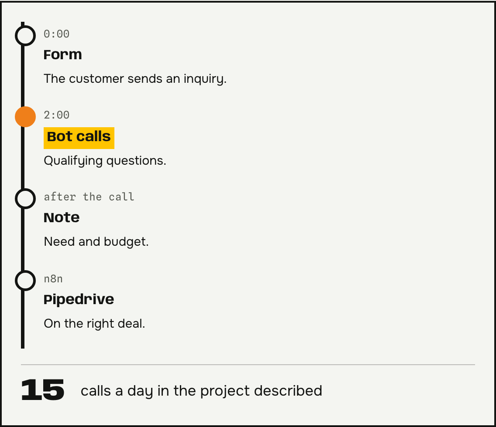
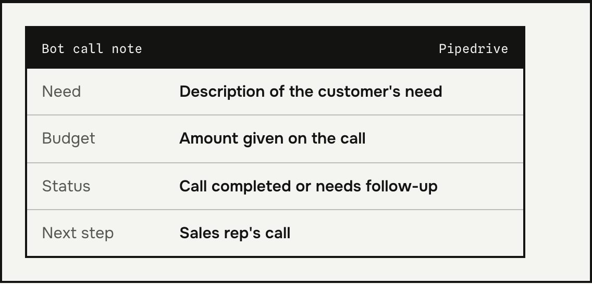
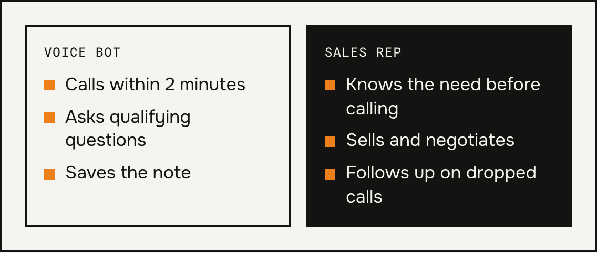

**A voice bot for your business** can call the person who filled out the form on your website within 2 minutes of submission. I describe a project where the bot handles 15 calls a day and hands the sales rep a ready-made note. Want to call leads back faster? Email me.

## Why call a lead back right away

Someone who just sent a form still has the matter on their mind. A sales rep can't always call right away, because they're on other calls.

## How this voice bot works, step by step

1. The customer submits the contact form on the website.
2. Within 2 minutes, the bot calls them and asks qualifying questions.
3. The call produces a note with the customer's need and budget.
4. An n8n workflow saves the note to the right deal in Pipedrive.

Dropped calls and requests to be contacted at another time also go to the sales rep. Nothing gets lost along the way. I built the bot on ElevenLabs and Twilio.

*An illustration of the note fields. Sample content.*

## What a voice bot for your business does and what the sales rep does

The bot doesn't sell or negotiate. It gathers information and saves the sales rep the first call, where the same questions come up anyway. The sales rep gets the note, sees the budget and the need, and knows right away where to start the call.

## A voice bot for your business and the AI Act

Since Aug. 2, 2026, customers must know they're talking to AI if it isn't obvious. When a bot calls, it's good practice for it to introduce itself in the first sentence. I cover the details in the post [AI Act for small businesses](/en/posts/ai-act-dla-malej-firmy/).

## Questions and answers

### Will the customer know they're talking to a bot?
They should hear it at the start of the call. The AI Act transparency rules require it when it isn't obvious.

### How many calls a day can the bot handle?
In the project described here, 15 calls a day. The number depends on how many forms your business gets.

### What if the customer doesn't pick up or hangs up?
Those cases go to the sales rep too. The rep then sees that the contact needs a follow-up, along with whatever the customer managed to say.

### Which CRM does it work with?
In the project described here, Pipedrive. I also work with HubSpot and API integrations.

### How much does a voice bot for your business cost?
The price depends on the number of questions, the CRM, and calling hours. Tell me what kind of inquiries you get each day, and I'll prepare a quote. I describe the service on the [AI voice agents for business](/en/services/ai-voice-agents/) page.
