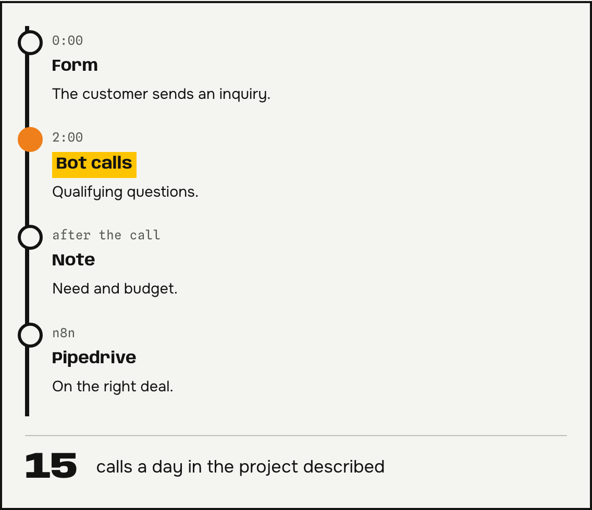
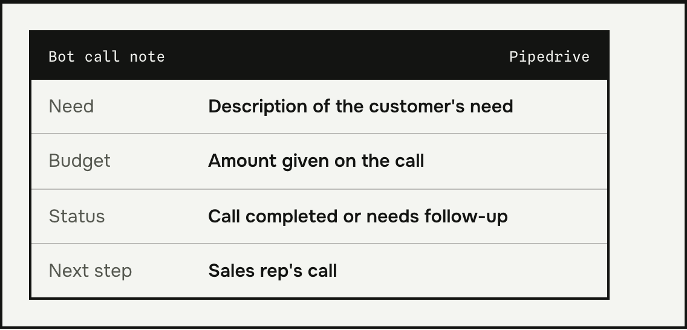
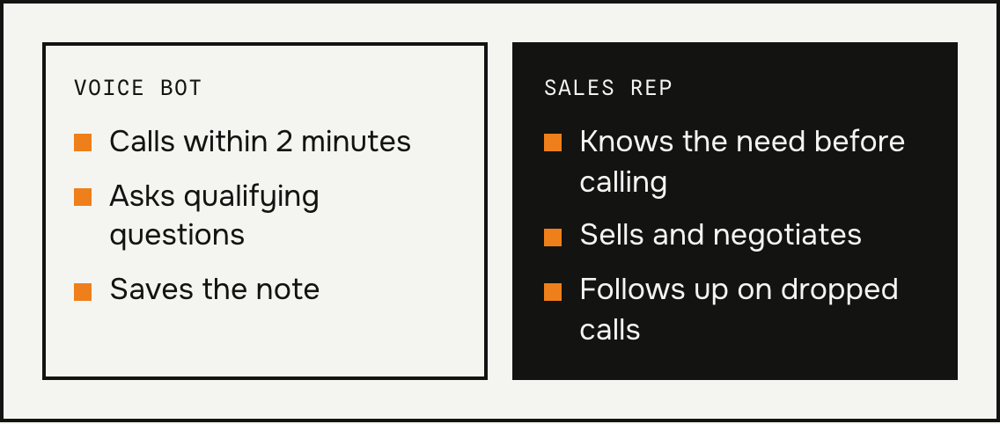

**A voice bot for your business** can call the person who filled out the form on your website within 2 minutes of submission. I describe a project where the bot handles 15 calls a day and hands the sales rep a note from the call. Want to call back people who reach out through your website faster? Email me and tell me how many inquiries you get.

*The bot calls within 2 minutes of the form being sent.*

## What a voice bot is and why call right away

A voice bot is a program that holds a phone conversation by voice and understands what the caller says. It doesn't make you press numbers on a keypad like old phone menus. It listens, asks follow-up questions, and responds to what it hears.

A lead is a person who left their details and an inquiry with a business, for example through a contact form on a website. That person just sent the form, so they're still thinking about their issue and waiting for an answer. A sales rep can't always call right away, because they're on other calls with clients at the same time. That's why in this project the bot handles the callback, calling 2 minutes after the form is sent, even when the whole team is busy.

## How this voice bot works, step by step

1. The customer fills out the contact form on the company website and leaves their phone number.
2. Within 2 minutes, the bot calls that number, introduces herself as an AI assistant, meaning artificial intelligence, and asks qualifying questions.
3. The qualifying questions check what the customer needs and what budget they have, and the answers become a note for the sales rep.
4. An n8n workflow, n8n being a tool that connects different apps, saves the note to the right deal in Pipedrive.

Pipedrive is a CRM, a program where a business keeps its list of clients, conversations, and deals. I also work with HubSpot and other systems that offer API integrations. Dropped calls and requests to be contacted at another time also go to the sales rep, so nothing gets lost along the way. If the customer asks for a person during the call, the agent transfers the call to a company employee. I built the bot on ElevenLabs and Twilio.

*An illustration of the note fields. Sample content.*

## What a voice bot for your business does and what the sales rep does

The bot doesn't sell or negotiate prices with the customer. It gathers information and saves the sales rep the first call, where the same questions come up anyway. The sales rep gets the note in the CRM, sees the customer's budget and need, and knows right away where to start the call.

I set the bot's scope with the business at the start of the project: what questions it asks, what goes into the note, and when it hands the call off. After that, the business doesn't have to change anything in the automations, because I make the changes when the client asks.

*The bot gathers information, the sales rep sells.*

## A voice bot and the law: the AI Act, GDPR, and consent to contact

The AI Act is the EU regulation on artificial intelligence, and its Article 50 applies from Aug. 2, 2026. Under Article 50(1), an AI system that talks with a person must tell them it's AI, unless that's obvious. Paragraph 5 of that article says the information must be clear and given at the latest at the first interaction. So in my deployment, the assistant opens the call by introducing herself as an AI assistant, meaning artificial intelligence.

GDPR (RODO in Polish) is the EU regulation on personal data protection, which covers things like a name and a phone number. Article 6 of the GDPR lists the legal grounds on which a business can use such data, for example consent or steps taken at the person's request before a contract. It's best to settle which ground applies to your form with a lawyer before the bot goes live.

Consent to contact is a person's permission for a business to call them with commercial information. Article 398 of the Polish Electronic Communications Law of July 12, 2024 bans using automated calling systems for direct marketing without the recipient's prior consent. I cover the AI rules in more detail in the post [AI Act for small businesses](/en/posts/ai-act-for-small-business/).

## Frequently asked questions about a voice bot for your business

### Will the customer know they're talking to a bot?
Yes, when talking to AI isn't obvious to the caller. In my deployment, the assistant introduces herself as an AI assistant, meaning artificial intelligence, at the start of the call. The European Commission's guidelines on Article 50 say the word "assistant" alone may not be enough, so it's better to say plainly that this is artificial intelligence.

### Can the customer ask to talk to a person?
Yes. They just ask during the call, and the agent transfers the call to a company employee.

### Can the bot call people without consent?
Not for marketing. Article 398 of the Polish Electronic Communications Law requires the recipient's prior consent for direct marketing through automated calling systems.

### What if the customer doesn't pick up or hangs up?
Those cases go to the sales rep in the CRM too. The rep then sees that the contact needs a follow-up, along with whatever the customer managed to say.

### How long does a voice bot deployment take?
On average 2 to 3 weeks until the client gets the first working agent to test. The time depends on the specifics of the agent and what else it has to do beyond the calls themselves.

### Does the client have to change anything in the automations?
No. I set the scope, meaning the call and the agent's tasks, at the start. The client gets a working agent and doesn't change it. I make changes only at their request.

### How much does a voice bot for your business cost?
The price depends on the number of questions, the type of CRM, and calling hours. Each quote is set individually, after talking with the client and learning what the agent has to do, and I describe the service on the [AI voice agents for business](/en/services/ai-voice-agents/) page.

**Email me: office@robert-debicki.pl** and tell me how many inquiries you get each day, and I'll quote your voice bot deployment.
