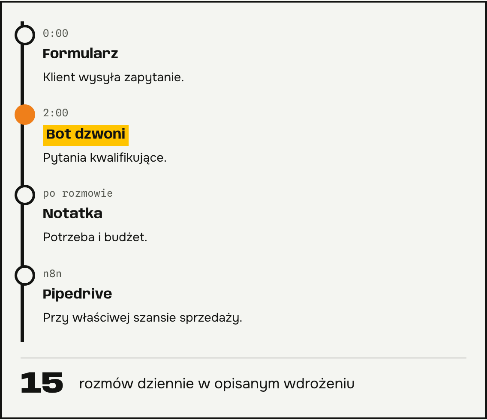
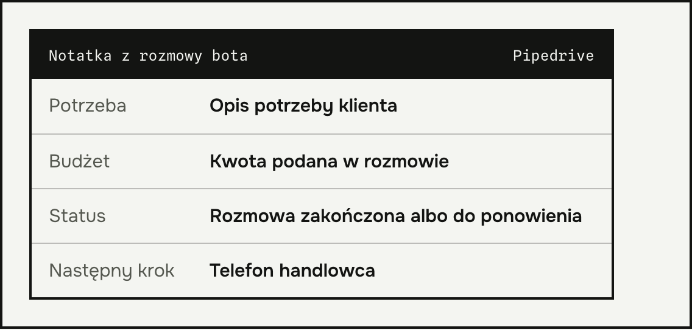
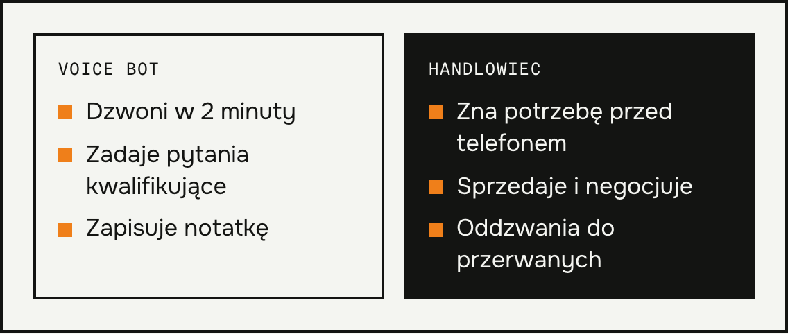

**Voice bot dla firmy** może zadzwonić do osoby, która wypełniła formularz na Twojej stronie, w 2 minuty od wysłania. Opisuję wdrożenie, w którym bot obsługuje 15 rozmów dziennie i przekazuje handlowcowi notatkę z rozmowy. Chcesz oddzwaniać szybciej do osób, które piszą przez stronę? Napisz do mnie i opisz, ile zapytań dostajesz.

*Bot dzwoni w ciągu 2 minut po wysłaniu formularza.*

## Czym jest voice bot i po co dzwonić od razu

Voice bot to program, który prowadzi rozmowę telefoniczną głosem i rozumie odpowiedzi rozmówcy. Nie każe wybierać numerów na klawiaturze jak dawne infolinie, tylko słucha, dopytuje i reaguje na to, co usłyszy.

Lead to osoba, która zostawiła firmie swoje dane i zapytanie, na przykład przez formularz kontaktowy na stronie. Taka osoba przed chwilą wysłała formularz, więc wciąż myśli o swojej sprawie i czeka na odpowiedź. Handlowiec nie zawsze może zadzwonić od razu, bo w tym samym czasie prowadzi inne rozmowy z klientami. Dlatego w tym wdrożeniu oddzwonienie robi bot, który dzwoni po 2 minutach od wysłania formularza, także wtedy, gdy cały zespół jest zajęty.

## Jak działa ten voice bot krok po kroku

1. Klient wypełnia formularz kontaktowy na stronie firmy i zostawia w nim swój numer telefonu.
2. Bot dzwoni pod ten numer w ciągu 2 minut, przedstawia się jako wirtualna asystentka i zadaje pytania kwalifikujące.
3. Pytania kwalifikujące sprawdzają, czego klient potrzebuje i jaki ma budżet, a z odpowiedzi powstaje notatka dla handlowca.
4. Scenariusz w n8n, czyli narzędziu, które łączy ze sobą różne aplikacje, zapisuje notatkę przy właściwej szansie sprzedaży w Pipedrive.

Pipedrive to CRM, czyli program, w którym firma prowadzi listę klientów, rozmów i szans sprzedaży. Pracuję też z HubSpotem i z innymi systemami, które mają integracje przez API. Przerwane rozmowy i prośby o kontakt w innym terminie też trafiają do handlowca, więc nic nie ginie po drodze. Jeśli klient w trakcie rozmowy poprosi o człowieka, agent przekierowuje połączenie do pracownika firmy. Bot zbudowałem na ElevenLabs i Twilio.

*Ilustracja pól notatki. Treść przykładowa.*

## Co robi voice bot dla firmy, a co handlowiec

Bot nie sprzedaje i nie negocjuje cen z klientem. Zbiera informacje i oszczędza handlowcowi pierwszą rozmowę, w której i tak padają te same pytania. Handlowiec dostaje notatkę w CRM, widzi budżet i potrzebę klienta, więc od razu wie, od czego zacząć telefon.

Zakres pracy bota ustalam z firmą na początku wdrożenia: jakie pytania zadaje, co zapisuje w notatce i kiedy przekazuje rozmowę dalej. Później firma nie musi niczego zmieniać w automatyzacjach, bo poprawki robię ja, gdy klient o nie poprosi.

*Bot zbiera informacje, sprzedaje handlowiec.*

## Voice bot a przepisy: AI Act, RODO i zgoda na kontakt

AI Act to unijne rozporządzenie o sztucznej inteligencji, a jego art. 50 obowiązuje od 2 sierpnia 2026. Według art. 50 ust. 1 system AI, który rozmawia z człowiekiem, ma go poinformować, że jest AI, chyba że to oczywiste. Ust. 5 tego artykułu mówi, że informacja ma paść jasno, najpóźniej przy pierwszym kontakcie z rozmówcą. W moim wdrożeniu asystentka zaczyna więc rozmowę od przedstawienia się jako wirtualna asystentka.

RODO to unijne rozporządzenie o ochronie danych osobowych, czyli między innymi imienia i numeru telefonu. Art. 6 RODO wymienia podstawy, na których firma może używać takich danych, na przykład zgodę albo działania na prośbę osoby przed zawarciem umowy. Którą podstawę przyjąć dla formularza, najlepiej ustalić z prawnikiem przed startem bota.

Zgoda na kontakt to zgoda osoby na to, żeby firma dzwoniła do niej z informacją handlową. Art. 398 ustawy Prawo komunikacji elektronicznej z 12 lipca 2024 zakazuje używania automatycznych systemów wywołujących do marketingu bezpośredniego bez uprzedniej zgody odbiorcy. Szczegóły o przepisach dla AI opisuję we wpisie [AI Act dla małej firmy](/wpisy/ai-act-dla-malej-firmy/).

## Najczęstsze pytania o voice bota dla firmy

### Czy klient pozna, że rozmawia z botem?
Tak, gdy rozmowa z AI nie jest dla rozmówcy oczywista. W moim wdrożeniu asystentka przedstawia się na początku rozmowy jako wirtualna asystentka. Wytyczne Komisji Europejskiej do art. 50 mówią, że samo słowo „asystent” może nie wystarczyć, więc lepiej mówić wprost, że to sztuczna inteligencja.

### Czy klient może poprosić o rozmowę z człowiekiem?
Tak. Wystarczy, że poprosi o to w trakcie rozmowy, a agent przekierowuje połączenie do pracownika firmy.

### Czy bot może dzwonić do osób bez zgody?
Nie w celach marketingowych. Art. 398 Prawa komunikacji elektronicznej wymaga uprzedniej zgody odbiorcy na marketing bezpośredni przez automatyczne systemy wywołujące.

### Co jeśli klient nie odbierze albo przerwie rozmowę?
Takie przypadki też trafiają do handlowca w CRM. Ma wtedy informację, że kontakt jest do ponowienia, razem z tym, co klient zdążył powiedzieć.

### Ile trwa wdrożenie voice bota?
Średnio od 2 do 3 tygodni, żeby oddać pierwszego działającego agenta do testów przez klienta. Czas zależy od specyfiki agenta i tego, co ma robić poza samymi rozmowami.

### Czy klient musi coś zmieniać w automatyzacjach?
Nie. Zakres, czyli rozmowę i zadania agenta, ustalam na początku, a klient dostaje działającego agenta i go nie zmienia. Zmiany robię tylko na jego prośbę.

### Ile kosztuje voice bot dla firmy?
Cena zależy od liczby pytań, rodzaju CRM i godzin dzwonienia. Każdą wycenę ustalam indywidualnie, po rozmowie z klientem i poznaniu zadań agenta, a zakres usługi opisuję na stronie [voiceboty dla firm](/uslugi/voiceboty/).

**Napisz do mnie: office@robert-debicki.pl** i podaj, ile zapytań dostajesz dziennie, a wycenię wdrożenie voice bota.
