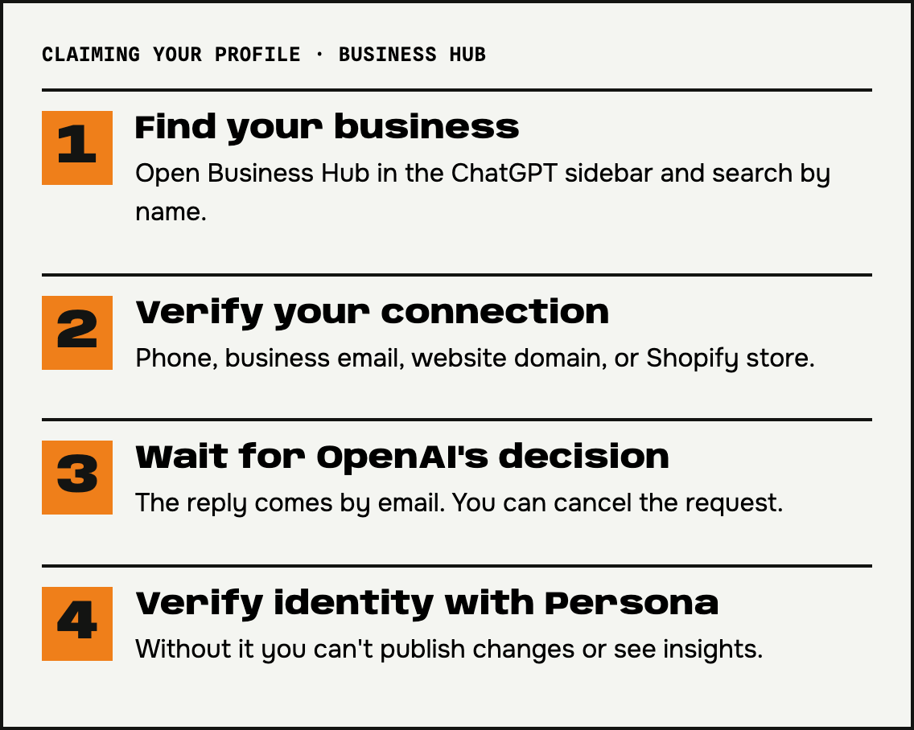
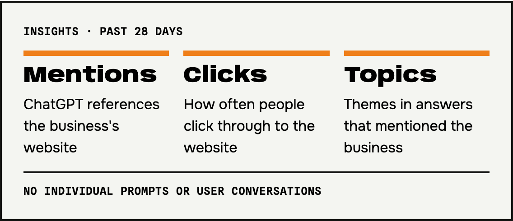
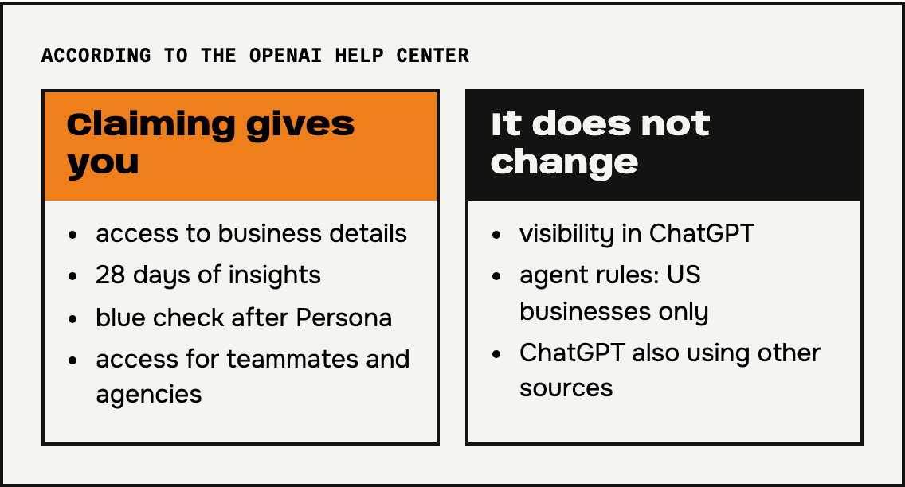

A **ChatGPT business profile** is a profile in Business Hub that a business owner, or someone authorized to represent the business, can claim. I explain how claiming works, what the insights show, and what OpenAI doesn't promise. I'm relying on an article from the OpenAI Help Center as it stood on Nov. 22, 2026. If you want to find out what AI could take over in your business, email me.

## ChatGPT business profile: what it is

You'll find Business Hub in the ChatGPT sidebar. There you claim your business, fill in its details, and see how people engage with it. According to OpenAI, you can claim a business that you own or are authorized to represent. You don't need an ads account or a ChatGPT Enterprise agreement for this.

The article doesn't list the countries. It only says that availability depends on the business's location and type, so check in Business Hub whether your business can be found. I describe how AI and automation work in Polish companies on the page about [AI implementation for business](/en/services/ai-automation/).

## How to claim your ChatGPT business profile

You search for the business by name, select the matching listing, and confirm the ChatGPT account you'll use to manage it. Then you choose one of the verification methods the listing shows: phone, business email, website domain, or Shopify store. For a domain, you add a TXT record that ChatGPT gives you to your DNS settings. OpenAI reviews the request and replies by email.

Claiming isn't the end of the process. To publish changes, view insights, or connect a product feed, you need to verify your identity with Persona. OpenAI lists a government-issued ID, business registration information, and proof that you're authorized to represent the business. In the legal name field, enter the name from your registration documents. The blue check appears only after Persona approves you.

*Order of steps according to the OpenAI Help Center, as of Nov. 22, 2026.*

## What the profile insights show

Once your claim and Persona are approved, Business Hub has an Insights tab. It shows aggregate data from the past 28 days: mentions, website clicks, and topics in which ChatGPT mentioned or cited the business. For an online business, a mention is when ChatGPT references its website. The brand name alone doesn't count.

You don't get individual prompts or user conversations. OpenAI also warns that counts may be incomplete, and a blank metric doesn't necessarily mean zero.

*Insights in Business Hub, aggregate data from the past 28 days.*

## What claiming doesn't change about your business's visibility in ChatGPT

OpenAI says plainly that claiming a profile doesn't change its visibility in ChatGPT. ChatGPT may also use other sources when it answers questions about a business, and updates to the profile take time to appear. So claiming gives you access to business details and insights, not a spot in the answers.

The agent that answers customers has separate requirements. According to the article, it's available to ecommerce and online service businesses in the US that have a website and meet OpenAI's agent policy. Local stores and restaurants can currently claim only an existing U.S. listing.

If someone offers to pay to get you into ChatGPT through a profile, ask where OpenAI promises that effect. The article I'm relying on makes no such promise. For how Polish companies are adopting AI, see the post on [how many companies use AI](/en/posts/business-process-automation-ai/).

*What claiming a profile gives you and what it doesn't change, according to OpenAI.*

## Frequently asked questions about the ChatGPT business profile

### Do I need an ads account to claim a profile?
No, according to OpenAI you don't need an ads account or a ChatGPT Enterprise agreement for this.

### Does claiming improve my business's visibility in ChatGPT?
No, because OpenAI says plainly that claiming a profile doesn't change its visibility in ChatGPT.

### Who can claim a business profile?
The business owner or a person authorized to represent the business. They have to verify their connection to the business and get OpenAI's approval.

### Do I have to publish a customer agent?
No, because claiming, the agent, and advertising are three separate things, and insights work without an agent.

### Can I give my team or an agency access?
Yes, the admin who claimed the profile adds teammates and gives an agency access, each through their own ChatGPT account.

### Will OpenAI support delete a published profile?
No, only an unpublished draft can be deleted. OpenAI Support doesn't delete, unpublish, or hide a profile that's already published.

### Does the profile work for businesses in Poland?
The article doesn't list countries. Availability depends on location and business type, so check in Business Hub whether your business shows up there.

**Email me: office@robert-debicki.pl** and describe a task that repeats every week in your business, and I'll check whether it can be automated.
