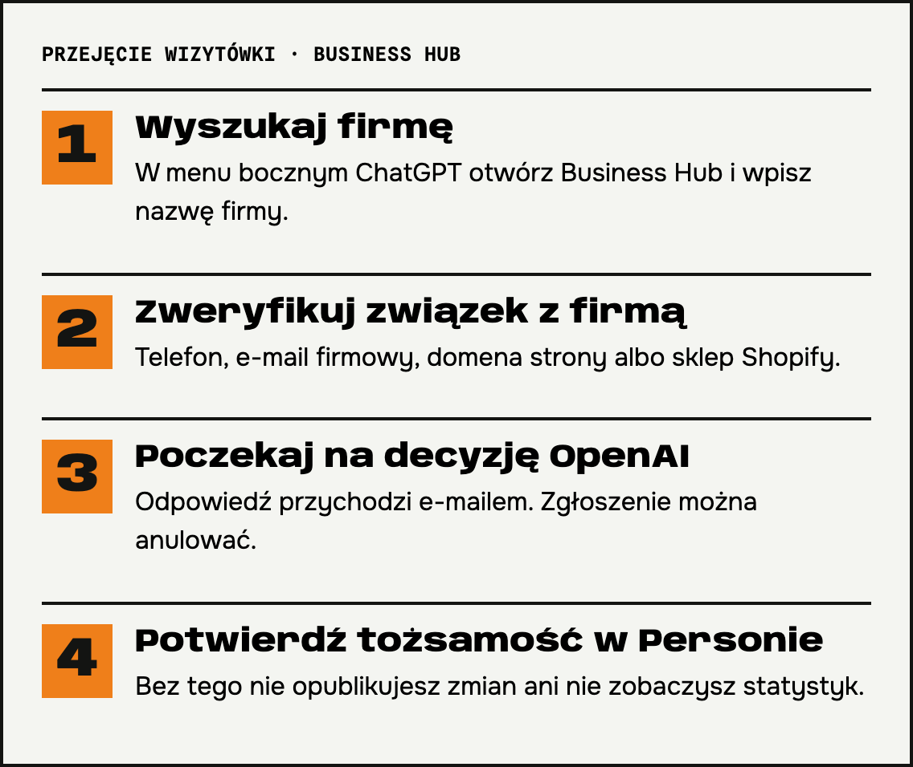
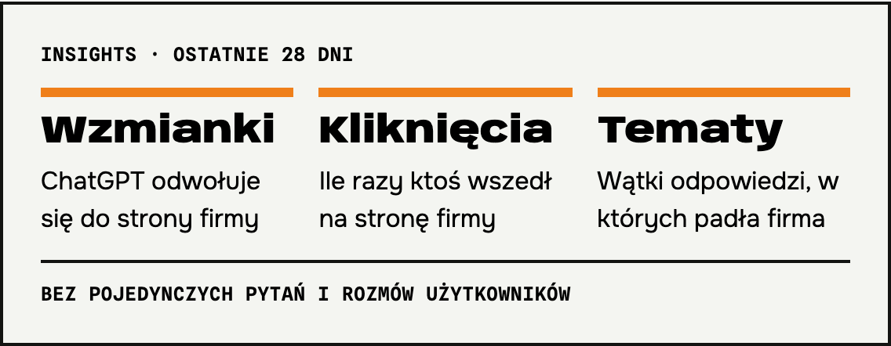
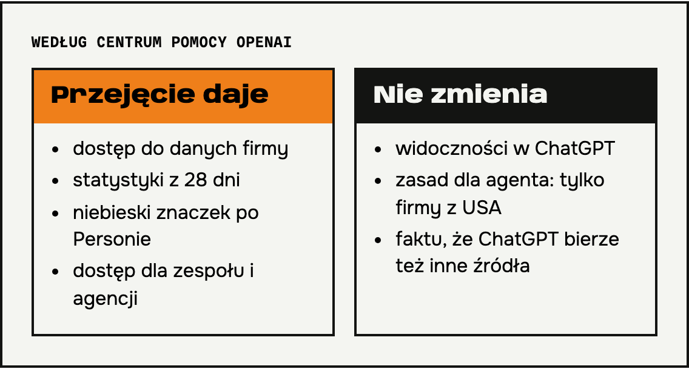

**Wizytówka firmy w ChatGPT** to profil w Business Hub, który może przejąć właściciel firmy albo osoba z jej upoważnieniem. Opisuję, jak wygląda przejęcie, co pokazują statystyki i czego OpenAI nie obiecuje. Opieram się na artykule z centrum pomocy OpenAI ze stanem na 22 listopada 2026 roku. Jeśli chcesz sprawdzić, co AI może przejąć w Twojej firmie, napisz do mnie.

## Wizytówka firmy w ChatGPT: co to jest

Business Hub znajdziesz w menu bocznym ChatGPT. Tam przejmujesz firmę, uzupełniasz jej dane i oglądasz, jak ludzie z nią wchodzą w interakcję. Według OpenAI przejąć możesz firmę, którą posiadasz albo którą masz upoważnienie reprezentować. Nie potrzebujesz do tego konta reklamowego ani umowy ChatGPT Enterprise.

Artykuł nie podaje listy krajów. Pisze tylko, że dostępność zależy od lokalizacji i rodzaju firmy, więc sprawdź w Business Hub, czy Twoją firmę da się znaleźć. Jak AI i automatyzacja pracują w polskich firmach, opisuję na stronie [wdrożenie AI w firmie](/uslugi/ai-i-automatyzacja/).

## Jak przejąć wizytówkę firmy w ChatGPT

Wyszukujesz firmę po nazwie, wybierasz pasujący wpis i potwierdzasz konto ChatGPT, którym będziesz nią zarządzać. Potem wybierasz jedną z metod weryfikacji, jakie pokazuje wpis: telefon, e-mail firmowy, domenę strony albo sklep Shopify. Przy domenie dodajesz w ustawieniach DNS rekord TXT, który podaje ChatGPT. OpenAI sprawdza zgłoszenie i odpowiada e-mailem.

Samo przejęcie to jeszcze nie koniec. Żeby publikować zmiany, oglądać statystyki albo podłączyć plik z produktami, musisz potwierdzić tożsamość w usłudze Persona. OpenAI wymienia dokument tożsamości, dane z rejestru firmy i dowód, że możesz ją reprezentować. W polu nazwy prawnej wpisz nazwę z dokumentów rejestrowych. Niebieski znaczek weryfikacji pojawia się dopiero po zatwierdzeniu Persony.

*Kolejność kroków według centrum pomocy OpenAI, stan na 22 listopada 2026.*

## Co pokazują statystyki wizytówki

Po zatwierdzeniu przejęcia i Persony w Business Hub działa zakładka Insights. Pokazuje zbiorcze dane z ostatnich 28 dni: wzmianki, kliknięcia w stronę i tematy, w których ChatGPT wspomniał o firmie albo ją zacytował. Dla firmy internetowej wzmianka to moment, gdy ChatGPT odwołuje się do jej strony. Sama nazwa marki się nie liczy.

Nie dostajesz pojedynczych pytań ani rozmów użytkowników. OpenAI uprzedza też, że liczby mogą być niepełne, a pusty wynik nie musi oznaczać zera.

*Statystyki w Business Hub, dane zbiorcze z ostatnich 28 dni.*

## Czego przejęcie nie zmienia w widoczności firmy w ChatGPT

OpenAI pisze wprost, że przejęcie wizytówki nie zmienia jej widoczności w ChatGPT. ChatGPT może też korzystać z innych źródeł, gdy odpowiada na pytania o firmę, a zmiany w wizytówce potrzebują czasu, żeby się pojawić. Przejęcie daje więc dostęp do danych firmy i statystyk, a nie miejsce w odpowiedziach.

Agent, który odpowiada klientom, ma osobne wymagania. Według artykułu jest dostępny dla firm z internetową sprzedażą i usługami online w USA, które mają stronę i spełniają politykę agentów OpenAI. Sklepy stacjonarne i restauracje mogą na razie przejąć tylko istniejący wpis w USA.

Jeśli ktoś oferuje Ci płatne wejście do ChatGPT przez wizytówkę, poproś o wskazanie, gdzie OpenAI obiecuje taki efekt. W artykule, na którym się opieram, takiej obietnicy nie ma. Jak wygląda sięganie po AI w polskich firmach, pokazuje wpis [ile firm używa AI](/wpisy/ile-firm-uzywa-ai/).

*Co daje przejęcie wizytówki, a czego nie zmienia, według OpenAI.*

## Najczęstsze pytania o wizytówkę firmy w ChatGPT

### Czy do przejęcia potrzebuję konta reklamowego?
Nie, według OpenAI nie potrzebujesz do tego konta reklamowego ani umowy ChatGPT Enterprise.

### Czy przejęcie poprawi widoczność firmy w ChatGPT?
Nie, bo OpenAI pisze wprost, że przejęcie wizytówki nie zmienia jej widoczności w ChatGPT.

### Kto może przejąć wizytówkę?
Właściciel firmy albo osoba, która ma upoważnienie do jej reprezentowania. Musi potwierdzić związek z firmą i dostać zatwierdzenie OpenAI.

### Czy muszę publikować agenta dla klientów?
Nie, bo przejęcie, agent i reklamy to trzy osobne rzeczy, a statystyki działają także bez agenta.

### Czy mogę dać dostęp zespołowi albo agencji?
Tak, administrator, który przejął wizytówkę, dodaje współpracowników i nadaje dostęp agencji, każdemu przez jego własne konto ChatGPT.

### Czy wsparcie OpenAI usunie opublikowaną wizytówkę?
Nie, usunąć można tylko nieopublikowany szkic. Wsparcie OpenAI nie usuwa, nie wycofuje ani nie ukrywa wizytówki, która już jest opublikowana.

### Czy wizytówka działa dla firm w Polsce?
Artykuł nie podaje listy krajów. Dostępność zależy od lokalizacji i rodzaju firmy, więc sprawdź w Business Hub, czy Twoja firma się tam pojawia.

**Napisz do mnie: office@robert-debicki.pl** i opisz zadanie, które w Twojej firmie powtarza się co tydzień, a sprawdzę, czy da się je zautomatyzować.
